---
format:
  html:
    code-copy: true
    toc: true
---

## Lecture 1

<!-- L01 -->
::: {.exercise-box #bank-exr-1 .no-solution}
**@exr-1**

Add a new markdown cell below this one and write "Hello world!" 
:::

<!-- L01 -->
::: {.exercise-box #bank-exr-eta}
**@exr-eta**

Compute $\eta$ for approximating $e$ with $3$, $2.7$, and $2.718$.

::: {.exercise-solution style="display: none;"}

We have 

<details><summary>Code</summary>

```julia
η( x, x_tilde ) = - log10( abs(x-x_tilde)/abs(x) )
η( exp(1), 3 ), η( exp(1), 2.7 ), η( exp(1), 2.718 )
```
</details>


```
(0.9844796209116626, 2.172274852323722, 3.984309635847452)
```

:::
:::

<!-- L01 -->
::: {.exercise-box #bank-exr-rate-1}
**@exr-rate-1**

Show that $\frac{n + \cos(n)}{n^2} = O(\frac1n)$ and $\frac{n^2+3}{n^{42}} = O(\frac1{n^{40}})$.

::: {.exercise-solution style="display:none;"}

Since $\cos(n) \leq n$ for all $n \in \mathbb{N}$, we have

\begin{align}
    0 \leq \frac{n + \cos n}{n^2}
    %
    \leq \frac{2n}{n^2} = \frac{2}{n}.
\end{align}

That is, $\frac{n + \cos n}{n^2}$ is bounded above by a constant multiple of $n^{-1}$ so $\frac{n + \cos n}{n^2} = O(n^{-1})$.

Similarly, $3 \leq 3n^2$ so $\frac{n^2 + 3}{n^{42}} \leq \frac{4}{n^{40}}$.

:::
:::

<!-- L01 -->
::: {.exercise-box #bank-exr-e name="Approximating Euler's constant"}
**@exr-e**

Let $e$ denote Euler's constant.

1. $e_N := \big( 1 + \frac{1}{N} \big)^N$ is an approximation $e$. What is the error, absolute error, and relative error in approximating $e$ with $e_N$ for $N = 1,2,...,10$? What are the number of accurate digits in this approximation?
2. What is the rate of convergence of $e_N$ to $e$?

::: {.exercise-solution style="display:none;"}

Let's define $e$ and the sequence of errors $|e - e_N|$:


<details><summary>Code</summary>

```julia
e = exp(1)

N = 1:100;
err = @. abs( e - (1 + 1/N)^N );
```
</details>


The error is equal to the absolute error in this case and is given by 

<details><summary>Code</summary>

```julia
err[1:10]
```
</details>


```
10-element Vector{Float64}:
 0.7182818284590451
 0.4682818284590451
 0.34791145808867485
 0.2768755784590451
 0.22996182845904567
 0.19665545671693163
 0.17178213141833298
 0.1524973145086972
 0.13710703674584712
 0.12453936835904278
```

Computing the relative errors give 

<details><summary>Code</summary>

```julia
err[1:10] ./ e
```
</details>


```
10-element Vector{Float64}:
 0.26424111765711533
 0.17227125736425472
 0.12798947277880338
 0.10185683307753335
 0.08459822894427681
 0.07234549952033957
 0.0631951145094156
 0.05610062684160521
 0.05043886005873465
 0.045815473235769066
```

Since $0.0458... = 4.58... \times 10^{-2} \leq 5 \times 10^{-2}$, $e_{10}$ is correct to $2$ significant (decimal) digits.

One can also compute the $\eta = - \log_{10} |\frac{e - e_N}{e}|$:

<details><summary>Code</summary>

```julia
- log10.( err[1:10]/e )
```
</details>


```
10-element Vector{Float64}:
 0.5779996023832055
 0.7637871764659977
 0.8928257498997241
 0.992009830990522
 1.072638728778693
 1.1405884803607715
 1.199316494876063
 1.2510322861176486
 1.2972347372416126
 1.338987823174671
```

Looking at the following plot, we can see that $| e - e_N | = O(N^{-1})$:

<details><summary>Code</summary>

```julia
plot( err ;
    xaxis=:log, yaxis=:log, xlabel=L"N", title="absolute error", legend=false, lw=2, m=2 )
plot!( N.^(-1), color=:black, linestyle=:dash, label = L"n^{-1}" )
```
</details>


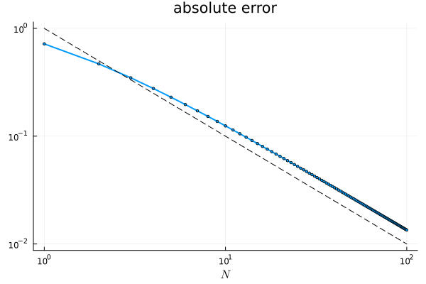

:::
:::

<!-- L01 -->
::: {.exercise-box #bank-exr-Euler-Mascheroni name="Approximating Euler-Mascheroni constant"}
**@exr-Euler-Mascheroni**

Euler-Mascheroni constant, $\gamma$, is defined as the limit of $\gamma_n = \sum_{k=1}^n \frac{1}{k} - \log n$ as $n \to \infty$. 

1. What is the absolute error in approximating $\gamma$ with $\gamma_{1000}$?
2. What is the rate of convergence of $\gamma_n$ to $\gamma$?
3. [This was just so that we can remember some calculus and also rigorously prove the rate of convergence that we have seen above using a rigorous error estimate]  
   Prove that $|\gamma - \gamma_n| \leq \frac1n$.
   
::: {.exercise-solution style="display: none;"}

First, we define the Euler-Mascheroni constant:

<details><summary>Code</summary>

```julia
γ = Base.MathConstants.eulergamma
```
</details>


```
γ = 0.5772156649015...
```

... and compute the absolute error in approximating $\gamma$ with $\gamma_{1000}$:

<details><summary>Code</summary>

```julia
Nmax = 1000;

N = 1:Nmax;
γN = zeros( Nmax );
γN[1] = 1;
for n ∈ 2:Nmax
    γN[n] = (1/n) + γN[n-1] + log( (n-1)/n );
end

println( "γ₁₀₀₀ = ", γN[1000] )
println( "Abs. error = " , abs( γ - γN[1000] ) )
```
</details>


```
γ₁₀₀₀ = 0.5777155815682078
Abs. error = 0.0004999166666749266

```

Here's a plot of the absolute errors on a log-log; the gradient matches $O(N^{-1})$:

<details><summary>Code</summary>

```julia
plot( γN .- γ , xaxis=:log, yaxis=:log , legend = false, lw = 2, m=2)   
plot!( N.^(-1) , linestyle=:dash)
```
</details>


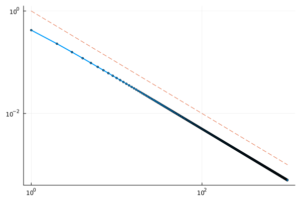

::: {.proof}
First, notice that 

\begin{align}   
    \gamma_n - \gamma_N 
    %
    &= \log \frac Nn - \sum_{k=n+1}^N \frac{1}{k}\\
    %
    &= \sum_{k=n+1}^N \left( \log \frac{k}{k-1} - \frac{1}{k} \right).
\end{align}

Here, $\frac1k$ is the area under the rectangle with base $[k-1,k]$ and height $\frac1k$ and $\log \frac{k}{k-1}$ is the integral of $\frac1x$ between $x = k-1$ and $x = k$: 

<details><summary>Code</summary>

```julia
k=3; x = range(k-1,k, 100);
plot( x, [x.^(-1) ones(100)./k (x .+ 1).^(-1)], 
    ylims=(0,1/(k-1)), 
    label=[L"y=\frac{1}{x}" L"\frac{1}{k}" L"y=\frac{1}{x+1}"] )
```
</details>


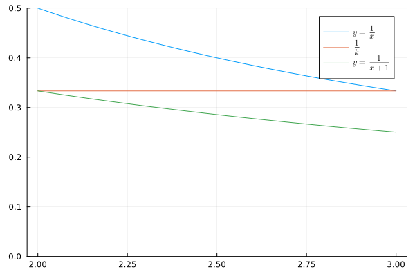

In the graph above, $\frac1k$ is the area under the red line, $\log \frac{k}{k-1}$ is the area under the blue line. We upper bound the absolute value of the error between these areas, by computing the area between $y = \frac1x$ and $y=\frac1{x+1}$:

\begin{align}
    0 &\leq \gamma_n - \gamma_N \nonumber\\
    %
    &= \sum_{k=n+1}^N \left( \log \frac{k}{k-1} - \frac{1}{k} \right) \\
    %
    &\leq \sum_{k=n+1}^N \int_{k-1}^k \left( \frac{1}{x} - \frac{1}{x + 1} \right) \mathrm{d}x \nonumber\\
    %
    &\leq \int_{n}^\infty \frac{1}{x(x+1)} \mathrm{d}x \\
    %
    &\leq \int_{n}^\infty \frac{1}{x^2} \mathrm{d}x = \frac1n
\end{align}

Here, we have shown that $(\gamma_n)$ is a Cauchy sequence and thus it converges, and we have the same estimate for $\gamma_n - \gamma$ by taking the limit in $N$.
:::

:::
:::

<!-- L01 -->
::: {.exercise-box #bank-exr-pi-artan name="Approximating π"}
**@exr-pi-artan**

*Assignment 1, Fall 2025, 30 pts* The quantities 

\begin{align}
\pi_N := 4 \sum_{n=0}^N \frac{(-1)^n}{2n+1}
\end{align}

approximate $\pi$ by using the Taylor expansion of $\arctan$ together with the fact that $\pi = 4 \arctan(1)$.

<details><summary>Code</summary>

```julia
using Plots, LaTeXStrings

Nmax = 100;
Ninter = 1:Nmax;

# vectors of length Nmax
p = zeros( Nmax ); q = zeros( Nmax );
p[1] = 4 * ( 1 - 1/3 ) ;
q[1] = abs( p[1] - π );
for N in 2:Nmax
    p[N] = p[N-1] + 4 * (-1)^N/(2*N + 1);
    q[N] = abs( p[N] - π );
end

plot(p, legend=false, xlabel="N", title=L"\pi_N")
```
</details>


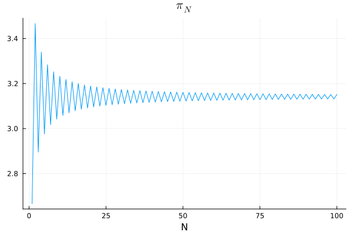

Based on the following graph, what is the rate of convergence of this particular approximation to $\pi$? Why do we use a log-log scale for this graph?

<details><summary>Code</summary>

```julia
plot( q , xaxis=:log, yaxis=:log, xlabel=L"N", title="absolute error", legend=false)
plot!( Ninter.^(-1) , ls=:dash)
```
</details>


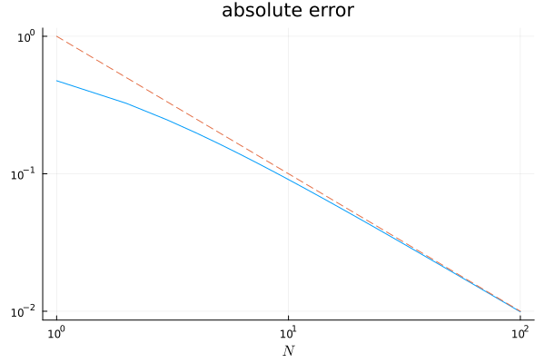

::: {.exercise-solution style="display: none;"}

We have $|\pi - \pi_N| = O(N^{-1})$. The log-log plot makes this behaviour easy to see.

In fact, one can show that 

\begin{align}
    |\pi - \pi_N| &= 4 \int_{0}^1 \frac{t^{2(N+1)}}{1 + t^2} \mathrm{d}t\nonumber\\
    %
    &\leq \frac{4}{2N+3}.
\end{align}

:::
:::

## Lecture 2

<!-- L02 -->
::: {.exercise-box #bank-exr-jam}
**@exr-jam**

In England, when we need to convert between lb and kg some people use the phrase "2.2 pounds of jam is the same as a kilogram". 

- What is the error, absolute error, and relative error of approximating 1 kg with 2.2 lb? 
- To how many significant digits is this approximation correct to?

You may use 1 kg = 2.20462262185 lb.

::: {.exercise-solution style="display: none;"}
The error is simply "exact minus approx." $= 2.20462262185 - 2.2 \approx 0.00462262185$. This is also the absolute error (because it is positive).

For the relative error, we divide by the exact value:

<details><summary>Code</summary>

```julia
x = 2.20462262185 
y = 2.2 

println("relative error = $( (x-y)/x )")
```
</details>


```
relative error = 0.0020967860005540483

```

The error is $0.002096... \leq 5 \times 10^{-3}$ and so $2.2$ is correct to 3 significant digits. (This is sufficient for all recipes you will likely use).

:::
:::

<!-- L02 -->
::: {.exercise-box #bank-exr-marathon}
**@exr-marathon**

Most people say a marathon is 26 miles when it is actually 26 miles 385 yards. In Europe, people say a marathon is 42 km when it is actually 42.194988 km.

- Which approximation has a smaller error? 
- What is the advantage of computing the relative errors in this case?

Hint: You may use the fact that 1 mile $=$ 1760 yards. 

::: {.exercise-solution style="display: none;"}

A marathon is $26 \times 1760 + 385$ yards. The error and relative error in this approximation is 

<details><summary>Code</summary>

```julia
x = 26*1760 + 385
y = 26*1760

err, r_err = x-y, (x-y)/x
```
</details>


```
(385, 0.00834326579261025)
```

The same calculation for the approximation in km is

<details><summary>Code</summary>

```julia
x′ = 42.194988
y′ = 42 

err′, r_err′ = x′-y′, (x′-y′)/x′
```
</details>


```
(0.19498800000000216, 0.004621117560218341)
```

<details><summary>Code</summary>

```julia
r_err / r_err′
```
</details>


```
1.8054649516893149
```

The approximation in miles has a $1.8\times$ larger relative error than the approximation in km. 

Why is the error in the approximation in miles much larger than $1.8\times$ bigger than the error in the approximation in km?

:::
:::

<!-- L02 -->
::: {.exercise-box #bank-exr-AU name="Astronomical Unit"}
**@exr-AU**

The astronomical unit is defined as $1 \text{AU} = 149,597,870,700 \text{m}$. Write this in standard form. 

::: {.exercise-solution style="display: none"}
$1.495978707 \times 10^{11} \text{m}$
:::
:::

<!-- L02 -->
::: {.exercise-box #bank-exr-fp-1}
**@exr-fp-1**

Write down all the floating point numbers with $k = 2$ in the interval $[1,2)$. What about the interval $[2,4)$? $[2^n,2^{n+1})$? 

::: {.exercise-hint style="display: none;"}

There are $2^k$ equally spaced floating point numbers in any interval $[2^n,2^{n+1})$ (as long as $\ell$ is sufficiently large).

:::

::: {.exercise-solution style="display: none"}

Floats between $1$ and $2$ are $(1.b_1b_2)_2 = 1 + b_1 2^{-1} + b_2 2^{-2}$ and so are $1$ ($b_1 = b_2 = 0$), $1.25$ ($b_1 = 0, b_2 = 1$), $1.5$ ($b_1 = 1, b_2 = 0$), $1.75$ ($b_1 = b_2 = 1$). 

Similarly, floats in the interval $[2^n, 2^{n+1})$ are of the form $(1 + b_1 2^{-1} + b_2 2^{-2} ) 2^n$. That is, $2^n$ ($b_1 = b_2 = 0$), $1.25 \times 2^n$ ($b_1 = 0, b_2 = 1$), $1.5 \times 2^n$ ($b_1 = 1, b_2 = 0$), $1.75 \times 2^n$ ($b_1 = b_2 = 1$).  

:::
:::

<!-- L02 -->
::: {.exercise-box #bank-exr-fp-3}
**@exr-fp-3**

Take $k=\ell=2$.

- What number does $0 0 1 1 0$ encode?
- Write the bitstring of $-3.5$.
- What are the maximum and minimum positive (normal) numbers and the machine precision in this system?

::: {.exercise-hint style="display: none;"}

Recall that floats are stored as $s | c | f$ where $s$ is the sign bit, $c$ the characteristic, and $f$ the fraction or mantissa. Recall that the bias is $b = 2^{\ell-1}-1 = 2 - 1 = 1$ and $c \in \{1, \dots, 2^\ell-2 \} = \{1,2\}$.

::: 

::: {.exercise-solution style="display: none;"}

In this case, we have $s = 0$, $c = (01)_2 = 1$ and $f = (0.10)_2 = \tfrac12$ and so this number represents $(-1)^s (1 + f) 2^{c - b} = (-1)^0 (1 + \tfrac12) 2^{1-1} = \tfrac32$.

$-3.5 = (-1)^1 (1 + 0.75) 2 = (-1)^1 (1 + (0.11)_2 ) 2^{2-1}$ and so the bitstring is $1 1 0 1 1$.

The maximum is $(-1)^0 (1 + (0.11)_2 ) 2^{ 2 - 1} = \tfrac72$,

The minimum positive float is $(-1)^0 (1 + (0.00)_2) 2^{ 1 - 1 } = 1$,

Machine precision is $2^{-k} = \tfrac14$. 

:::
:::

<!-- L02 -->
::: {.exercise-box #bank-exr-fp-2}
**@exr-fp-2**

What are the maximum and minimum positive numbers and the machine precision for each of ``Float16``, ``Float32``, and ``Float64``?

::: {.exercise-hint style="display:none;"}

Recall, the bitstring is stored as $s | c | f$ with $1 | \ell | k$ bits for each where

* ``Float16`` = half precision = $1|5|10$,   
* ``Float32`` = single precision = $1|8|23$, and   
* ``Float64`` = double precision = $1|11|52$.  

:::

::: {.exercise-solution style="display:none;"}

In general, the *maximum number* is $2^{2^{\ell-1} -1}( 2 - 2^{-k} ) \approx 2^{2^{\ell-1}}$, the *minimum positive (normal) number* is $2^{2-2^{\ell-1}}$, and the *machine precision* is $\epsilon_{\text{mach}} = 2^{-k}$. Therefore:

* ``Float16`` ($\ell = 5$, $k = 10$): the maximum is $2^{15}(2 - 2^{-10}) = 65504$, the minimum positive (normal) number is $2^{-14} \approx 6.10 \times 10^{-5}$, and the machine precision is $2^{-10} \approx 9.77 \times 10^{-4}$.
* ``Float32`` ($\ell = 8$, $k = 23$): the maximum is $2^{127}(2 - 2^{-23}) \approx 3.40 \times 10^{38}$, the minimum positive (normal) number is $2^{-126} \approx 1.18 \times 10^{-38}$, and the machine precision is $2^{-23} \approx 1.19 \times 10^{-7}$.
* ``Float64`` ($\ell = 11$, $k = 52$): the maximum is $2^{1023}(2 - 2^{-52}) \approx 1.80 \times 10^{308}$, the minimum positive (normal) number is $2^{-1022} \approx 2.23 \times 10^{-308}$, and the machine precision is $2^{-52} \approx 2.22 \times 10^{-16}$.

You can check these in Julia with ``floatmax``, ``floatmin``, and ``eps``:

<details><summary>Code</summary>

```julia
for T ∈ (Float16, Float32, Float64)
    label = "$T:  "
    pad = " "^length(label)
    println(label, "max = ", floatmax(T), "\n", pad, "min = ", floatmin(T), "\n", pad, "eps = ", eps(T))
end
```
</details>


```
Float16:  max = 6.55e4
          min = 6.104e-5
          eps = 0.000977
Float32:  max = 3.4028235e38
          min = 1.1754944e-38
          eps = 1.1920929e-7
Float64:  max = 1.7976931348623157e308
          min = 2.2250738585072014e-308
          eps = 2.220446049250313e-16

```

::: 
:::

<!-- L02 -->
::: {.exercise-box #bank-exr-Float16-pi}
**@exr-Float16-pi**

Write down the bitstring for $\pi$ in ```Float16```.

::: {.exercise-hint style="display: none;"}

$\pi$ in ```Float16``` rounds to 

<details><summary>Code</summary>

```julia
x = Float16( π )
x == 3.140625
```
</details>


```
true
```

and, in ```Float16```, we have $1|\ell|k = 1|5|10$. Therefore, the bias is $2^{\ell-1}-1 = 2^{4}-1 = 15$

:::

::: {.exercise-solution style="display: none;"}

Since $3.140625 = (-1)^0 (1 + 1/2 + 0/4 + 0/8 + 1/16 + 0/32 + 0/64 + 1/128)\times 2^{16-15}$, the bitstring is $0 | 1 0 0 0 0 | 1 0 0 1 0 0 1 0 0 0$

<details><summary>Code</summary>

```julia
bitstring(x)
```
</details>


```
"0100001001001000"
```

:::
:::

<!-- L02 -->
::: {.exercise-box #bank-exr-cond-2}
**@exr-cond-2**

Compute the relative condition numbers of (i) $x \mapsto cx$ for $c \not= 0$, (ii) $\log(x)$, (iii) $\exp$, (iv) $x^p$, and (v) $f\circ g$ in terms of $\kappa_f$ and $\kappa_g$

::: {.exercise-hint style="display: none;"}

Recall that $\kappa_f(x) = \left| \frac{x f'(x)}{f(x)} \right|$.

:::

::: {.exercise-solution style="display: none;"}

Since $(x \mapsto cx)' = c$, $\log'(x) = \tfrac1x$, $\exp'(x) = \exp(x)$, $(x^p)' = p x^{p-1}$, and $(f \circ g)'(x) = f'(g(x)) g'(x)$, we have

\begin{align}
    \kappa_{x \mapsto c x}(x) &= \left| \frac{x c}{cx} \right| = 1 \qquad \text{for } x \not=0, \nonumber\\
    %
    \kappa_{\log}(x) &= \left| \frac{x \cdot \tfrac1x}{\log(x)} \right| = \frac{1}{|\log x|} \qquad \text{for } x>0, x \not= 1, \nonumber\\
    %
    \kappa_{\exp}(x) &= \left| \frac{x e^x}{e^x} \right| = |x| \nonumber\\
    %
    \kappa_{x\mapsto x^p}(x) &= \left| \frac{x \cdot p x^{p-1}}{x^p} \right| = |p| \nonumber
\end{align}

and 

\begin{align}
    \kappa_{f\circ g}(x) &= \left| \frac{x f'(g(x)) g'(x)}{f(g(x))} \right| \nonumber\\ 
    %
    &=\left| \frac{g(x) f'(g(x))}{ f(g(x))} \right| 
    \left| \frac{x g'(x)}{ g(x) } \right| \nonumber\\
    %
    &= \kappa_{f}(g(x)) \kappa_g(x) \nonumber
\end{align}

for $f(g(x)) \not=0$.

:::
:::

<!-- L02 -->
::: {.exercise-box #bank-exr-subtractive-cancellation-1}
**@exr-subtractive-cancellation-1**

*Midterm, Fall 2025, Compulsory Section, 3 pts.* Let us define

\begin{align*}
   f(x) = \frac{\sqrt{1+x}-1}{x}, \qquad g(x) = \frac{1}{\sqrt{1+x} + 1}.
\end{align*}

One may verify that $f$ and $g$ are mathematically identical (but you don't have to). The following table is the output of evaluating $f$ and $g$ on $\{10^{-14}, 10^{-15}, 10^{-16}\}$ in double precision floating point. Why are the function values different?

<details><summary>Code</summary>

```julia
f = x -> ( sqrt(1 + x) - 1 ) / x
g = x-> 1/( 1 + sqrt(1 + x) )

t = [1e-14; 1e-15; 1e-16];
   
println( "                         f(x)                  g(x)" )
println( "x = 10^(-14):     ", f(t[1]), "    ",    g(t[1]) )
println( "x = 10^(-15):     ", f(t[2]), "   ",    g(t[2]) )
println( "x = 10^(-16):     ", f(t[3]), "                   ",    g(t[3]) )
```
</details>


```
                         f(x)                  g(x)
x = 10^(-14):     0.4884981308350689    0.4999999999999988
x = 10^(-15):     0.44408920985006256   0.4999999999999999
x = 10^(-16):     0.0                   0.5

```

::: {.exercise-solution style="display: none;"}

Subtractive cancellation! The formula $f$ suffers from subtractive cancellation, but the formula $g$ does not.

(The formulae are the same since 

\begin{align}
    f(x) &= \frac{\sqrt{1+x}-1}{x} \frac{\sqrt{1+x}+1}{\sqrt{1+x}+1} \nonumber\\
    %
    &= \frac{1+x-1}{\sqrt{1+x}+1}  = g(x). \nonumber
\end{align}

Moreover, we can see that $\lim_{x\to 0} f(x) = \lim_{x\to 0} g(x) = \frac12$.)

:::
:::

## Quiz 0

<!-- Q0 -->
::: {.exercise-box #bank-q0-1 release="now"}
**Quiz 0: Exercise 1**

Let $x_n = \frac{1 + n^2}{ 2 n^3 } \cos n$. For which of the following sequences $(\varepsilon_n)$ do we have $x_n = O(\varepsilon_n)$ as $n\to\infty$? Select all that apply.

(a). $\varepsilon_n = e^{-n}$,
(b). $\varepsilon_n = n^{-2}$,
(c). $\varepsilon_n = n^{-1}$,
(d). $\varepsilon_n = 1$,
(e). $\varepsilon_n = n$.

::: {.exercise-solution style="display: none;"}

(c), (d), and (e). Since $|\cos n| \leq 1$ and $1 \leq n^2$ for all $n \in \mathbb N$, we have

\begin{align}
   |x_n| &= \left|\frac{1 + n^2}{ 2 n^3 } \cos n\right| \nonumber\\
   %
   &\leq \frac{n^2 + n^2}{ 2 n^3 } \nonumber\\
   %
   &= n^{-1} \leq 1 \leq n. \nonumber
\end{align}

Therefore, $x_n = O(n^{-1})$, $O(1)$, and $O(n)$.

However, $x_n \not= O(n^{-2})$ (and so $x_n \not= O(e^{-n})$ either): $|\cos x| < \frac12$ only when $x$ lies in an interval of the form $(\frac\pi3, \frac{2\pi}3) + k\pi$ (of length $\frac\pi3 < 2$), so at least one of any three consecutive integers $n$ satisfies $|\cos n| \geq \frac12$. For these $n$, we have $|x_n| \geq \frac{n^2}{2n^3} \cdot \frac12 = \frac1{4n}$, and so $n^2 |x_n| \geq \frac{n}{4}$ is unbounded.

:::
:::

<!-- Q0 -->
::: {.exercise-box #bank-q0-2 release="now"}
**Quiz 0: Exercise 2**

Let us define

\begin{align*}
   f(x) = \frac{\sqrt{1+x}-1}{x}, \qquad g(x) = \frac{1}{\sqrt{1+x} + 1}.
\end{align*}

One may verify that $f$ and $g$ are mathematically identical (but you don't have to). The following table is the output of evaluating $f$ and $g$ on $\{10^{-14}, 10^{-15}, 10^{-16}\}$ in double precision floating point. Why are the function values different?

<details><summary>Code</summary>

```julia
f = x -> ( sqrt(1 + x) - 1 ) / x
g = x-> 1/( 1 + sqrt(1 + x) )

t = [1e-14; 1e-15; 1e-16];

println( "                         f(x)                  g(x)" )
println( "x = 10^(-14):     ", f(t[1]), "    ",    g(t[1]) )
println( "x = 10^(-15):     ", f(t[2]), "   ",    g(t[2]) )
println( "x = 10^(-16):     ", f(t[3]), "                   ",    g(t[3]) )
```
</details>

```
                         f(x)                  g(x)
x = 10^(-14):     0.4884981308350689    0.4999999999999988
x = 10^(-15):     0.44408920985006256   0.4999999999999999
x = 10^(-16):     0.0                   0.5
```

::: {.exercise-solution style="display: none;"}

Subtractive cancellation! For small $x$, $\sqrt{1+x} \approx 1 + \frac{x}{2}$, so the numerator of $f$ is the difference of two numbers that agree in almost all of their digits: the result has very few correct significant digits. At $x = 10^{-16} < \frac12 \epsilon_{\rm mach}$ we even have ```1 + 1e-16 == 1```, so the numerator is exactly $0$. The formula $g$ only adds positive numbers, so there is no cancellation and $g(x) \approx \frac12$ is accurate.

(The formulae are the same since

\begin{align}
    f(x) &= \frac{\sqrt{1+x}-1}{x} \frac{\sqrt{1+x}+1}{\sqrt{1+x}+1} \nonumber\\
    %
    &= \frac{1+x-1}{x(\sqrt{1+x}+1)}  = g(x). \nonumber
\end{align}

Moreover, $\lim_{x\to 0} f(x) = \lim_{x\to 0} g(x) = \frac12$.)

:::
:::

## Lecture 3

<!-- L03 -->
::: {.exercise-box #bank-exr-ep-over-2}
**@exr-ep-over-2**

Let $\epsilon$ be the machine precision. Is $(1 + \epsilon/2) - 1 = 1 + (\epsilon/2-1)$ in Float64?

::: {.exercise-solution style="display:none;"}

<details><summary>Code</summary>

```julia
ϵ = eps( Float64 )
(1.0 + ϵ/2) - 1.0 == 1.0 + (ϵ/2 - 1.0)
```
</details>


```
false
```

This is false, since $1 + \epsilon$ is the smallest float larger than $1$, Julia has to round or truncate $1 + \epsilon/2$:

<details><summary>Code</summary>

```julia
1 + ϵ/2
```
</details>


```
1.0
```

Therefore, $(1 + \epsilon/2) -1 = 0$. On the other hand $\epsilon/2 - 1$ is a float and so $1 + (\epsilon/2 - 1)$ is not equal to $0$.

:::
:::

<!-- L03 -->
::: {.exercise-box #bank-exr-fp-sums}
**@exr-fp-sums**

Let $X$ be an array containing $10^{16}, -10^{16}$, and $N$ copies of $1$. What is the sum of all the entries of the array $X$? Does it depend on the order of summation? What about in ``Float64``? Why?


::: {.exercise-solution style="display: none;"}

<details><summary>Code</summary>

```julia
using Random

N = 10^2
X = vcat( [1e16, -1e16], fill(1., N) )

for _ ∈ 1:10 
    shuffle!(X)
    s = 0. 
    for x ∈ X
        s += x 
    end
    println(s)
end 
```
</details>


```
72.0
32.0
92.0
25.0
44.0
94.0
77.0
96.0
55.0
26.0

```

This happens because $2^{53} \leq 10^{16} < 2^{54}$ and so the spacing between floats in this interval is $2^{n-k} = 2^{53-52} = 2$ (in Float64, the binary precision is $k=52$). As a result $10^{16} + 1$ is not a float; Julia rounds this to $10^{16}$:

<details><summary>Code</summary>

```julia
1e16 + 1
```
</details>


```
1.0e16
```

:::
:::

<!-- L03 -->
::: {.exercise-box #bank-exr-FNC-1-4-1}
**@exr-FNC-1-4-1**

Exercise 1.4.1 from @fnc, <a href="https://fncbook.com/stability/">[Fundamentals of Numerical Computation by Driscoll, Braun]</a> 

::: {.exercise-hint style="display: none;"}

<details><summary>Code</summary>

```julia
f = x -> (1 - cos(x) )/sin(x)
g = x -> 2*sin(x/2)^2/sin(x)

(f(1e-6), g(1e-6))
```
</details>


```
(5.000444502912538e-7, 5.000000000000416e-7)
```

:::

::: {.exercise-solution style="display: none;"}

Since $1 - \cos x = 2 \sin^2 \frac{x}{2}$, the formulas $f(x) = \frac{1 - \cos x}{\sin x}$ and $g(x) = \frac{2 \sin^2(x/2)}{\sin x}$ are mathematically identical (both equal $\tan \frac{x}{2}$).

In floating point, however, they are different for small $x$. For $x = 10^{-6}$ (see the code above):

* $f(10^{-6}) \approx 5.000444 \times 10^{-7}$, with relative error $\approx 9 \times 10^{-5}$ (only about $4$ correct significant digits),
* $g(10^{-6}) \approx 5.000000000000416 \times 10^{-7}$, which is correct to machine precision (relative error $\approx 10^{-16}$).

The problem itself is well-conditioned: with $F(x) = \tan\frac{x}{2}$, we have $\kappa_F(x) = \left|\frac{x F'(x)}{F(x)}\right| = \frac{x}{\sin x} \approx 1$ for small $x$. The large error in $f$ is therefore due to the *algorithm*: $\cos(10^{-6}) \approx 1 - 5 \times 10^{-13}$, so computing $1 - \cos x$ subtracts two nearly equal numbers (subtractive cancellation) and loses about $12$ significant digits. The formula $g$ involves no such subtraction, and so is stable.

:::
:::

<!-- L03 -->
::: {.exercise-box #bank-exr-FNC-1-4-2}
**@exr-FNC-1-4-2**

Exercise 1.4.2 from @fnc, <a href="https://fncbook.com/stability/">[Fundamentals of Numerical Computation by Driscoll, Braun]</a>


::: {.exercise-hint style="display: none;"}

<details><summary>Code</summary>

```julia
x = @. 10.0^(-(1:11));
f = @. (exp(x) - 1)/x;

p=1;
for n ∈ 1:8
    p = @. p + x^n/( factorial(n+1) );
end 

abs.(f-p) ./ x
```
</details>


```
11-element Vector{Float64}:
    1.1102230246251565e-14
    1.0880185641326532e-12
    4.285460875053104e-11
    4.32542890393961e-9
    9.701794922989393e-7
    3.798317216308078e-5
    0.005663214341922184
    1.1077470940534795
   82.24037095772019
  826.9037099495335
 8273.537099867668
```

<details><summary>Code</summary>

```julia
# upper bound on the error between f and p as functions on x
err = @. (1/factorial(10)) * (x^9/(1-x))
```
</details>


```
11-element Vector{Float64}:
 3.061924358220656e-16
 2.7835675983824175e-25
 2.7584904128114e-34
 2.7560075231509052e-43
 2.7557594799933906e-52
 2.755734678133266e-61
 2.7557321979718108e-70
 2.755731949955909e-79
 2.755731925154322e-88
 2.7557319226741635e-97
 2.755731922426145e-106
```

:::

::: {.exercise-solution style="display: none;"}

Using the Taylor expansion of $e^x$, we have 

\begin{align}
    f(x) = \frac{e^x - 1}{x} = \sum_{n=0}^\infty \frac{x^n}{(n+1)!}, \qquad 
    p(x) := \sum_{n=0}^{8} \frac{x^n}{(n+1)!}. \nonumber
\end{align}

For $0 < x < 1$, the truncation error satisfies

\begin{align}
    |f(x) - p(x)| = \sum_{n = 9}^\infty \frac{x^n}{(n+1)!} \leq \frac{1}{10!} \sum_{n=9}^\infty x^n = \frac{x^9}{10!\,(1-x)}, \nonumber
\end{align}

which is less than $3.1 \times 10^{-16}$ for $x \leq 0.1$ (see the second code cell above). Since $f(x) \geq 1$, the polynomial $p$ is accurate to machine precision for all $x \in (0, 0.1]$.

On the other hand, the formula $\frac{e^x - 1}{x}$ suffers from subtractive cancellation for small $x$ ($e^x \approx 1$): its relative error grows roughly like $\epsilon_{\rm mach}/x$, from $\approx 10^{-14}$ at $x = 10^{-2}$ to $\approx 10^{-8}$ at $x = 10^{-8}$. The differences $|f - p|$ computed above are therefore almost entirely the error of the naive formula, not the truncation error of $p$. (Julia's ```expm1``` avoids this problem: ```expm1(x)/x``` is accurate for all small $x$.)

:::
:::

<!-- L03 -->
::: {.exercise-box #bank-exr-change-sign-1}
**@exr-change-sign-1**

Let $f(x) = e^x - 2x - 1$. Apply change of sign theorem to $f$ to conclude there exists $\xi \in [1,2]$ such that $f(\xi) = 0$.

::: {.exercise-solution style="display: none;"}

The function $f(x) = e^x - 2x - 1$ is continuous with $f(1) = e - 3 \approx -0.28 < 0$ and $f(2) = e^2 - 5 \approx 2.39 > 0$. Therefore, $f(1) f(2) < 0$ and, by the change of sign theorem, there exists $\xi \in [1,2]$ with $f(\xi) = 0$.

:::
:::

<!-- L03 -->
::: {.exercise-box #bank-exr-change-sign-2}
**@exr-change-sign-2**

Let's return to @exr-change-sign-1. You showed that $f(x) = e^x - 2x - 1$ has a root $\xi \in [1,2]$. 

Show that $f(x) = 0$ can be solved by instead considering the fixed point problems $g(x) = x$ or $h(x) = x$ where

$$
\begin{align}
    g(x) &= \log( 2x + 1 ), \\
    h(x) &= \frac{e^x - 1}{2}.
\end{align}
$$

Show that Brouwer's fixed point theorem applies to $g$ but **not** $h$ on $[1,2]$.

::: {.exercise-solution style="display: none;"}

For $x \in [1,2]$ we have $2x + 1 > 0$, and $\log$ is one-to-one, so

\begin{align}
    g(x) = x &\iff \log(2x+1) = x \nonumber\\
             &\iff 2x + 1 = e^x \nonumber\\
             &\iff f(x) = 0, \nonumber
\end{align}

and 

\begin{align}
    h(x) = x &\iff \frac{e^x - 1}{2} = x \nonumber\\
             &\iff e^x - 2x - 1 = 0 \nonumber\\
             &\iff f(x) = 0. \nonumber
\end{align}

That is, the roots of $f$ are exactly the fixed points of $g$ and of $h$.

**$g$:** $g$ is continuous and increasing on $[1,2]$, with $g(1) = \log 3 \approx 1.10$ and $g(2) = \log 5 \approx 1.61$. So, for all $x \in [1,2]$,

\begin{align}
    1 < g(1) \leq g(x) \leq g(2) < 2. \nonumber
\end{align}

Therefore $g : [1,2] \to [1,2]$ and Brouwer's fixed point theorem gives a fixed point $\xi = g(\xi) \in [1,2]$.

**$h$:** $h(1) = \frac{e - 1}{2} \approx 0.86 < 1$ (and $h(2) = \frac{e^2 - 1}{2} \approx 3.19 > 2$), so $h$ does **not** map $[1,2]$ into $[1,2]$ and Brouwer's fixed point theorem does not apply. (Of course, $h$ still has the fixed point $\xi \in [1,2]$ found above: the theorem just cannot be used to show it.)

:::
:::

<!-- L03 -->
::: {.exercise-box #bank-exr-LambertW name="Lambert W function"}
**@exr-LambertW**

*Assignment 1, Fall 2025, [30 pts].* Prove that, for $x \geq 0$, there exists a unique $W(x) \geq 0$ for which $W(x) e^{W(x)} = x$. Show that $\Omega := W(1)$ satisfies $0.56 < \Omega < 0.58$.
   
::: {.exercise-hint style="display: none;"}

Intermediate value theorem is useful!

:::

::: {.exercise-solution style="display: none;"}

The function $F(w) := w e^w$ is continuous on $[0, \infty)$ with $F(0) = 0$ and $F(w) \to \infty$ as $w \to \infty$. Therefore, for $x \geq 0$, there exists $w_x \geq 0$ with $F(0) \leq x \leq F(w_x)$ and, by the intermediate value theorem, there exists $W \in [0, w_x]$ with $F(W) = x$. Moreover, $F'(w) = (1 + w) e^w > 0$, so $F$ is strictly increasing on $[0,\infty)$: if $W' < W < W''$ then $F(W') < x < F(W'')$. Hence $W(x) := W$ is the unique solution in $[0,\infty)$ of $W e^W = x$.

Finally, $F(0.56) = 0.56\, e^{0.56} \approx 0.980 < 1$ and $F(0.58) = 0.58\, e^{0.58} \approx 1.035 > 1$, and so (again since $F$ is continuous and strictly increasing) $\Omega = W(1) \in (0.56, 0.58)$. In the plot below, $\Omega$ is where the curve $y = w e^w$ crosses the line $y = 1$:

<details><summary>Code</summary>

```julia
using Plots, LaTeXStrings
F = w -> w * exp(w)

plot( F, 0.3, 0.75; label = L"y = w e^w", xlabel = L"w", lw = 2, legend = :topleft )
hline!( [1]; label = L"y = 1", linestyle = :dash )
scatter!( [0.56, 0.58], F.([0.56, 0.58]); label = L"w = 0.56,\ 0.58", color = :red )
```
</details>


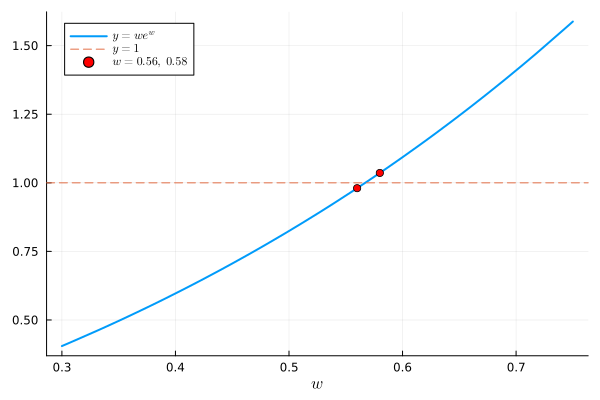

:::
:::

<!-- L03 -->
::: {.exercise-box #bank-exr-condition-numbers}
**@exr-condition-numbers**

*Assignment 2, Fall 2025, [10 pts].*  For fixed $f$, define

\begin{align}
    g(x) &= f(x - a), \\ 
    h(x) &= b f(x), \\ 
    j(x) &= f(c x), 
\end{align}

1. What is $\kappa_g(x)$?
2. Write $\kappa_{h}(x)$ in terms of $\kappa_f$,
3. Write $\kappa_{j}(x)$ in terms of $\kappa_f$,
4. What is $\kappa_f(x)$ when $f(x) = e^{-x^2}$?
   

::: {.exercise-solution style="display: none;"}

Recall that $\kappa_f(x) = \left| \frac{x f'(x)}{f(x)} \right|$.

1. $g'(x) = f'(x - a)$ and so 
   $\kappa_g(x) = \left| \frac{x f'(x-a)}{f(x-a)} \right| = \left| \frac{x}{x - a} \right| \kappa_f(x - a)$.
2. $h'(x) = b f'(x)$ and so $\kappa_h(x) = \left| \frac{x\, b f'(x)}{b f(x)} \right| = \kappa_f(x)$ (for $b \not= 0$): scaling the output doesn't change the conditioning.
3. $j'(x) = c f'(cx)$ and so $\kappa_j(x) = \left| \frac{x\, c f'(cx)}{f(cx)} \right| = \kappa_f(cx)$. (Common mistakes: $|c| \kappa_f(cx)$, $\frac{1}{|c|}\kappa_f(x)$, or $\frac{1}{|c|}\kappa_f(cx)$.)
4. $f'(x) = -2x e^{-x^2}$ and so $\kappa_f(x) = \left| \frac{x \cdot (-2x) e^{-x^2}}{e^{-x^2}} \right| = 2x^2$.

:::
:::

<!-- L03 -->
::: {.exercise-box #bank-exr-conditioning-diff}
**@exr-conditioning-diff**

*Assignment 2, Fall 2025, [25 pts].* Consider the differential equation (initial value problem)

$$
\begin{align}
\begin{split}
    u'(x) &= u(x) +e^{-x} \nonumber \\
    u(0) &= -\frac12 .
\end{split}
\end{align}
$$

1. Show that $u(x) = -\frac12 e^{-x}$ solves @eq-exr-diff. 

Now we perturb the initial data, by considering 

$$
\begin{align}
\begin{split}
    u'(x) &= u(x) +e^{-x} \nonumber \\
    u(0) &= \alpha
\end{split}
\end{align}
$$

for $\alpha := \epsilon - \frac12$.  

2. Show that $u_{\alpha}(x) = (\alpha + \frac12) e^x -\frac12 e^{-x}$ solves @eq-exr-diff-2.
3. Plot the functions $u$ and $u_{\alpha}$ and comment on the difference between the solutions for large $x$.
4. Let $f( \alpha ) = u_\alpha( 100 )$. What is the condition number $\kappa_f( \alpha )$? 
5. Explain what happens for $\alpha \approx -\frac12$. Link your observations to your answer for question 3.

::: {.exercise-solution style="display: none;"}

1. $u'(x) = \frac12 e^{-x} = -\frac12 e^{-x} + e^{-x} = u(x) + e^{-x}$ and $u(0) = -\frac12$.
2. $u_\alpha'(x) = (\alpha + \frac12) e^x + \frac12 e^{-x} = u_\alpha(x) + e^{-x}$ and $u_\alpha(0) = (\alpha + \frac12) - \frac12 = \alpha$.

3. The difference between the two solutions is $u_\alpha(x) - u(x) = (\alpha + \frac12) e^{x} = \epsilon e^x$. Here are $u$ and $u_\alpha$ for $\epsilon = 10^{-10}$:

<details><summary>Code</summary>

```julia
α = 1e-10 - 1/2;

u = x -> -exp(-x)/2;
uα = x -> (α + 1/2)*exp(x) + u(x);

plt1 = plot([u, uα], 0, 10, label=[L"u" L"u_\alpha"], title="Small x")
plt2 = plot([u, uα], 0, 100, label=[L"u" L"u_\alpha"], title="Large x")

plot( plt1, plt2, size=(1000,500))
```
</details>


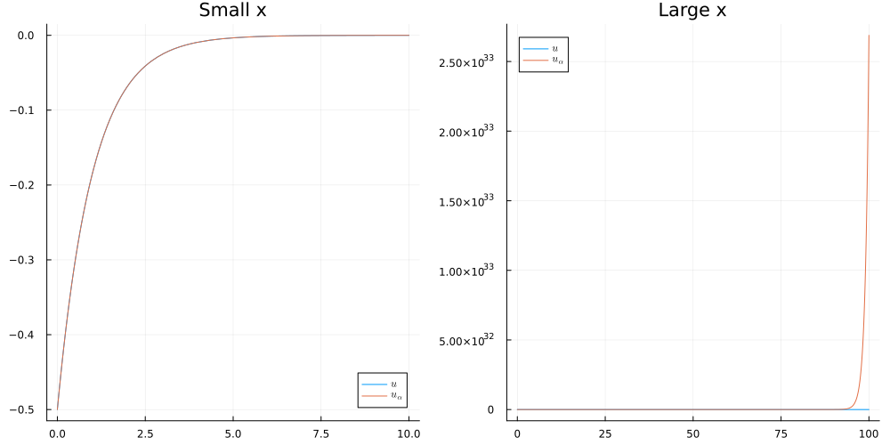

For small $x$ (left) the two solutions are indistinguishable: $u_\alpha(x) \approx u(x)$. For large $x$ (right) they are completely different: $u(x) = -\frac12 e^{-x}$ decays to $0$, whereas $u_\alpha(x) \approx \epsilon e^x$ grows exponentially. For example, $u(20) \approx -10^{-9}$ but $u_\alpha(20) \approx 0.05$, and $u(30) \approx -5 \times 10^{-14}$ but $u_\alpha(30) \approx 1069$.

The difference is easiest to see on a logarithmic scale:

<details><summary>Code</summary>

```julia
err = x -> abs( u(x) - uα(x) ) 

plot( err, 0, 100 , yaxis=:log, legend = false, title="absolute error between u and uα" )
```
</details>


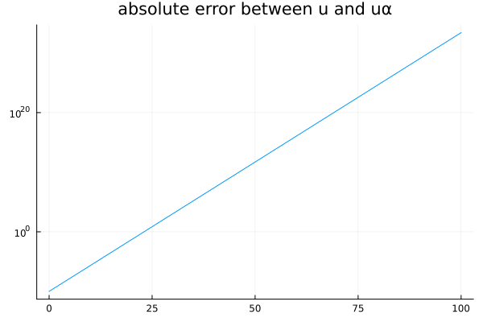

On a logarithmic $y$-axis, the error $|u(x) - u_\alpha(x)| = \epsilon e^x$ is a straight line with slope $1$ (in natural-log units): a perturbation of size $\epsilon = 10^{-10}$ in the initial condition grows by a factor $e$ for every unit increase in $x$, and is about $3 \times 10^{33}$ at $x = 100$.

4. $f(\alpha) = u_\alpha(100) = (\alpha + \frac12) e^{100} - \frac12 e^{-100}$ and $f'(\alpha) = e^{100}$, so
   \begin{align}
       \kappa_f(\alpha) = \left| \frac{\alpha f'(\alpha)}{f(\alpha)} \right| = \left| \frac{\alpha e^{100}}{(\alpha + \frac12) e^{100} - \frac12 e^{-100}} \right|. \nonumber
   \end{align}
5. As $\alpha \to -\frac12$, $\kappa_f(\alpha) \to \left| \frac{-\frac12 e^{100}}{-\frac12 e^{-100}} \right| = e^{200} \approx 7 \times 10^{86}$: the problem is extremely ill-conditioned. A tiny relative change in the initial condition (e.g. storing $-\frac12 + \epsilon$ in floating point) leads to a huge relative change in $u(100)$, which is exactly what the plots in part 3 show. 

    For example, with $\epsilon = 10^{-10}$ as in the plots: the relative change in the input is $\left|\frac{\epsilon}{-1/2}\right| = 2 \times 10^{-10}$, while $u(100) \approx -1.9 \times 10^{-44}$ and $u_\alpha(100) \approx 2.7 \times 10^{33}$, a relative change of about $1.4 \times 10^{77}$ in the output. Their ratio is $\approx 7.2 \times 10^{86} \approx e^{200} \approx \kappa_f(\alpha)$, as predicted.

:::
:::

<!-- L03 -->
::: {.exercise-box #bank-exr-cond-number-poly}
**@exr-cond-number-poly**

*Assignment 2, Fall 2025, [10 pts].* Let $p_{\alpha}(x) = \alpha x^n + \sum_{j=0}^{n-1} a_{j} x^j$ be a polynomial of degree $n$ and let $r(\alpha)$ be a root of $p_{\alpha}$. What is the condition number $\kappa_r(\alpha)$? 

::: {.exercise-solution style="display: none;"}

Since $p_\alpha(r(\alpha)) = 0$ for all $\alpha$, differentiating with respect to $\alpha$ gives

\begin{align}
    r(\alpha)^n + p_\alpha'\big(r(\alpha)\big)\, r'(\alpha) = 0
    \qquad \text{and so} \qquad 
    r'(\alpha) = - \frac{r(\alpha)^n}{p_\alpha'\big(r(\alpha)\big)} \nonumber
\end{align}

(assuming $r(\alpha)$ is a simple root, so that $p_\alpha'(r(\alpha)) \not= 0$). Therefore,

\begin{align}
    \kappa_r(\alpha) = \left| \frac{\alpha\, r'(\alpha)}{r(\alpha)} \right|
    = \left| \frac{\alpha\, r(\alpha)^{n-1}}{p_\alpha'\big(r(\alpha)\big)} \right|. \nonumber
\end{align}

In particular, the root is ill-conditioned when $p_\alpha'(r(\alpha))$ is small, i.e. when $r(\alpha)$ is close to a repeated root.

:::
:::

## Lecture 4

<!-- L04 -->
::: {.exercise-box #bank-exr-contraction-1}
**@exr-contraction-1**

Suppose $g :[a,b] \to \mathbb R$ is continuously differentiable with $|g'(x)| \leq L < 1$ for all $x \in [a,b]$. Show that $g$ is a contraction with constant $L$.

::: {.exercise-hint style="display: none;"}

Use Taylor/mean value theorem.

:::

::: {.exercise-solution style="display: none;"}

By the mean value theorem, for $x, y \in [a,b]$, there exists $c \in [a,b]$ such that 

\begin{align}
    |g(x) - g(y)|&= |g'(c)| |x-y| \nonumber\\
    %
    &\leq L |x-y|.
\end{align}

As a result, $g$ is a contraction.

:::
:::

<!-- L04 -->
::: {.exercise-box #bank-exr-contraction-2}
**@exr-contraction-2**

Suppose $g \in C^1([a,b])$. Take the simple iteration $x_{n+1} = g(x_n)$ for some contraction $g : [a,b] \to [a,b]$. Show that $(x_n)$ converges to the fixed point of $g$ in $[a,b]$ at least linearly with asymptotic error constant $\mu = |g'(\xi)|$.


::: {.exercise-hint style="display: none;"}

Notice that, by the mean value theorem, there exists $\eta_n$ between $x_{n}$ and $\xi$ for which  

\begin{align}
    \frac
        {|x_{n+1} - \xi|}
        {|x_n - \xi|}
    %
    &= \frac
        {|g(x_n) - g(\xi)|}
        {|x_n - \xi|} \nonumber\\
    %
    &= \frac
        {|g'(\eta_n)| |x_n - \xi|}
        {|x_n - \xi|} \nonumber\\
    %
    &= |g'(\eta_n)| \nonumber
\end{align}

:::

::: {.exercise-solution style="display: none;"}

Following the hint: since $(x_n) \to \xi$, and $\eta_n$ is between $x_n$ and $\xi$, we have 

\begin{align}
    \lim_{n\to\infty}
    \frac
        {|x_{n+1} - \xi|}
        {|x_n - \xi|}
    %
    &= |g'(\xi)| \nonumber
\end{align}

and the order of convergence is at least linear with asymptotic error constant $\mu = |g'(\xi)| < 1$.  

(Recal that, if $\mu = 0$, the order of convergence is superlinear)

:::
:::

<!-- L04 -->
::: {.exercise-box #bank-exr-change-sign-5}
**@exr-change-sign-5**

Show that $g(x) = \log( 2x + 1)$ is a contraction on $[1,2]$ with $L = \frac23$. Hence conclude that $x_{n+1} := g(x_n)$ converges for all $x_1 \in [1,2]$.

::: {.exercise-solution style="display: none;"}

First, note that @exr-change-sign-2 gives $1 < g(1) \leq g(x) \leq g(2) < 2$ for all $x\in [1,2]$.

Notice that $g'(x) = \frac{2}{2x+1}$ which is positive and decreasing on $[1,2]$. We therefore have $\frac25 = g'(2) \leq g'(x) \leq g'(1) = \frac{2}{3}$ and so $g$ is a contraction with $L = \frac23$ by @exr-contraction-1. Applying the contraction mapping theorem shows that $(x_n)$ converges linearly to the fixed point $\xi \in [1,2]$ of $g$.  

:::
:::

<!-- L04 -->
::: {.exercise-box #bank-exr-2025-A2}
**@exr-2025-A2**

*Assignment 2, Fall 2025, [25 pts].* Fix $a, x_1 > 0$ and define the iteration $x_{n+1} = \frac{1}{2}\big( x_n + \frac{a}{x_n} \big)$.  

1. ✍ Show that $x_{n+1}$ has the same sign as $x_n$, 
2. ✍ Suppose that $(x_n) \to \xi$. What is the value of $\xi$? 
3. 💻 Let $x$ be as in question 2. Show numerically that $(x_n) \to \xi$ for a few different choices of $a$ and $x_1$,
4. 💻 This iteration can be seen as a way of approximating $\xi$. What is the correseponding order of convergence?
   
::: {.exercise-solution style="display: none;"}

1. Note $\frac12 x_n$ and $\frac1{2 x_n}$ have the same sign as $x_n$. Moreover, since $a> 0$, $\frac{a}{x_n}$ has the same sign as $x_n$. As a result $x_{n+1}$ has the same sign as $x_n$. Since $x_1 > 0$, we find that $x_n > 0$ for all $n$.

2. Since $g(x) := \frac12\big( x + \frac{a}{x} \big)$ is continuous on $(0,\infty)$ and $(x_n)\to\xi$, we have $\xi = g(\xi)$. Therefore, we have $\frac12\xi = \frac12 \frac{a}{\xi}$ and so $\xi^2 = a$. Since $\xi > 0$ since $x_n > 0$ for all $n$, we have $\xi = + \sqrt{a}$. 

3. 

<details><summary>Code</summary>

```julia
A = [2, 4, 9, 81]
X = [1., 2., 1e-2]
for a ∈ A
    for x1 ∈ X 
        g = x -> (1/2) * (x + a/x)
        print( "(a, x₁) = (", a, ", ", x1, "); " )

        x, boo = simple_iteration( g, x1 )
        if boo 
            println( "converged to ", x[end] )
        else
            println( " [didn't converge]" )
        end
    end
    println("")
end
```
</details>


```
(a, x₁) = (2, 1.0); converged to 1.414213562373095
(a, x₁) = (2, 2.0); converged to 1.414213562373095
(a, x₁) = (2, 0.01); converged to 1.414213562373095

(a, x₁) = (4, 1.0); converged to 2.0
(a, x₁) = (4, 2.0); converged to 2.0
(a, x₁) = (4, 0.01); converged to 2.0

(a, x₁) = (9, 1.0); converged to 3.0
(a, x₁) = (9, 2.0); converged to 3.0
(a, x₁) = (9, 0.01); converged to 3.0

(a, x₁) = (81, 1.0); converged to 9.0
(a, x₁) = (81, 2.0); converged to 9.0
(a, x₁) = (81, 0.01); converged to 9.0


```

This method converges to $\sqrt{a}$ for all $a$ and $x_1$ that we chose.

4. Here, we compute $x_{n+1} = g(x_n)$ for $a = 2$ and $x_1 = 1$:

<details><summary>Code</summary>

```julia
function μ( x, ξ; α=1 )
    return @. abs( x[2:end] - ξ ) / ( abs(x[1:end-1] - ξ )^α );
end 

g = x -> (1/2) * (x + 2/x)
x, _ = simple_iteration(g, 1; tol=1e-5)

x
```
</details>


```
5-element Vector{Float64}:
 1.0
 1.5
 1.4166666666666665
 1.4142156862745097
 1.4142135623746899
```

Next, we compute $\frac{|x_{n+1} - \xi|}{|x_n-\xi|^\alpha}$ for $\alpha = 1$:

<details><summary>Code</summary>

```julia
display( μ( x, √2 ) ) 
```
</details>


```
4-element Vector{Float64}:
 0.20710678118654724
 0.028595479208965498
 0.0008658015152821018
 7.508466926336308e-7
```

This appears to converge to $0$; suggesting the convergence is superlinear.

For $\alpha = 2$, we have:

<details><summary>Code</summary>

```julia
display( μ( x, √2; α=2) ) 
```
</details>


```
4-element Vector{Float64}:
 0.49999999999999917
 0.33333333333330084
 0.35294117643144196
 0.35352238456116425
```

This is a number $>0$, suggesting the convergence is quadratic.

In fact, in the Lecture 5, we will prove that the convergence is quadratic with $\mu = \frac1{2\sqrt{a}}$. In the last case, this is 

<details><summary>Code</summary>

```julia
1/( 2√2 )
```
</details>


```
0.35355339059327373
```

which matches the numerically computed value above.

We could have also numerically approximated $\alpha$ by computing $\frac{\log |x_{n+1} - \xi|}{\log |x_n - \xi|}$:

<details><summary>Code</summary>

```julia
@. log(abs(x[2:end]-√2)) / log(abs(x[1:end-1]-√2))
```
</details>


```
4-element Vector{Float64}:
 2.7864397013573967
 2.4473369494135158
 2.1732752731987097
 2.0796040502714805
```


:::
:::

<!-- L04 -->
::: {.exercise-box #bank-exr-Lambert-W-2 name="Lambert W function" .difficult}
**@exr-Lambert-W-2**

*Assignment 3, Fall 2025.* The *Lambert W function* (also called the *product-log function*) $W : [0,\infty) \to [0,\infty)$ satisfies $W(a) e^{W(a)} = a$. Define $\Omega := W(1)$. 

1. ✍ Show that $\Omega \in [0.56, 0.58]$. 
2. ✍ Show that $\Omega$ is a fixed point of $g$ and $h$ as defined by  

\begin{align}
    g(x) = e^{-x}, \qquad h(x) = \log \left|\frac{1}{x}\right|
\end{align}

3. 💻 Show numerically that $x_{n+1} = g(x_n)$ converges and $y_{n+1} = h(y_n)$ diverges for a few different choices of $x_1$ and $y_1$.
4. ✍ Show that $g:[\frac{1}{e}, 1]\to[\frac{1}{e},1]$ with $|g'| < 1$, 
5. ✍ Explain why this means that the iteration $x_{n+1} = g(x_n)$ converges for all $x_1 \in [\frac{1}{e}, 1]$,
6. ✍ Now fix $x_1 \in \mathbb R$. Show that the sequence $(x_n)$ is eventually contained in $[0,1]$ and that $g : [0,1] \to [\frac{1}{e}, 1]$. Explain why this means that $(x_n)$ converges for all $x_1 \in \mathbb R$,
7. ✍ What is the order of convergence of this method? 
8. 💻 Confirm this numerically. 
9. ✍ Show that $(y_n)$ doesn't converge to $\Omega$ unless $y_n = \Omega$ for some $n$ (for example, when $y_1 = -\Omega$).

::: {.exercise-solution style="display:none;"}

[Solution](https://jack.thomaslabs.co.uk/teaching/Math5485-Fall-2025/A3%20Solutions.html)

:::
:::

<!-- L04 -->
::: {.exercise-box #bank-exr-simple-iteration name="Simple iteration"}
**@exr-simple-iteration**

*Midterm, Fall 2025, Optional section, 30 pts.* Define $g(x) = 1 + \frac{1}{1 + x}$ and $I := [1,2]$.

1. **[3 points]** Show that $g(x) \in I$ for all $x \in I$.
2. **[3 points]** Which theorem guarantees the existence of a fixed point $\xi = g(\xi) \in I$.
3. **[3 points]** Compute the value of $\xi$.
4. **[3 points]** Show that $L := \max_{x \in I} |g'(x)| = \frac14$.
5. **[3 points]** Explain why this means the iteration $x_{n+1} = g(x_n)$ converges to $\xi$ for all $x_1 \in I$.
6. **[5 points]** What is the order of convergence? 
7. **[5 points]** What is the asymptotic error constant?
8. **[5 points]** Fix $x_1 \in I$. Find $n$ for which the error bound $|x_{n+1} - \xi| \leq \frac{1}{64}$ is guaranteed. 

::: {.exercise-solution style="display:none;"}

[Solution](https://jack.thomaslabs.co.uk/teaching/Math5485-Fall-2025/Solutions%20-%20Math%205485%20Midterm.html)

:::
:::

## Quiz 1

<!-- Q1 -->
::: {.exercise-box #bank-q1-1 release="now"}
**Quiz 1: Exercise 1**

Let $x_n = \frac{1 + n^2}{ 3 n^4 } \cos n^5$. For which of the following sequences $(\varepsilon_n)$ do we have $x_n = O(\varepsilon_n)$ as $n\to\infty$? Select all that apply.

* $\varepsilon_n = e^{-n}$,   
* $\varepsilon_n = n^{-2}$,   
* $\varepsilon_n = n^{-1}$,   
* $\varepsilon_n = 1$,   
* $\varepsilon_n = n$.

::: {.exercise-solution style="display: none;"}

(b), (c), (d), and (e). Since $|\cos n^5| \leq 1$ and $1 \leq n^2$ for all $n \in \mathbb N$, we have

\begin{align}
   |x_n| &= \left|\frac{1 + n^2}{ 3 n^4 } \cos n^5\right| \nonumber\\
   %
   &\leq \frac{n^2 + n^2}{ 3 n^4 } \nonumber\\
   %
   &= \frac23 n^{-2} \leq n^{-1} \leq 1 \leq n. \nonumber
\end{align}

Therefore, $x_n = O(n^{-2})$, $O(n^{-1})$, $O(1)$, and $O(n)$. However, $x_n \not= O(e^{-n})$: e.g. along the subsequence of $n$ for which $|\cos n^5| \geq \frac12$ (there are infinitely many), $|x_n| \geq \frac16 n^{-2}$, which decays much slower than $e^{-n}$.

:::
:::

<!-- Q1 -->
::: {.exercise-box #bank-q1-2 release="now"}
**Quiz 1: Exercise 2**

Note that $x := 1.001^{2026}$ and $y := e^{2026 \log 1.001}$ are mathematically identical ($x=y$). In the following code, we use 16 bit floating point arithmetic to compute $x$ (by repeated multiplication) and $y$ (with the above formula):

<details><summary>Code</summary>
```julia
b, n, x = Float16( 1.001 ), 2026, Float16( 1 );
for i ∈ 1:n
    x = b*x
end
y = exp( n * log( b ) )
println( "x = ", x, "; y = ", y )
```
</details>

```
x = 5.914; y = 7.227
```

Which result do you trust more and why?

::: {.exercise-solution style="display: none;"}

Trust $y$ more. Computing $x$ by repeated multiplication involves $2026$ multiplications, each of which introduces a round-off error (of relative size up to $\frac12 \epsilon_{\rm mach} = 2^{-11}$ in ```Float16```) and these errors accumulate. On the other hand, $y$ is computed with only three operations (```log```, ```*```, and ```exp```), so there are far fewer opportunities for round-off error.

(In fact, neither value equals $1.001^{2026} \approx 7.576$: ```Float16(1.001)``` is $1 + 2^{-10} \approx 1.000977$, and $y \approx 7.227$ is an accurate value of $(1 + 2^{-10})^{2026} \approx 7.225$.)

:::
:::

<!-- Q1 -->
::: {.exercise-box #bank-q1-3 release="now"}
**Quiz 1: Exercise 3**

True or false: there exists a continuous function $f$ with a root in $[a,b]$ and $f(a) f(b) > 0$? Why or why not?

::: {.exercise-solution style="display: none;"}

**True.** For example, $f(x) = x^2$ has a root in $[-1,1]$ but $f(-1) f(1) = 1 > 0$. That is, the converse of the change of sign theorem is false.

:::
:::

<!-- Q1 -->
::: {.exercise-box #bank-q1-4 release="now"}
**Quiz 1: Exercise 4**

True or false: the function $f(x) = x^2$ is a contraction on some interval $[a,b]$. Show your working.

::: {.exercise-solution style="display: none;"}

**True.** For example, on $[0, \frac14]$ we have $|x^2 - y^2| = |x+y|\,|x-y| \leq \frac12 |x-y|$, so $f$ is a contraction with $L = \frac12$.

More generally, $|x^2 - y^2| = |x+y|\,|x-y| \leq 2\max(|a|,|b|)\,|x-y|$ for $x, y \in [a,b]$ (or use the mean value theorem: $|x^2 - y^2| = 2|\xi|\,|x-y|$ for some $\xi$ between $x$ and $y$). Therefore, $f$ is a contraction on any $[a,b] \subset (-\frac12, \frac12)$ with $L = 2\max(|a|,|b|) < 1$.

:::
:::

## Lecture 5

<!-- L05 -->
::: {.exercise-box #bank-exr-simple-no-its}
**@exr-simple-no-its**

Suppose $g : [a,b] \to [a,b]$ is a contraction with constant $L < 1$ and consider the simple iteration $x_{n+1} = g(x_n)$. Let $\xi \in [a,b]$ be the unique fixed point of $g$ in $[a,b]$. 

1. Show that $|x_1 - \xi| \leq \frac1{1-L} |x_1 - x_2|$, 
2. Hence, write down a lower bound on the number of iterations $n$ to ensure $|x_{n+1} - \xi|\leq \varepsilon$.

::: {.exercise-hint style="display: none"}

1. Use the triangle inequaltiy, 
2. Use the fact that 

\begin{align}
    |x_{n+1} - \xi| \leq \frac{L^n}{1-L} |x_1 - x_2|
\end{align}

:::

::: {.exercise-solution style="display: none"}

Recall that $|x_{n+1} - \xi| \leq L |x_{n} - \xi|$. In particular, we have $|x_1 - \xi| \leq |x_1 - x_2| + |x_2 - \xi| \leq |x_1 - x_2| + L|x_1-\xi|$ and thus $|x_1 - \xi| \leq \frac1{1-L} |x_1 - x_2|$. As a result, we have 

\begin{align}
    |x_{n+1} - \xi| &\leq L^n |x_1 - \xi| \nonumber\\
                    &\leq 
                    \frac
                        {L^n}
                        {1-L} 
                    |x_1 - x_2|
\end{align}

This number is less than $\epsilon$ when

\begin{align}
    n \geq \frac{ \log \frac{|x_1-x_2|}{\epsilon(1-L)}  }{\log\frac1L}.
\end{align}

This gives an upper bound on the number of iterations needed in order to be within some fixed tolerance.

Let's back to the function $g(x) = \log(2x+1)$. For an error of $\epsilon = 10^{-10}$, we require around $54$ iterations. Actually, $40$ will do (but we have an upper bound): 

<details><summary>Code</summary>

```julia
g(x) = log( 2x + 1 )
x, _ = simple_iteration( g, 1.0; N=1000, tol=0.0 )    # fixed point ξ ≈ 1.256 
ξ = x[end]

ϵ = 1e-10; 
L = 2/3;
x1 = 1; x2 = g(x1);
@show N = log( abs(x1-x2) / ( ϵ * (1-L) ) ) / log( 1/L )

x, _ = simple_iteration( g, 1.0; N=54, tol=1e-20 )

abs( x[40] - ξ )
```
</details>


```
N = log(abs(x1 - x2) / (ϵ * (1 - L))) / log(1 / L) = 53.78490871074893

```

```
8.923461969345681e-11
```

:::
:::

<!-- L05 -->
::: {.exercise-box #bank-exr-2025-A2-cont}
**@exr-2025-A2-cont**

@exr-2025-A2 continued...

This is an example of Newton's method!

\begin{align}
    x_{n+1} = \frac12 \left( x_n + \frac{a}{x_n} \right)
\end{align}

is the Newton iteration with $f(x) = x^2 - a$. Notice that $\xi = \sqrt{a}$ and $f'(\xi) = 2\sqrt{a}$, $f''(\xi) = 2$. 

Compute the order of convergence and asymptotic error constant numerically, and compare to @thm-Newton.

::: {.exercise-solution style="display:none;"}

Here, we plot the order of convergence and asymptotic error constant: 

<details><summary>Code</summary>

```julia
g(x) = x^2 - 2
g′(x) = 2*x 
orderOfConvergence( Newton(g,g′,1.), sqrt(2); α=2 )

println( "theoretical value of μ (for α=2) = ",  (1/2) * ( 2/ g′(sqrt(2)) ) )
```
</details>


```
iteration  abs error        log error    α          μ (α=2.0)     
1          4.142136e-01     -0.3828      NaN        NaN           
2          8.578644e-02     -1.0666      2.7864     0.5000        
3          2.453104e-03     -2.6103      2.4473     0.3333        
4          2.123901e-06     -5.6729      2.1733     0.3529        
5          1.594724e-12     -11.7973     2.0796     0.3535        
theoretical value of μ (for α=2) = 0.35355339059327373

```

:::
:::

<!-- L05 -->
::: {.exercise-box #bank-exr-2025-A5-B .no-solution}
**@exr-2025-A5-B**

[Assignment 5, Fall 2025, Section B](https://jack.thomaslabs.co.uk/teaching/Math5485-Fall-2025/A5%20Solution.html#b.-keplers-equation)

What happens when applying Newton to Kepler's equation with $\epsilon = 1$ (in this case $f(2\pi) = f'(2\pi) = f''(2\pi) = 0$).
:::

<!-- L05 -->
::: {.exercise-box #bank-exr-faster-linear name="Faster than linear convergence"}
**@exr-faster-linear**

Suppose that $g$ is twice continuously differentiable with $g(\xi) = \xi$ and $g'(\xi) = 0$.

1. ✍️ Show that there exists $\delta > 0$ such that $x_{n+1} = g(x_n)$ converges to $\xi$ for all $x_1 \in [\xi - \delta, \xi + \delta]$.  
2. ✍️ Show that 

\begin{align}
    \lim_{n\to\infty} \frac{|x_{n+1} - \xi|}{|x_n - \xi|^2} = \frac12 |g''(\xi)| \nonumber
\end{align}

(whenever $x_n \not= \xi$ for all $n$). What is the order of convergence when $g''(\xi) \not= 0$?  

:::{.exercise-solution style="display:none;"}

1. Since $g'$ is continuous and $g'(\xi) = 0$, there exists $\delta > 0$ such that
   
$$
|g'(x)| \leq \tfrac12 \qquad \text{for all } x \in I := [\xi-\delta, \xi+\delta].
$$

For $x \in I$ the mean value theorem gives some $\eta$ between $x$ and $\xi$ (so $\eta\in I$) with

$$
|g(x) - \xi| = |g(x) - g(\xi)| = |g'(\eta)|\,|x-\xi| \leq \tfrac12 |x - \xi| \le \tfrac12\delta,
$$

so $g(I) \subseteq I$. The same argument applied to any $x,y\in I$ gives $|g(x)-g(y)| \le \frac12|x-y|$, so $g : I \to I$ is a contraction with $L = \frac12$. By the contraction mapping theorem, $x_{n+1} = g(x_n)$ converges to the unique fixed point of $g$ in $I$, which is $\xi$, for every $x_1 \in I$. 

The contraction mapping theorem is proved by writing $|x_{n+1}-\xi| \leq 2^{-n}|x_1-\xi| \to 0$ as $n\to \infty$.

2. Take $x_1\in I$, so $x_n\in I$ for all $n$. By Taylor's theorem about $\xi$, there exists $\eta_n$ between $x_n$ and $\xi$ with
   
\begin{align}
x_{n+1} &= g(x_n) \nonumber\\
%
&= g(\xi) + g'(\xi)(x_n-\xi) + \tfrac12 g''(\eta_n)(x_n-\xi)^2 \nonumber\\
%
&= \xi + \tfrac12 g''(\eta_n)(x_n-\xi)^2 .
\end{align}

Hence, as $x_n \neq \xi$,

$$
\frac{|x_{n+1} - \xi|}{|x_n - \xi|^2} = \tfrac12 |g''(\eta_n)| .
$$

Since $x_n \to \xi$ and $\eta_n$ is between $x_n$ and $\xi$, $\eta_n \to \xi$. By continuity of $g''$ we have 

$$
\lim_{n\to\infty}\frac{|x_{n+1} - \xi|}{|x_n - \xi|^2} = \tfrac12 |g''(\xi)| .
$$

*Order of convergence.* If $g''(\xi) \not= 0$, the limit above is finite and nonzero, so the convergence is **quadratic** ($\alpha = 2$) with asymptotic error constant $\mu = \frac12|g''(\xi)|$.

:::
:::

<!-- L05 -->
::: {.exercise-box #bank-exr-Newton-1 name="Newton"}
**@exr-Newton-1**

*Newton's method* $x_{n+1} = x_n - \frac{f(x_n)}{f'(x_n)}$ is the simple iteration with $g(x) := x - \frac{f(x)}{f'(x)}$.

✍️ Suppose that $f$ is three times continuously differentiable with $f(\xi) = 0$ and $f'(\xi) \not= 0$. Show that $g'(\xi) = 0$ and $g''(\xi) = \frac{f''(\xi)}{f'(\xi)}$. What does this tell you about Newton's method?

::: {.exercise-hint style="display: none;"}
Taylor's theorem.
:::

::: {.exercise-solution style="display:none;"}

Since $f'$ is continuous and $f'(\xi)\neq0$, $f' \neq 0$ on some interval $I$ around $\xi$. As a result, $g$ is defined on $I$. Since $f\in C^3$, we have $g \in C^2(I)$. By the quotient rule (or product rule),

\begin{align}
g'(x) &= 1 - \frac{f'(x)^2 - f(x)f''(x)}{f'(x)^2} 
%
\nonumber\\
&= \frac{f(x)\,f''(x)}{f'(x)^2}.
\end{align}

At $x=\xi$ the numerator contains $f(\xi) = 0$, so $g'(\xi) = 0$. Differentiating $g' = f f'' \,(f')^{-2}$ once more gives

$$
g''(x) = \frac{f'(x)f''(x) + f(x)f'''(x)}{f'(x)^2} - \frac{2 f(x) f''(x)^2}{f'(x)^3}.
$$

At $x = \xi$ every term containing $f(\xi)=0$ vanishes, leaving

\begin{align}
g''(\xi) &= \frac{f'(\xi)f''(\xi)}{f'(\xi)^2} 
%
\nonumber\\
%
&= \frac{f''(\xi)}{f'(\xi)} .
\end{align}

Since $g$ is $C^2$ near $\xi$ with $g(\xi) = \xi$ and $g'(\xi) = 0$, @exr-faster-linear applies:

* Newton converges for all $x_1$ sufficiently close to $\xi$;
* the convergence is at least quadratic, with
  
$$
\lim_{n\to\infty}\frac{|x_{n+1} - \xi|}{|x_n - \xi|^2} = \tfrac12|g''(\xi)| = \frac12\left|\frac{f''(\xi)}{f'(\xi)}\right| ,
$$

which is exactly the asymptotic error constant in @thm-Newton;
* if $f''(\xi)\neq 0$ the order is exactly $2$; if $f''(\xi) = 0$ the convergence is faster than quadratic.

:::
:::

<!-- L05 -->
::: {.exercise-box #bank-exr-division-iter name="Division without dividing"}
**@exr-division-iter**

Fix $a > 0$.

1. ✍️ Show that Newton's method applied to $f(x) := \frac1x - a$ is given by $x_{n+1} = x_n(2 - a x_n)$.  
2. ✍️ Define $e_n := 1 - a x_n$ and show that $e_{n+1} = e_n^2$. Hence, find all $x_1$ for which $(x_n) \to \frac1a$.  
3. ✍️ Show that $\left| x_{n+1} - \frac1a \right| = a \left| x_n - \frac1a \right|^2$. What are the order of convergence and the asymptotic error constant? Compare with the asymptotic error constant $\mu = \frac12 \left| \frac{f''(\xi)}{f'(\xi)} \right|$ from lectures.  
4. 💻 Take $a = 7$. Verify your answers to (ii) and (iii) numerically using $x_1 = 0.1, 0.28$, and $0.3$.

::: {.exercise-solution style="display:none;"}

1. We have $f(x) = \frac1x - a$ and $f'(x) = -\frac1{x^2}$ and so Newton is 

\begin{align}
x_{n+1} &= x_n - \frac{f(x_n)}{f'(x_n)} \nonumber\\
%
&= x_n - \frac{\frac1{x_n} - a}{ - \frac{1}{x_n^2} } \nonumber\\
%
&= x_n( 2 - a x_n )
\end{align}

  If $x_n \to \xi$, then $\xi = \frac1a$. 

2. Notice $e_n = 1 - a x_n$ and so 

\begin{align}
e_{n+1} &= 1 - a x_{n+1} \nonumber\\
&= 1 - a x_n (2 - ax_n) \nonumber\\
&= 1 - 2 a x_n + (ax_n)^2 \nonumber\\
&= (1 - a x_n)^2 = e_n^2.
\end{align} 

We have $x_n \to \frac1a$ if and only if $e_n \to 0$. Since $e_{n+1} = e_n^2 = e_1^{2^n}$, we have $e_n \to 0$ for all $x_1$ with $|e_1| = |1 - a x_1| < 1$. That is, if $0 < x_1 < 2/a$.

3. We have 

\begin{align}
|x_{n+1} - \frac1a| &= \frac{1}{a} | 1 - a x_{n+1} | \nonumber\\
&= \frac1a |e_{n+1}| \nonumber\\
&= \frac1a |1 - a x_n|^2 \nonumber\\
&= a |x_n - \frac1a|^2.
\end{align} 

Therefore, the order of convergence is $\alpha = 2$ with asymptotic error constant $\mu = a$. Here, we are applying Newton's method to $f(x) = \frac1x - a$ and so $f'(x) = -\frac1{x^2}$, $f''(x) = \frac2{x^3}$, and $\frac12 \big|\frac{f''(1/a)}{f'(1/a)}\big| = \frac12 \frac2{a^{-3}} (a^{-2}) = a$ (which agrees with the above).

:::
:::

## Problem Class 1

<!-- PC1 -->
::: {.exercise-box #bank-exr-P1-1 release-date="2026-09-30"}
**Exercise 1**

Show that each of the following have fixed points on $[2,4]$:

\begin{align}
    g_1(x) &= 1 + x - \frac19 x^2 \nonumber\\
    g_2(x) &= \pi + 0.99 \sin x \nonumber\\
    g_3(x) &= x + 1 - \tan\frac{x}4
\end{align}

1. Do you expect the simple iterations $x_{n+1} = g_j( x_n )$ to converge? 
2. Why? 
3. Test your hypothesis numerically. 
4. Compute the order of convergence and asymptotic error constants. 
:::

<!-- PC1 -->
::: {.exercise-box #bank-exr-P1-2 release-date="2026-09-30"}
**Exercise 2**

Suppose that $g(\xi) = \xi$, $g'(\xi) = 0$ and $|g''|$ is bounded near $\xi$. 

1. Show that the simple iteration $x_{n+1} = g(x_n)$ with $x_1 \approx \xi$ converges to $\xi$. 
2. What is the order of convergence?
3. Can you generalise this statement to the case where $g'(\xi) = \cdots = g^{(\ell-1)}(\xi) = 0$ and $g^{(\ell)}$ bounded near $\xi$?
:::

<!-- PC1 -->
::: {.exercise-box #bank-exr-P1-3 release-date="2026-09-30"}
**Exercise 3**

For $\alpha \in (0,1]$, define $x_{n+1} := x_n + \alpha ( g(x_n) - x_n )$ where $g$ is continuous. 

1. Show that if $(x_n) \to \xi$ then $\xi$ is a fixed point of $g$
2. Suppose that $g'$ is continuous with $g'(\xi) < 0$. Show that there exists $\alpha_0 > 0$ such that, if $\alpha \leq \alpha_0$, then $(x_n)$ converges to $\xi$ for all $x_1$ sufficiently close to $\xi$
:::

## Lecture 6

<!-- L06 -->
::: {.exercise-box #bank-exr-L6-Taylor}
**@exr-L6-Taylor**

Show that the degree $m_0$ Taylor polynomial of $f$ about $x_0$ solves @eq-interpolation when $X = \{ x_0 \}$.

::: {.exercise-hint style="display:none;"}

Recall that 

\begin{align}
    p(x) = f(x_0) + f'(x_0)(x-x_0) + \cdots + \frac{f^{(m_0)}(x_0)}{m_0!}(x-x_0)^{m_0}
    %
    \nonumber
\end{align}

is the degree $m_0$ Taylor polynomial of $f$ about $x_0$.

:::

::: {.exercise-solution style="display: none;"}

Let
$$
p(x) = \sum_{k=0}^{m_0} \frac{f^{(k)}(x_0)}{k!}(x-x_0)^k .
$$
Fix $0 \le j \le m_0$ and differentiate $j$ times. Terms with $k<j$ have degree $<j$ and thus vanish, and $\frac{d^j}{dx^j}(x-x_0)^k = \frac{k!}{(k-j)!}(x-x_0)^{k-j}$ for $k \ge j$, so
$$
p^{(j)}(x) = \sum_{k=j}^{m_0} \frac{f^{(k)}(x_0)}{(k-j)!}(x-x_0)^{k-j}.
$$
At $x=x_0$ every term with $k>j$ contains a positive power of $(x-x_0)$ and so vanishes, leaving only $k=j$:
$$
p^{(j)}(x_0) = \frac{f^{(j)}(x_0)}{0!} = f^{(j)}(x_0).
$$
As $j\in\{0,\dots,m_0\}$ was arbitrary, $p$ satisfies all conditions of @eq-interpolation for $X=\{x_0\}$, and $p$ has degree at most $m_0$. 

:::
:::

<!-- L06 -->
::: {.exercise-box #bank-exr-l06-1}
**@exr-l06-1**

Write down the polynomial of least degree interpolating $f(x) = \sin(x)$ at the points $0, \frac{\pi}{2}, \pi$

::: {.exercise-solution style="display:none;"}

The nodes are $x_0=0$, $x_1=\tfrac\pi2$, $x_2=\pi$ with data $f(x_0)=0$, $f(x_1)=1$, $f(x_2)=0$. In the Lagrange form $p(x) = \sum_{j=0}^2 f(x_j)\,\ell_j(x)$ the terms with $f(x_j)=0$ drop out, leaving

\begin{align}
p(x) &= \ell_1(x) \nonumber\\
%
&= \frac{(x-x_0)(x-x_2)}{(x_1-x_0)(x_1-x_2)} 
\nonumber\\
%
&= \frac{x(x-\pi)}{\left(\frac\pi2\right)\left(-\frac\pi2\right)} \nonumber\\
%
&= -\frac{4}{\pi^2}\,x(x-\pi).
\end{align}

:::
:::

<!-- L06 -->
::: {.exercise-box #bank-exr-Lagrange-int-1}
**@exr-Lagrange-int-1**

Write down an error estimate for approximating $f(x) = \sin(x)$ by $I_{\{0, \frac\pi2, \pi\}}f(x) = - \frac4{\pi^2} x (x - \pi)$.

::: {.exercise-solution style="display:none;"}

Here $n=2$, so @thm-Lagrange-interpolation gives, for each $x\in[0,\pi]$, some $\xi_x\in[0,\pi]$ with

\begin{align}
\sin x - p(x) &= \frac{f^{(3)}(\xi_x)}{3!}\,q(x), \nonumber\\ 
%
q(x) &:= x\big(x-\tfrac\pi2\big)(x-\pi).
\end{align}

Since $f^{(3)}(x) = -\cos x$, $|f^{(3)}(\xi_x)| \le 1$, so

$$
|\sin x - p(x)| \;\le\; \frac{|q(x)|}{6}
$$

for all $x\in [0,\pi]$.

The maximum of $|q(x)|$ on $[0,\pi]$ is attained at a critial point of $q(x)$. Since $q'(x) = (x-\tfrac\pi2)(x-π) + x(x-\pi) + x(x-\tfrac\pi2) = 3x^2 -3\pi x + \tfrac{\pi^2}{2}$, the maxima are obtained at $x_{\pm} = \left( \frac12 \pm \frac16 \sqrt{3} \right) \pi$ with $q(x_{\pm}) = \frac{\pi^3}{12\sqrt3}$ and so 

$$
|\sin x - p(x)| \;\le\; \frac{\pi^3}{72\sqrt3}.
$$

:::
:::

<!-- L06 -->
::: {.exercise-box #bank-exr-poly-interpolation-2}
**@exr-poly-interpolation-2**

Consider $f(x) = e^{-x}$ on $[-1,1]$. 

1. Find a Lagrange interpolating polynomial $p$ of $f$ on $\{ -1, 0 , 1\}$,

2. Write down an error estimate for approximating $f$ with $p$ on $[-1,1]$.

::: {.exercise-solution style="display:none;"}

*1.* With $x_0=-1, x_1=0, x_2=1$ and $f(x_0)=e, f(x_1)=1, f(x_2)=e^{-1}$, the Lagrange polynomials are

\begin{align}
\ell_0(x) &= \frac{x(x-1)}{2}, \nonumber\\
%
\ell_1(x) &= 1-x^2, \nonumber\\
%
\ell_2(x) &= \frac{x(x+1)}{2},
\end{align}

so

\begin{align}
p(x) &= e\,\frac{x(x-1)}{2} + (1-x^2) + e^{-1}\frac{x(x+1)}{2} \nonumber\\
    &= \left(\frac{e+e^{-1}}{2}-1\right)x^2 - \frac{e-e^{-1}}{2}\,x + 1.
\end{align}

1. Here $n=2$ and $f^{(3)}(x) = -e^{-x}$, so $\max_{[-1,1]}|f^{(3)}| = e$. The node polynomial is $\ell_X(x) = (x+1)x(x-1) = x^3-x$; it vanishes at $\pm1$ and its critical points are $x=\pm1/\sqrt3$, where $|x^3-x| = \frac{1}{\sqrt3}\left(1-\frac13\right) = \frac{2}{3\sqrt3}$. By @thm-Lagrange-interpolation,

\begin{align}
    |f(x)-p(x)| &\leq \frac{e}{3!}\,|x^3-x| \nonumber\\
    %
    &\leq \frac{e}{6}\cdot\frac{2}{3\sqrt3} 
    \nonumber\\
    %
    &= \frac{e}{9\sqrt3} \;\approx\; 0.174 
\end{align}

for all $x\in [-1,1]$.

(The actual maximum error is about $0.079$.)

:::
:::

<!-- L06 -->
::: {.exercise-box #bank-exr-equispaced-node-poly name="Growth of the equispaced node polynomial" .difficult}
**@exr-equispaced-node-poly**

Let $X = \{x_0 < \cdots < x_n\}$ be $n+1$ equispaced nodes on $[-1,1]$, i.e. $x_j = -1 + jh$ with $h = 2/n$, and let $\ell_X(x) = (x-x_0)(x-x_1)\cdots(x-x_n)$ be the node polynomial.

1. Fix $x \in [x_k, x_{k+1}]$ for some $0 \leq k \leq n-1$. By bounding $|x - x_j|$ for $j < k$ and $j > k+1$ and using $|x-x_k|\,|x-x_{k+1}| \leq h^2/4$, show that

   $$
       |\ell_X(x)| \leq \frac{h^{n+1}}{4} (k+1)!\,(n-k)!,
   $$

   and deduce that $\max_{x\in[-1,1]} |\ell_X(x)| \leq \dfrac{n!}{4} h^{n+1}$.

2. Use Stirling's formula, $n! \sim \sqrt{2\pi n}\,(n/e)^n$, to show that there is a constant $C > 0$, independent of $n$, such that

   $$
       \max_{x\in[-1,1]} |\ell_X(x)| \leq C\, \frac{(2/e)^n}{\sqrt n} \qquad \text{for all } n.
   $$

3. By evaluating $\ell_X$ at the point $x^* = x_0 + h/2$, show that there is a constant $c > 0$, independent of $n$, such that

   $$
       \max_{x\in[-1,1]} |\ell_X(x)| \geq c\, \frac{(2/e)^n}{n} \qquad \text{for all } n.
   $$

Note that $2/e \approx 0.736$: parts 2 and 3 together show that $\max\limits_{x\in[-1,1]} |\ell_X(x)|$ decays exponentially, but at a rate no better than $(2/e)^n$.

::: {.exercise-solution style="display: none;"}

**1.** Fix $x\in[x_k,x_{k+1}]$ and split $\prod_{j=0}^n|x-x_j|$ into three groups.

* $j\le k-1$: since $x_j < x \le x_{k+1}$, $|x-x_j| \le x_{k+1}-x_j = (k+1-j)h$. As $j$ runs over $0,\dots,k-1$, we have $k+1-j$ runs over $k+1,\dots,2$ and so $\prod_{j=0}^{k-1}|x-x_j| \le h^k\,(k+1)!$.
* $j\ge k+2$: since $x_k \le x < x_j$, $|x-x_j| \le x_j-x_k = (j-k)h$, and $j-k$ runs over $2,\dots,n-k$, so $\prod_{j=k+2}^{n}|x-x_j| \le h^{\,n-k-1}\,(n-k)!$.
* $j\in\{k,k+1\}$: we have 

\begin{align}
    (x-x_k) (x_{k+1}-x) \leq \left( \frac{(x-x_k) + (x_{k+1}-x)}{2} \right)^2 = \frac{h^2}{4}.
\end{align}

Multiplying (the powers of $h$ add to $k+(n-k-1)+2=n+1$):
$$
|\ell_X(x)| \;\le\; \frac{h^{n+1}}{4}(k+1)!\,(n-k)!.
$$
For the uniform bound write
$$
(k+1)!\,(n-k)! = \frac{(n+1)!}{\binom{n+1}{k+1}} .
$$
For $0\le k\le n-1$ we have $1\le k+1\le n$, and $\binom{n+1}{m}\ge \binom{n+1}{1} = n+1$ for $1\le m\le n$ (binomial coefficients increase towards the middle of each row). Hence $(k+1)!(n-k)! \le (n+1)!/(n+1) = n!$, with equality for $k=0$ and $k=n-1$, and since every $x\in[-1,1]$ lies in some $[x_k,x_{k+1}]$,
$$
\max_{x\in[-1,1]}|\ell_X(x)| \;\le\; \frac{n!}{4}h^{n+1}.
$$

**2.** We use Stirling's formula in the form of the two-sided bound
$$
\sqrt{2\pi n}\left(\frac ne\right)^n \;\le\; n! \;\le\; e\sqrt n\left(\frac ne\right)^n,
$$
(for $n\ge1$), which makes the constants explicit. With $h=2/n$,
$$
\frac{n!}{4}h^{n+1} \;\le\; \frac{e\sqrt n\, n^n e^{-n}}{4}\cdot\frac{2^{n+1}}{n^{n+1}} \;=\; \frac{e}{2}\,\frac{(2/e)^n}{\sqrt n}.
$$
So Part 2 holds with $C = e/2$; this is exactly the bound $|\ell_X(x)| \le \frac{e}{2\sqrt n}(2/e)^n$ quoted in the lecture. (Asymptotically, $\frac{n!}{4}h^{n+1}\sim\sqrt{\pi/2}\,\frac{(2/e)^n}{\sqrt n}$.)

**3.** At $x^* = -1+h/2$ we have $x^*-x_j = h\left(\tfrac12-j\right)$, so
$$
\begin{align}
    |\ell_X(x^*)| 
    %
    &= h^{n+1}\prod_{j=0}^n\left|j-\tfrac12\right| \nonumber\\
    %
    &= h^{n+1}\cdot\frac12\prod_{j=1}^n\frac{2j-1}{2} \nonumber\\
    %
    &= \frac{h^{n+1}}{2^{n+1}}\prod_{j=1}^n(2j-1) \nonumber\\
    %
    &= \frac{h^{n+1}}{2^{2n+1}}\cdot\frac{(2n)!}{n!},
\end{align}
$$
using $\prod_{j=1}^n(2j-1) = \frac{(2n)!}{2\cdot4\cdots(2n)} = \frac{(2n)!}{2^n n!}$. The lower Stirling bound for $(2n)!$ and the upper one for $n!$ give
$$
\begin{align}
    \frac{(2n)!}{n!} &\ge \frac{\sqrt{4\pi n}\,(2n)^{2n}e^{-2n}}{e\sqrt n\, n^n e^{-n}} 
    \nonumber\\
    %
    &= \frac{2\sqrt\pi}{e}\,4^n n^n e^{-n},
\end{align}
$$
so, with $h^{n+1} = 2^{n+1}/n^{n+1}$,
$$
\begin{align}
    \max_{x\in[-1,1]}|\ell_X(x)| &\ge |\ell_X(x^*)| \nonumber\\
    %
    &\ge \frac{2^{n+1}}{n^{n+1}}\cdot\frac{4^n}{2^{2n+1}}\cdot\frac{2\sqrt\pi}{e}\,n^n e^{-n} 
    \nonumber\\
    %
    &= \frac{2\sqrt\pi}{e}\,\frac{(2/e)^n}{n}.
\end{align}
$$
So Part 3 holds with $c = 2\sqrt\pi/e\approx1.30$.

Parts 2 and 3 together show that $\max|\ell_X|$ decays like $(2/e)^n\approx(0.736)^n$, up to a factor between $1/n$ and $1/\sqrt n$. 

:::
:::

<!-- L06 -->
::: {.exercise-box #bank-exr-Runge-threshold name="A convergence threshold for Runge's example" .difficult}
**@exr-Runge-threshold**

Fix $\alpha > 0$ and let $f(x) = \dfrac{1}{1+\alpha x^2}$, as in @exm-Runge (with $\alpha=25$).

1. Using the geometric series $f(x) = \sum_{k=0}^\infty (-\alpha)^k x^{2k}$ for $|x| < 1/\sqrt\alpha$, show that

   \begin{align}
       f^{(2k)}(0) &= (2k)!\,(-\alpha)^k, \nonumber\\ 
       f^{(2k+1)}(0) &= 0. \nonumber
   \end{align}

2. Using partial fractions (the poles of $f$ are at $x = \pm i/\sqrt\alpha$), show more generally that for $n$ even

   $$
       \max_{x \in [-1,1]} |f^{(n)}(x)| = n!\, \alpha^{n/2},
   $$

   with the maximum attained at $x=0$.

3. Combine part 2 with @exr-equispaced-node-poly and @thm-Lagrange-interpolation to show that, for $X$ the equispaced nodes on $[-1,1]$,

   $$
       |f(x) - I_Xf(x)| \leq C\sqrt\alpha \, \frac{1}{\sqrt n} \left( \frac{2\sqrt\alpha}{e} \right)^n,
   $$

   and deduce that this bound converges to $0$ whenever $\alpha < \frac{e^2}{4} \approx 1.847$. 

It turns out that we have convergence for all $\alpha < \alpha_{\rm c} \approx 3.621$ @Trefethen, @Epperson.

Next week, we will see that for Chebyshev nodes, the node polynomial instead satisfies $|\ell_X(x)| \leq 2^{1-n}$ and so

$$
    |f(x) - I_Xf(x)| \leq 2\sqrt\alpha \left( \frac{\sqrt\alpha}{2} \right)^n,
$$

which converges to $0$ whenever $\alpha < 4$. (A sharper argument, using that $f$ is analytic throughout a neighbourhood of $[-1,1]$ in $\mathbb C$ rather than just bounding derivatives along the real axis shows that Chebyshev interpolation converges for *all* $\alpha > 0$.)

::: {.exercise-solution style="display: none;"}

**1.** For $|x|<1/\sqrt\alpha$ we have $|\alpha x^2|<1$, so
$$
\begin{align}
f(x) &= \frac{1}{1-(-\alpha x^2)} \nonumber\\
%
&= \sum_{k=0}^\infty(-\alpha)^kx^{2k}.
\end{align}
$$
A convergent power series is the Taylor series of its sum, so its coefficients are $f^{(m)}(0)/m!$. Comparing coefficients of $x^{2k}$ and $x^{2k+1}$:
$$
\begin{align}
\frac{f^{(2k)}(0)}{(2k)!} &= (-\alpha)^k \;\Longrightarrow\; f^{(2k)}(0) \nonumber\\
%
&= (2k)!\,(-\alpha)^k
\end{align}
$$
and $f^{(2k+1)}(0)=0$.

**2.** Let $a := 1/\sqrt\alpha$, so $1+\alpha x^2 = \alpha(x-ia)(x+ia)$ and
$$
f(x) = \frac{1}{2i\sqrt\alpha}\left(\frac{1}{x-ia}-\frac{1}{x+ia}\right).
$$
Using $\frac{d^n}{dx^n}(x-c)^{-1} = (-1)^nn!\,(x-c)^{-(n+1)}$,
$$
f^{(n)}(x) = \frac{(-1)^nn!}{2i\sqrt\alpha}\Big((x-ia)^{-(n+1)} - (x+ia)^{-(n+1)}\Big).
$$
Write $x+ia = re^{i\theta}$ with $r = \sqrt{x^2+a^2}$ and $\theta = \arg(x+ia)\in(0,\pi)$, so $x-ia = re^{-i\theta}$ and the bracket equals $r^{-(n+1)}\big(e^{i(n+1)\theta}-e^{-i(n+1)\theta}\big) = 2i\,r^{-(n+1)}\sin((n+1)\theta)$. Hence
$$
f^{(n)}(x) = \frac{(-1)^n\,n!\,\sin\big((n+1)\theta\big)}{\sqrt\alpha\;r^{n+1}} .
$$
Since $r\ge a = \alpha^{-1/2}$ and $|\sin|\le1$, for every real $x$
$$
|f^{(n)}(x)| \;\le\; \frac{n!}{\sqrt\alpha}\,\alpha^{(n+1)/2} = n!\,\alpha^{n/2}. 
$$
Equality requires $r=a$, i.e. $x=0$, where $\theta=\pi/2$ and $|\sin((n+1)\pi/2)|$ is $1$ for $n$ even and $0$ for $n$ odd. So for even $n$ the bound is attained at $x=0$.

**3.** Let $X$ be the $n+1$ equispaced nodes. By @thm-Lagrange-interpolation, $(\ast)$ with $n+1$ in place of $n$, and Part 2 of @exr-equispaced-node-poly,
$$
\begin{align}
|f(x)-I_Xf(x)| &\le \frac{(n+1)!\,\alpha^{(n+1)/2}}{(n+1)!}\cdot C\,\frac{(2/e)^n}{\sqrt n} 
%
\nonumber\\
&= C\sqrt\alpha\,\frac{1}{\sqrt n}\left(\frac{2\sqrt\alpha}{e}\right)^n.
\end{align}
$$
If $\alpha \leq e^2/4$ then $\max_{x\in[-1,1]}|f(x)-I_Xf(x)|\to0$ (and this error bound blows up for $\alpha>e^2/4$).

:::
:::

## Lecture 7

<!-- L07 -->
::: {.exercise-box #bank-exr-Chebyshev-1}
**@exr-Chebyshev-1**

Show that $T_0(x) = 1$ and $T_1(x) = x$.

::: {.exercise-solution style="display: none;"}

For $x\in[-1,1]$ write $\cos \theta = x$ for some $\theta\in[0,\pi]$. Then
$$
\begin{align}
T_0(x) &= \cos(0\cdot\theta) = 1, \nonumber\\
T_1(x) &= \cos\theta = x.
\end{align}
$$

:::
:::

<!-- L07 -->
::: {.exercise-box #bank-exr-Chebyshev-2}
**@exr-Chebyshev-2**

Use $\cos(x+y) = \cos x \cos y - \sin x \sin y$ to show that 

* $T_{n+1}(x) = 2x T_{n}(x) - T_{n-1}(x)$ for $n =1,2,\dots$,
* Hence show that $T_n$ is a polynomial of degree $n$,
* Show that the coefficent of $x^n$ in $T_n$ is $2^{n-1}$ for $n \geq 1$.

::: {.exercise-solution style="display: none;"}

**(i)** Let $x=\cos\theta$ with $\theta\in[0,\pi]$. Using the hint, we have
$$
\begin{aligned}
T_{n+1}(x) &= \cos(n\theta+\theta) \nonumber\\
&= \cos n\theta\cos\theta - \sin n\theta\sin\theta,\\
T_{n-1}(x) &= \cos(n\theta-\theta) \nonumber\\
&= \cos n\theta\cos\theta + \sin n\theta\sin\theta .
\end{aligned}
$$
Adding, $T_{n+1}(x) + T_{n-1}(x) = 2\cos\theta\cos n\theta = 2x\,T_n(x)$, which is the recursion. It holds for every $x\in[-1,1]$ and $n\ge1$.

**(ii) and (iii)** If $T_{n-1}, T_n$ are polynomials of degree $n-1,n$ (resp.) and $T_n$ has leading coefficient $2^{n-1}$ then $T_{n+1} = 2x T_n - T_{n-1}$ is a polynomial of degree $n+1$ with leading coefficient $2^n$. This combined with the fact that $T_0, T_1$ are polynomials of degree $0$ and $1$ and the leading coefficient of $T_1$ is $1 = 2^{1-1}$ we can conclude (by induction).

:::
:::

<!-- L07 -->
::: {.exercise-box #bank-exr-Chebyshev-3}
**@exr-Chebyshev-3**

Show that 

* $\|T_n\|_{L^\infty([-1,1])} = 1$,
* $T_{n}\big( \cos\tfrac{j\pi}{n} \big) = (-1)^j$ for $j = 0,\dots,n$ (extreme points; Chebyshev nodes of the second kind),
* $T_{n+1} = 0$ on $\big\{ \cos \frac{(2j+1)\pi}{2(n+1)} \big\}_{j=0}^{n}$ (zeros; Chebyshev nodes of the first kind).

::: {.exercise-solution style="display: none;"}

**(i)** We can write $x\in[-1,1]$ as $\cos\theta$ for some $\theta\in[0,\pi]$, so $|T_n(x)| = |\cos n\theta|\le1$. Also $T_n(1) = \cos 0 = 1$. Hence $\max_{x\in [-1,1]}|T_n(x)| = 1$.

**(ii)** Let $n\ge1$. For $j=0,\dots,n$, $\theta_j = j\pi/n\in[0,\pi]$, so $T_n(\cos\theta_j) = \cos(n\theta_j) = \cos(j\pi) = (-1)^j$. Since $\cos$ is strictly decreasing on $[0,\pi]$, these are $n+1$ distinct points, and by (i) they are points where $|T_n|$ attains its maximum $1$. They are the only such points in $[-1,1]$, because $|\cos n\theta|=1$ with $\theta\in[0,\pi]$ forces $n\theta\in\{0,\pi,\dots,n\pi\}$.

**(iii)** For $j=0,\dots,n$, $\theta_j = \frac{(2j+1)\pi}{2(n+1)}\in(0,\pi)$ and
$$
\begin{align}
T_{n+1}(\cos\theta_j) &= \cos\big((n+1)\theta_j\big) \nonumber\\
%
&= \cos\Big(\frac{(2j+1)\pi}{2}\Big) = 0 .
\end{align}
$$
Again these $n+1$ points are distinct (as $\cos$ is strictly decreasing on $[0,\pi]$). Since $T_{n+1}$ has degree $n+1$ (@exr-Chebyshev-2), it has at most $n+1$ roots, so these are **all** the zeros of $T_{n+1}$. Hence
$$
\begin{align}
T_{n+1}(x) &= 2^n\prod_{j=0}^n\Big(x-\cos\tfrac{(2j+1)\pi}{2(n+1)}\Big), \nonumber\\
%
\text{i.e.}\qquad \ell_{X_{\rm I}} &= 2^{-n}T_{n+1} = t_{n+1}.
\end{align}
$$

:::
:::

<!-- L07 -->
::: {.exercise-box #bank-exr-l07-cheb-small}
**@exr-l07-cheb-small**

Recall that $T_{n+1}(x) = 2x T_n(x) - T_{n-1}(x)$ for $n=1,2,...$.

1. Use the recursion to write down $T_2$, $T_3$ and $T_4$ in the monomial basis.
2. Write down the Chebyshev nodes of the first kind $X_{\mathrm I}$ for $n = 2$ (i.e. the zeros of $T_3$) and check directly that $\ell_{X_{\mathrm I}}(x) = t_3(x) = x^3 - \tfrac34 x$.
3. Find $\| \ell_{X_{\mathrm I}} \|_{L^\infty([-1,1])}$ for $n=2$ by calculus, and compare with the equispaced nodes $\{-1, 0, 1\}$.

::: {.exercise-solution style="display: none;"}

**1.** Starting from $T_0=1$, $T_1=x$:
$$
\begin{aligned}
T_2 &= 2x\cdot x - 1 \nonumber\\
&= 2x^2-1,\\
T_3 &= 2x(2x^2-1) - x \nonumber\\
&= 4x^3-3x,\\
T_4 &= 2x(4x^3-3x) - (2x^2-1) \nonumber\\
&= 8x^4-8x^2+1 .
\end{aligned}
$$

**2.** For $n=2$, $X_{\rm I} = \big\{\cos\frac{(2j+1)\pi}{6}\big\}_{j=0}^2 = \big\{\cos\frac\pi6,\cos\frac\pi2,\cos\frac{5\pi}6\big\} = \big\{\tfrac{\sqrt3}{2},\,0,\,-\tfrac{\sqrt3}{2}\big\}$. Then
$$
\begin{align}
\ell_{X_{\rm I}}(x) &= \Big(x-\tfrac{\sqrt3}2\Big)\,x\,\Big(x+\tfrac{\sqrt3}2\Big) 
\nonumber\\
&= x\Big(x^2-\tfrac34\Big) \nonumber\\
&= x^3-\tfrac34x = \tfrac14(4x^3-3x) 
\nonumber\\
&= 2^{1-3}\,T_3(x) = t_3(x).
\end{align}
$$

**3.** Let $g(x) = x^3-\frac34x$. Then $g'(x) = 3x^2-\frac34 = 0 \iff x=\pm\frac12$. Comparing values at the critical points and endpoints:
$$
\begin{align}
g\big(\tfrac12\big) &= \tfrac18-\tfrac38 = -\tfrac14,\nonumber\\
g\big(-\tfrac12\big) &= \tfrac14,\nonumber\\
g(1) &= \tfrac14,\nonumber\\
g(-1) &= -\tfrac14 .
\end{align}
$$
So $\|\ell_{X_{\rm I}}\|_{L^\infty} = \frac14 = 2^{-2}$, attained at the four points $\pm\frac12,\pm1$ with alternating signs. These are $\cos\frac{j\pi}{3}$, $j=0,\dots,3$, the extreme points of $T_3$.

For the equispaced nodes, $\ell(x) = x^3-x$ has critical points $x=\pm\frac1{\sqrt3}$ and vanishes at $\pm1$, so
$$
\begin{align}
\|\ell_{\{-1,0,1\}}\|_{L^\infty} &= \frac1{\sqrt3}\Big(1-\frac13\Big) \nonumber\\
%
&= \frac{2}{3\sqrt3}\approx0.385,
\end{align}
$$
about $1.54$ times larger than $\frac14$. Because the factor $\frac{\max|f^{(3)}|}{3!}$ in the error bound is the same for both node sets, the Chebyshev nodes give an error bound about $35\%$ smaller.

:::
:::

<!-- L07 -->
::: {.exercise-box #bank-exr-l07-XII}
**@exr-l07-XII**

In the notes, we claimed that $\ell_{X_{\mathrm{II}}}(x) = 2^{-n} \big( T_{n+1}(x) - T_{n-1}(x) \big)$ for $n \geq 1$. Since $\|T_n\|_{L^\infty} = 1$, this gives $\| \ell_{X_{\rm II}} \|_{L^\infty} \leq 2^{1-n}$.

Prove the claim as follows:

1. Show that $T_{n+1}(\cos\theta) - T_{n-1}(\cos\theta) = -2 \sin\theta \sin n\theta$.
2. Deduce that $T_{n+1} - T_{n-1}$ vanishes on $X_{\mathrm{II}} = \big\{ \cos\frac{j\pi}{n} \big\}_{j=0}^n$.
3. Show that $2^{-n} \big( T_{n+1} - T_{n-1} \big)$ is monic of degree $n+1$, and conclude.

::: {.exercise-solution style="display: none;"}

**1.** From the two addition-formula identities in @exr-Chebyshev-2, subtracting instead of adding:
$$
\begin{align}
T_{n+1}(\cos\theta) - T_{n-1}(\cos\theta) &= \big(\cos n\theta\cos\theta - \sin n\theta\sin\theta\big) - \big(\cos n\theta\cos\theta + \sin n\theta\sin\theta\big) \nonumber\\
&= -2\sin\theta\,\sin n\theta .
\end{align}
$$

**2.** At $x_j = \cos\theta_j$ with $\theta_j = j\pi/n$, $j=0,\dots,n$, we have $\sin(n\theta_j) = \sin(j\pi) = 0$, so $(T_{n+1}-T_{n-1})(x_j) = 0$. (At the endpoints $j=0,n$ the factor $\sin\theta_j$ vanishes too.) The $n+1$ points $x_j$ are distinct, since $\cos$ is strictly decreasing on $[0,\pi]$.

**3.** By @exr-Chebyshev-2, $T_{n+1}$ has degree $n+1$ and leading coefficient $2^n$, and $T_{n-1}$ has degree $n-1<n+1$. So $P := 2^{-n}(T_{n+1}-T_{n-1})$ is a monic polynomial of degree $n+1$. Both $P$ and $\ell_{X_{\rm II}}$ are monic of degree $n+1$, so $P-\ell_{X_{\rm II}}\in\mathcal P_n$. This difference vanishes at the $n+1$ distinct points of $X_{\rm II}$, so it is the zero polynomial (a nonzero polynomial of degree $\le n$ has at most $n$ roots). Hence
$$
\ell_{X_{\rm II}} = 2^{-n}\big(T_{n+1}-T_{n-1}\big).
$$
Finally, $\|\ell_{X_{\rm II}}\|_{L^\infty} \le 2^{-n}\big(\|T_{n+1}\|_{L^\infty}+\|T_{n-1}\|_{L^\infty}\big) = 2^{1-n}$.

:::
:::

<!-- L07 -->
::: {.exercise-box #bank-exr-l07-interval}
**@exr-l07-interval**

Suppose we want to interpolate on a general interval $[a,b]$ rather than $[-1,1]$.

1. Let $\phi(t) = \frac{a+b}{2} + \frac{b-a}{2} t$, so that $\phi$ maps $[-1,1]$ onto $[a,b]$. If $Y = \{y_0,\dots,y_n\} \subset [-1,1]$ and $X = \phi(Y) = \{\phi(y_0), \dots, \phi(y_n)\}$, show that
   $$
       \ell_X\big(\phi(t)\big) = \left( \frac{b-a}{2} \right)^{n+1} \ell_Y(t).
   $$
2. Deduce that, if $X$ is the image of $X_{\mathrm I}$ under $\phi$, then $\max_{x \in [a,b]} |\ell_X(x)| = 2 \left( \frac{b-a}{4} \right)^{n+1}$.
3. Let $f(x) = \sin x$ on $[0, \pi]$, interpolated at the image of $X_{\mathrm I}$. Write down an error bound and find the smallest $n$ that guarantees $\max_{x\in[0,\pi]} |f(x) - I_Xf(x)| \leq 10^{-6}$.

::: {.exercise-solution style="display: none;"}

**1.** $\phi$ is linear: $\phi(t)-\phi(y_j) = \frac{b-a}{2}(t-y_j)$. Therefore
$$
\begin{align}
\ell_X(\phi(t)) &= \prod_{j=0}^n\big(\phi(t)-\phi(y_j)\big) \nonumber\\
%
&= \prod_{j=0}^n\frac{b-a}{2}(t-y_j) \nonumber\\
&= \left(\frac{b-a}{2}\right)^{n+1}\ell_Y(t).
\end{align}
$$

**2.** By @exr-Chebyshev-3, $\ell_{X_{\rm I}} = t_{n+1} = 2^{-n}T_{n+1}$, so $\max_{t\in[-1,1]}|\ell_{X_{\rm I}}(t)| = 2^{-n}$. Since $\phi$ is a bijection from $[-1,1]$ onto $[a,b]$, every $x\in[a,b]$ is $\phi(t)$ for exactly one $t\in[-1,1]$, so by Part 1
$$
\begin{align}
\max_{x\in[a,b]}|\ell_X(x)| &= \left(\frac{b-a}{2}\right)^{n+1}\max_{t\in[-1,1]}|\ell_{X_{\rm I}}(t)| \nonumber\\
%
&= \frac{(b-a)^{n+1}}{2^{n+1}2^{n}} \nonumber\\
&= 2\left(\frac{b-a}{4}\right)^{n+1}.
\end{align}
$$

**3.** All derivatives of $\sin$ are $\pm\sin$ or $\pm\cos$, so $|f^{(n+1)}|\le1$. With $b-a=\pi$, the Lagrange error formula and Part 2 give
$$
\max_{x\in[0,\pi]}|\sin x - I_Xf(x)| \;\le\; \frac{1}{(n+1)!}\cdot 2\left(\frac{\pi}{4}\right)^{n+1} =: B_n .
$$
Evaluating:
$$
\begin{align}
B_6 &\approx 7.3\times10^{-5},\nonumber\\
B_7 &\approx 7.2\times10^{-6},\nonumber\\
B_8 &\approx 6.3\times10^{-7},
\end{align}
$$
and $B_n$ decreases in $n$. So the smallest $n$ with $B_n\le10^{-6}$ is $n=8$, (that is, $9$ interpolation nodes).

:::
:::

## Quiz 2

<!-- Q2 -->
::: {.exercise-box #bank-q2-1 release="now"}
**Quiz 2: Exercise 1**

Recall that $g : [a,b] \to \mathbb R$ is a *contraction* if there exists $L < 1$ such that $|g(x) - g(y)| \leq L |x-y|$ for all $x,y \in [a,b]$.

Prove the uniqueness part of the contraction mapping theorem. That is, suppose that $g :[a,b] \to [a,b]$ is a contraction with a fixed point $\xi = g(\xi) \in [a,b]$ and show that $\xi$ is the only fixed point of $g$ in $[a,b]$.

::: {.exercise-solution style="display: none;"}

Suppose $\zeta = g(\zeta) \in [a,b]$ is a fixed point. Then

\begin{align}
    |\xi - \zeta| = |g(\xi) - g(\zeta)| \leq L |\xi-\zeta|
    \nonumber
\end{align}

and so $(1 - L)|\xi - \zeta| \leq 0$. Since $L < 1$, we must have $|\xi - \zeta| = 0$ and thus $\xi = \zeta$.

:::
:::

<!-- Q2 -->
::: {.exercise-box #bank-q2-2 release="now"}
**Quiz 2: Exercise 2**

Show that $g(x) = \cos x$ maps $[0,\tfrac\pi3]$ to $[0,\tfrac\pi3]$ and is a contraction on $[0,\tfrac\pi3]$. What does this tell you about the iteration $x_{n+1} = \cos x_n$ with $x_1 = 0$?

::: {.exercise-solution style="display: none;"}

Since $\cos$ is decreasing on $[0,\tfrac\pi3]$, we have $0 < \tfrac12 = \cos \tfrac\pi3 \leq g(x) \leq \cos 0 = 1 < \tfrac\pi3$ for all $x \in [0, \tfrac\pi3]$ and so $g : [0,\tfrac\pi3] \to [\tfrac12, 1] \subset [0,\tfrac\pi3]$.

Moreover, $|g'(x)| = |\sin x| \leq \sin \tfrac\pi3 = \frac{\sqrt{3}}{2} < 1$ for all $x \in [0,\tfrac\pi3]$ and so, by the mean value theorem, $g$ is a contraction with $L = \frac{\sqrt3}{2}$.

By the contraction mapping theorem, there exists a unique fixed point $\xi = \cos \xi \in [0,\tfrac\pi3]$ and, since $x_1 = 0 \in [0,\tfrac\pi3]$, the iteration $x_{n+1} = \cos x_n$ converges to $\xi$ (at least linearly, with asymptotic error constant $\mu = |g'(\xi)| = \sin \xi$).

:::
:::

<!-- Q2 -->
::: {.exercise-box #bank-q2-3 release="now"}
**Quiz 2: Exercise 3**

Recall that if $f$ is $n+1$ times continuously differentiable and $X = \{x_0 < \dots < x_n\}$, then, for all $x$, there exists $\xi_x$ (between the smallest and largest of $x, x_0, \dots, x_n$) such that

\begin{align}
   f(x) - I_Xf(x) = \frac{f^{(n+1)}(\xi_x)}{(n+1)!} (x - x_0)(x-x_1) \cdots (x-x_n). \nonumber
\end{align}

Let $f(x) = x^3$ and $X = \{ x_0 < x_1 < x_2 \} := \{-1, 0, 1\}$. Find a polynomial interpolant $p$ of $f$ on $X$. Write down the interpolation error formula (above) in this case.

::: {.exercise-solution style="display: none;"}

We have $f(-1) = -1$, $f(0) = 0$, $f(1) = 1$. The polynomial $p(x) = x \in \mathcal P_2$ satisfies $p(x_j) = f(x_j)$ for $j = 0,1,2$ and so, by uniqueness, $I_Xf(x) = x$. (Alternatively, use the Lagrange polynomials: $I_Xf(x) = -\ell_0(x) + \ell_2(x) = -\frac{x(x-1)}{2} + \frac{x(x+1)}{2} = x$.)

Here $n = 2$ and $f'''(x) = 6$ for all $x$, so the error formula gives

\begin{align}
   f(x) - I_Xf(x) = \frac{6}{3!}(x+1)x(x-1) = x^3 - x, \nonumber
\end{align}

which agrees with $x^3 - x$ (for any choice of $\xi_x$).

:::
:::

<!-- Q2 -->
::: {.exercise-box #bank-q2-4 release="now"}
**Quiz 2: Exercise 4**

Let $f(x) = \frac1x$ and $X = \{1, 2\}$.

(a) Find the linear interpolant $I_Xf$.
(b) Use the interpolation error formula to show that $|f(x) - I_Xf(x)| \leq \frac14$ for all $x \in [1,2]$.
*Hint:* $|(x-1)(x-2)|$ is largest on $[1,2]$ at $x = \frac32$.
(c) Compute the actual error at $x = \frac32$.

::: {.exercise-solution style="display: none;"}

(a) Using the Lagrange polynomials $\ell_0(x) = \frac{x-2}{1-2} = 2 - x$ and $\ell_1(x) = \frac{x-1}{2-1} = x - 1$, we have

\begin{align}
   I_Xf(x) = f(1) \ell_0(x) + f(2) \ell_1(x) = (2 - x) + \tfrac12 (x-1) = \frac{3 - x}{2}. \nonumber
\end{align}

(b) Here $n = 1$ and $f''(x) = \frac{2}{x^3}$, so $\max_{\xi \in [1,2]} |f''(\xi)| = 2$. Moreover, $|(x-1)(x-2)|$ is maximised on $[1,2]$ at the midpoint $x = \frac32$ where it equals $\frac14$. Therefore,

\begin{align}
   |f(x) - I_Xf(x)| \leq \frac{\max_{[1,2]}|f''|}{2!} |(x-1)(x-2)| \leq \frac{2}{2} \cdot \frac14 = \frac14. \nonumber
\end{align}

(c) $f(\frac32) = \frac23$ and $I_Xf(\frac32) = \frac34$, so the error is $|\frac23 - \frac34| = \frac1{12} \leq \frac14$.

(In fact, $f(x) - I_Xf(x) = \frac{(x-1)(x-2)}{2x}$, which agrees with the error formula with $\xi_x = \sqrt[3]{2x}$, e.g. $\xi_{3/2} = \sqrt[3]{3} \in [1,2]$.)

:::
:::

## Lecture 8

<!-- L08 -->
::: {.exercise-box #bank-exr-Bary-1}
**@exr-Bary-1**

Let's use the formula

$$
\begin{align}
    I_Xf(x) &= \sum_{j=0}^n f(x_j) \ell_j(x), \\
    %
    \ell_j(x) &:= \prod_{k\not=j} \frac{x - x_k}{x_j - x_k} \nonumber
\end{align}
$$

to compute the polynomial interpolation of $f(x) = \frac1{1+25x^2}$ (Runge function, as above):

<details><summary>Code</summary>

```julia
Runge = t -> 1/(1 + 25t^2)

function ℓⱼ( j, t, x ) 
    if j == 0
        return prod( @. t - x[2:end] ) / prod( @. x[1] - x[2:end] )
    elseif j == length(x)-1 
        return prod( @. t - x[1:end-1] ) / prod( @. x[end] - x[1:end-1] )
    else
        return prod( @. t - x[1:j] ) * prod( @. t - x[(j+2):end] ) / ( prod( @. x[j+1] - x[1:j] ) * prod( @. x[j+1] - x[(j+2):end] ) )
    end
end 

function p_naive( t, x, y ) 
    r = 0
    for j in 0:(length(x)-1)
        r = r + ℓⱼ(j, t, x) * y[j+1] 
    end
    return r
end 

egrid = range(-1, 1, length=401)

anim = @animate for n ∈ [10, 20, 50, 100, 200, 400, 600, 700, 760, 780:20:1020...]
    x = @. cos( π*(0:n)/n )
    y = @. Runge( x )
    p = p_naive.( egrid, Ref(x), Ref(y) )
    err = @. max( abs( p - Runge(egrid) ), 1e-17 )

    plt1 = plot(Runge, -1, 1; label=L"y = f(x)", lw = 3, linestyle = :dash, 
            title = "Naive Lagrange formula: n = $n", ylims = (-0.5, 1.5))
    plot!(plt1, egrid, p; label=L"y = p(x)", lw = 3 )
    scatter!(plt1, x, y; primary = false, markersize = 2, markerstrokewidth = 0)

    plt2 = plot(egrid, err; yscale = :log10, ylims = (1e-17, 1e2), legend = false, lw = 2,
            title = @sprintf("max error = %.2e", maximum(err)))
    plot( plt1, plt2; size=(1000, 500) )
end

gif(anim, "../images/Naive Lagrange.gif", fps = 1, show_msg = false)
```
</details>


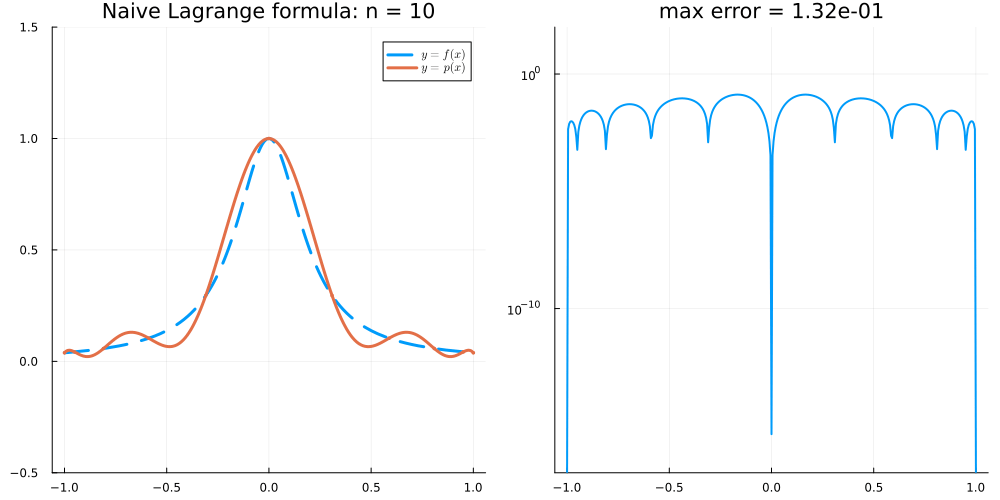

What is happening here?

::: {.exercise-hint style="display:none;"}

Underflow! The products $\prod_{k} (t - x_k)$ and $\prod_{k\not=j} (x_j - x_k)$ are of size roughly $2^{-n}$ (and the partial products computed in the code can be even smaller). Around $n \approx 800$, these partial products fall below the smallest normal double ($\approx 2.2 \times 10^{-308}$) into the subnormal range, where precision is lost.

:::

::: {.exercise-solution .draft style="display: none;"}

Mathematically nothing goes wrong: Chebyshev interpolation of the Runge function converges (geometrically), so the *exact* interpolant only gets better as $n$ grows. The breakdown is a floating-point effect: **underflow**.

*Sizes of the products.* For these nodes $|\ell_X(t)| \le 2^{1-n}$ (@exr-l07-XII), and $\prod_{k\ne j}|x_j-x_k| = 1/|\lambda_j| = \frac{2n}{2^n}$ (or $\frac{4n}{2^n}$ for $j=0,n$) by @eq-Barycentric-Chebyshev-II. So every product appearing in $\ell_j$ is of size roughly $2^{-n}$: about $10^{-235}$ for $n = 780$ and $10^{-307}$ for $n=1020$.

*Where it breaks.* Double precision numbers have about 16 significant digits only down to the smallest normal number `floatmin(Float64)` $=2^{-1022}\approx 2.2\times10^{-308}$; below that come the *subnormal* numbers, which have fewer and fewer significant bits, and below $\approx 5\times10^{-324}$ everything rounds to $0$. The lecture code does not form $\prod_{k\ne j}(t-x_k)$ in one go; it computes the two one-sided products $\prod_{k<j}(t-x_k)$ and $\prod_{k>j}(t-x_k)$ separately and then multiplies them. A one-sided product leaves out factors that may be as large as $2$, so it can be *much* smaller than the full product (which is itself already $\lesssim 2^{1-n}$). In the code below, the first subnormal one-sided products appear at $n\approx 780$, and their number grows quickly with $n$. A subnormal result carries a large relative error (or is exactly $0$); it is then divided by denominators of size $\approx 2^{-n}$, so the error is amplified and the computed $\ell_j(t)$ is garbage. This is exactly where the error in the animation jumps from $\sim 10^{-14}$ to $10^{-12}$ ($n=780$), $10^{-4}$ ($n=800$) and $O(1)$–$O(10)$ ($n\ge 860$). The denominator products $\prod_{k\ne j}(x_j-x_k) \approx 2n/2^n$ stay normal up to $n = 1020$ (they would underflow a little later).

Besides being unstable, the naive formula costs $O(n^2)$ flops per evaluation point. The barycentric formula @eq-Barycentric with the rescaled weights $(-1)^j\tau_j$ never forms these tiny products, costs $O(n)$ per point, and is stable (@Higham2004).

***Note on the lecture solution.*** The hint ("underflow") is right. More precisely: the full products ($\approx 2^{-n}$) and the denominator products are still *normal* numbers for $n \le 1020$. What first becomes subnormal (at $n\approx780$) are the one-sided numerator products $\prod_{k<j}(t-x_k)$, $\prod_{k>j}(t-x_k)$ computed in the code.


```julia
Runge = t -> 1/(1 + 25t^2)

function ℓⱼ( j, t, x )      # as in the lecture
    if j == 0
        return prod( @. t - x[2:end] ) / prod( @. x[1] - x[2:end] )
    elseif j == length(x)-1
        return prod( @. t - x[1:end-1] ) / prod( @. x[end] - x[1:end-1] )
    else
        return prod( @. t - x[1:j] ) * prod( @. t - x[(j+2):end] ) / ( prod( @. x[j+1] - x[1:j] ) * prod( @. x[j+1] - x[(j+2):end] ) )
    end
end
p_naive( t, x, y ) = sum( ℓⱼ(j, t, x) * y[j+1] for j in 0:(length(x)-1) )

egrid = range(-1, 1, length=401)      # as in the lecture
for n in [700, 760, 780, 800, 860, 1000]
    x = @. cos( π*(0:n)/n )
    err = maximum( abs(p_naive(t, x, Runge.(x)) - Runge(t)) for t in egrid )
    # one-sided numerator products computed inside ℓⱼ that are subnormal
    nsub = count( issubnormal(prod(t .- x[1:j])) || issubnormal(prod(t .- x[(j+2):end])) for t in egrid, j in 1:(n-1) )
    # smallest denominator product |∏_{k≠j}(x_j - x_k)|
    dmin = minimum( abs(prod(x[j] .- x[1:j-1]) * prod(x[j] .- x[j+1:end])) for j in 1:(n+1) )
    @printf("n = %4d: max error = %.1e,  #subnormal one-sided products = %5d,  smallest denominator = %.1e\n",
            n, err, nsub, dmin)
end
println("floatmin(Float64) = ", floatmin(Float64))
```

:::
:::

<!-- L08 -->
::: {.exercise-box #bank-exr-sum-lagrange-1}
**@exr-sum-lagrange-1**

Suppose that $X = \{ x_0 < ... < x_n \}$ and let $\ell_j$ be the corresponding Lagrange polynomials. Show that $\sum_{j=0}^n \ell_j(x) = 1$ for all $x$.

::: {.exercise-solution style="display: none;"}

Let $s(x) := \sum_{j=0}^n \ell_j(x)$. Each $\ell_j$ has degree $n$, so $s\in\mathcal P_n$. Since $\ell_j(x_i) = \delta_{ij}$,
$$
s(x_k) = \sum_{j=0}^n \delta_{jk} = 1.
$$
for all $k=0,\dots,n$. Hence $s - 1 \in \mathcal P_n$ vanishes at the $n+1$ distinct points $x_0,\dots,x_n$, so $s-1 = 0$ (a nonzero polynomial of degree $\le n$ has at most $n$ roots). Thus $\sum_j \ell_j(x) = 1$ for **all** $x\in\mathbb R$.

Equivalently: $s = \sum_j 1\cdot\ell_j = I_X 1$ is the interpolant of the constant function $1$, and $1\in\mathcal P_n$ interpolates itself, so $I_X1 = 1$ by uniqueness.

:::
:::

<!-- L08 -->
::: {.exercise-box #bank-exr-Bary-weights}
**@exr-Bary-weights**

Explain why one may instead consider any weights of the form $w_j := C \lambda_j$ in the Barycentric formula @eq-Barycentric. Why might this be a good idea? See @eq-Barycentric-Chebyshev-II for the weights appearing in the Barycentric formula for Chebyshev nodes of the second kind.

::: {.exercise-solution style="display: none;"}

Let $C\ne0$ be a constant that does **not** depend on $j$. The formula does not depend on $C$: for $x\not\in X$,
$$
\frac{\sum_{j}\frac{C\lambda_j f(x_j)}{x-x_j}}{\sum_{j}\frac{C\lambda_j}{x-x_j}}
= \frac{C\sum_{j}\frac{\lambda_j f(x_j)}{x-x_j}}{C\sum_{j}\frac{\lambda_j}{x-x_j}}
= \frac{\sum_{j}\frac{\lambda_j f(x_j)}{x-x_j}}{\sum_{j}\frac{\lambda_j}{x-x_j}} = I_Xf(x),
$$
(the denominator is nonzero because it equals $1/\ell_X(x)$ by @exr-sum-lagrange-1). 

*Why it is a good idea.*

1. **Overflow/underflow.** The true weights can be astronomically large or small. For Chebyshev nodes of the second kind $|\lambda_j| = \frac{2^n}{2n}$ (or $\frac{2^n}{4n}$): already `2.0^1024 == Inf`, so for large $n$ the formula would compute $\mathrm{Inf}/\mathrm{Inf} = \mathrm{NaN}$.
2. **Simplicity.** The rescaled Chebyshev weights are known exactly in closed form: no $O(n^2)$ computation of products and no rounding error in the weights. They are also the same on every interval: the affine map $[-1,1]\to[a,b]$ multiplies every $\lambda_j$ by the same factor $\big(\frac{2}{b-a}\big)^n$, which cancels (compare @exr-Bary-2, where $\{0,\frac\pi2,\pi\}$ gets the weights $\frac12,-1,\frac12$).

:::
:::

<!-- L08 -->
::: {.exercise-box #bank-exr-Bary-2}
**@exr-Bary-2**

Recall that the degree $2$ polynomial interpolation of $f(x) = \sin x$ on $X = \{ x_0 < x_1 < x_2 \} = \{ 0, \frac\pi2, \pi \}$ is $I_X f(x) = -\frac4{\pi^2} x(x-\pi)$. Write the Barycentric version of this formula @eq-Barycentric.

Explain how you would have to update this formula if we added an extra point $x_{3} = -2\pi$ to the interpolation set.

::: {.exercise-solution style="display: none;"}

The Barycentric formula @eq-Barycentric depends on the weights $\lambda_j = \prod_{k\not=j} (x_j-x_k)^{-1}$ which in this case are given by 

$$
\begin{align}
    \lambda_0 &= \frac{1}{(0-\frac\pi2)(0-\pi)} = \frac2{\pi^2}, \nonumber\\
    \lambda_1 &= \frac{1}{(\frac\pi2-0)(\frac\pi2 - \pi)} = -\frac4{\pi^2}, \nonumber\\
    \lambda_2 &= \frac{1}{(\pi - 0)(\pi-\frac\pi2)} = \frac2{\pi^2}
\end{align}
$$

(which makes sense because $\{ 0, \frac\pi2, \pi \}$ are Chebyshev nodes of the second kind scaled to $[0,\pi]$. The scaling only multiplies all of the weights by a common constant, which cancels in the Barycentric formula. In general, the Chebyshev weights can be chosen to be $\frac12, -1, 1, -1, \dots, (-1)^{n-1}, \frac{(-1)^n}{2}$.) 

Since $f(x_{j}) = 0$ for $j=0,2$, we have 

$$
\begin{align}
    I_Xf(x) &= \left.\left( 
        \frac{\lambda_0 f(x_0)}{x - x_0} + \frac{\lambda_1 f(x_1)}{x - x_1} + \frac{\lambda_2 f(x_2)}{x - x_2}
    \right) \middle/ \left( 
        \frac{\lambda_0}{x - x_0} + \frac{\lambda_1}{x - x_1} + \frac{\lambda_2}{x - x_2}
    \right) \right. \nonumber\\
    %
    &= \left.\left( 
        \frac{-1}{x - \frac\pi2}
    \right) \middle/ \left( 
        \frac{1/2}{x} + \frac{-1}{x - \frac\pi2} + \frac{1/2}{x - \pi}
    \right) \right.
\end{align}
$$

where, in the second line, we have multiplied all of the weights by $\frac{\pi^2}{4}$ (which does not change the formula) to obtain the weights $\frac12, -1, \frac12$.

We would have to update $\lambda_{j}$ by dividing by $x_{j} - (-2\pi)$ for each $j=0,1,2$ so we get $\lambda_0,\lambda_1,\lambda_2 = \frac{1}{\pi^3}, -\frac{8}{5\pi^3}, \frac{2}{3\pi^3}$ and write down 

$$
\begin{align}
    \lambda_3 = \frac{1}{(-2\pi-0)(-2\pi-\frac\pi2)(-2\pi-\pi)} = -\frac{1}{15\pi^3}
\end{align}
$$

:::
:::

<!-- L08 -->
::: {.exercise-box #bank-exr-l08-bary-small}
**@exr-l08-bary-small**

Let $n = 2$ and let $X = X_{\mathrm{II}} = \big\{ \cos\frac{j\pi}{2} \big\}_{j=0}^2$ be the Chebyshev nodes of the second kind, so that $x_0 = 1$, $x_1 = 0$, and $x_2 = -1$. Compute $\lambda_0, \lambda_1, \lambda_2$ directly from the definition $\lambda_j = \big( \prod_{k\not=j} (x_j - x_k) \big)^{-1}$ and check that they agree with @eq-Barycentric-Chebyshev-II.

::: {.exercise-solution style="display: none;"}

We have
$$
\begin{align}
    \lambda_0 &= \frac{1}{(1 - 0)(1 - (-1))} = \frac12, \nonumber\\
    \lambda_1 &= \frac{1}{(0 - 1)(0 - (-1))} = -1, \nonumber\\
    \lambda_2 &= \frac{1}{(-1 - 1)(-1 - 0)} = \frac12. \nonumber
\end{align}
$$
With $n = 2$, @eq-Barycentric-Chebyshev-II gives $\lambda_0 = \frac{2^2}{8} = \frac12$, $\lambda_1 = (-1)^1 \frac{2^2}{4} = -1$, and $\lambda_2 = (-1)^2 \frac{2^2}{8} = \frac12$.

:::
:::

<!-- L08 -->
::: {.exercise-box #bank-exr-l08-bary-weights .difficult}
**@exr-l08-bary-weights**

In the notes, we claimed that for the Chebyshev nodes $X_{\mathrm{II}} = \big\{ x_j = \cos\frac{j\pi}{n} \big\}_{j=0}^n$ the barycentric weights $\lambda_j := \big( \prod_{k\not=j} (x_j - x_k) \big)^{-1}$ are given by

$$
    \lambda_j = \begin{cases}
        \frac{2^{n}}{4n}  & \text{if } j = 0 \\
        (-1)^j \frac{2^{n}}{2n} & \text{if } j = 1,\dots,n-1 \\
        (-1)^n \frac{2^{n}}{4n} & \text{if } j = n
    \end{cases}
$$

Prove the claim as follows:

1. Show that $\lambda_j = 1 / \ell_X'(x_j)$, where $\ell_X(x) = \prod_{k=0}^n (x - x_k)$ is the node polynomial.
2. Show that $T_n'(\cos\theta) = n \frac{\sin n\theta}{\sin\theta}$. Using @exr-l07-XII, deduce that 
$$
    \ell_X(x) = \frac{2^{1-n}}{n} (x^2 - 1) T_n'(x).
$$
3. By differentiating $T_n(\cos\theta) = \cos n\theta$ twice, show that $T_n$ satisfies the *Chebyshev differential equation* 
$$
    (1 - x^2) T_n''(x) - x T_n'(x) + n^2 T_n(x) = 0.
$$
4. Let $w(x) := (x^2-1) T_n'(x)$. Show that 
$$
    w'(x) = x T_n'(x) + n^2 T_n(x).
$$
5. Compute $w'(x_j)$ for $j = 0,\dots,n$ and conclude.
6. Explain why we may replace $\lambda_j$ by $(-1)^j$ (halved for $j = 0, n$) in the barycentric formula. Why is this a good idea when $n$ is large?

::: {.exercise-hint style="display: none;"}

For 5, treat the interior nodes and the endpoints separately: $x_1,\dots,x_{n-1}$ are the points where $T_n$ attains $\pm 1$ in $(-1,1)$. For the endpoints, evaluate the differential equation from 3 at $x = \pm 1$ to find $T_n'(\pm1)$.

:::

::: {.exercise-solution style="display: none;"}

1. Differentiating $\ell_X(x) = (x - x_j) \prod_{k\not=j} (x - x_k)$ with the product rule and setting $x = x_j$ gives $\ell_X'(x_j) = \prod_{k\not=j} (x_j - x_k) = 1/\lambda_j$.

2. Differentiating $T_n(\cos\theta) = \cos n\theta$ gives $-\sin\theta \, T_n'(\cos\theta) = -n \sin n\theta$. Therefore, with $x = \cos\theta$,
$$
    (x^2 - 1) T_n'(x) = -\sin^2\theta \cdot n \frac{\sin n\theta}{\sin \theta} = -n \sin\theta \sin n\theta = \frac{n}{2} \big( T_{n+1}(x) - T_{n-1}(x) \big)
$$
by @exr-l07-XII. Since both sides are polynomials which agree on $[-1,1]$, they are equal, and so $\ell_X(x) = 2^{-n}\big( T_{n+1}(x) - T_{n-1}(x) \big) = \frac{2^{1-n}}{n} (x^2-1) T_n'(x)$.

3. Differentiating $-\sin\theta \, T_n'(\cos\theta) = -n \sin n\theta$ again gives $\sin^2\theta \, T_n''(\cos\theta) - \cos\theta \, T_n'(\cos\theta) = -n^2 \cos n\theta = -n^2 T_n(\cos\theta)$. With $x = \cos\theta$ and $\sin^2\theta = 1 - x^2$, this is the Chebyshev differential equation on $[-1,1]$ and therefore everywhere (both sides are polynomials).

4. By the product rule, $w' = 2x T_n' + (x^2-1) T_n''$. By 3, $(x^2-1) T_n'' = n^2 T_n - x T_n'$ and so $w' = x T_n' + n^2 T_n$.

5. For $j = 1,\dots,n-1$, $T_n(x_j) = \cos j\pi = (-1)^j$ and, since $x_j$ is an interior maximum or minimum of $T_n$, $T_n'(x_j) = 0$. Therefore $w'(x_j) = n^2 (-1)^j$. 

At $x = 1$, the differential equation gives $-T_n'(1) + n^2 T_n(1) = 0$ and so $T_n'(1) = n^2$. Therefore, $w'(x_0) = w'(1) = n^2 + n^2 = 2n^2$. Similarly, at $x = -1$, we have $T_n'(-1) = -n^2 T_n(-1) = (-1)^{n+1} n^2$ and so $w'(x_n) = w'(-1) = (-1)^n n^2 + (-1)^n n^2 = 2 (-1)^n n^2$.

By 1 and 2, $\lambda_j = 1 / \ell_X'(x_j) = \frac{n 2^{n-1}}{w'(x_j)}$, which gives 
$$
\begin{align}
    \lambda_0 = \frac{n 2^{n-1}}{2n^2} = \frac{2^n}{4n}, \qquad 
    \lambda_j = \frac{n 2^{n-1}}{(-1)^j n^2} = (-1)^j \frac{2^n}{2n}, \qquad 
    \lambda_n = \frac{n 2^{n-1}}{2(-1)^n n^2} = (-1)^n \frac{2^n}{4n}. \nonumber
\end{align}
$$

6. The barycentric formula is unchanged if every $\lambda_j$ is multiplied by the same constant $c \not= 0$ (the factor $c$ cancels between the numerator and the denominator). Taking $c = \frac{2n}{2^n}$ gives the weights $(-1)^j$, halved for $j = 0, n$. For large $n$, $2^n$ overflows in floating point arithmetic (for example, `2.0^1024 == Inf`) whereas the rescaled weights are all of size $1$ or $\frac12$.

:::
:::

<!-- L08 -->
::: {.exercise-box #bank-exr-l08-bary-equi}
**@exr-l08-bary-equi**

Let $X = \{x_0 < \dots < x_n\}$ be the equispaced nodes on $[-1,1]$: $x_j = -1 + jh$ for $j = 0, \dots, n$, where $h = \frac2n$.

1. Show that $\prod_{k\not= j} (x_j - x_k) = (-1)^{n-j} h^n \, j!\, (n-j)!$, and deduce that the barycentric weights are
$$
    \lambda_j = \frac{(-1)^{n-j}}{h^n\, n!} \binom{n}{j}.
$$
2. Using @exr-Bary-weights, explain why we may use the weights $w_j := (-1)^j \binom{n}{j}$ in the Barycentric formula @eq-Barycentric instead. Compare the ratio $\max_j |w_j| / \min_j |w_j|$ for these weights with the same ratio for the weights $(-1)^j \tau_j$ for Chebyshev nodes ($\tau_j = \frac12$ for $j = 0,n$ and $\tau_j = 1$ otherwise) as $n \to \infty$.
3. Write a function `EquispacedInterpolant(f, n)`, analogous to `ChebyshevInterpolant` from the notes, which returns the polynomial interpolant of `f` on the equispaced nodes (using the weights $w_j$ from 2; in Julia, `binomial(n, j)` computes $\binom{n}{j}$). Compute the maximum error $\max_{t} |f(t) - I_Xf(t)|$ over the grid `range(-1, 1, length=2001)` for:
    - the Runge function $f(x) = \frac{1}{1 + 25x^2}$ with $n = 10, 20, 40$,
    - $f(x) = e^x$ with $n = 10, 20, 40, 60$.

   Compare your results with the error estimate from @thm-Lagrange-interpolation together with the bound $\| \ell_X \|_{L^\infty([-1,1])} \leq \frac{e}{2\sqrt n} \big( \frac2e \big)^n$ for equispaced nodes from Lecture 6. Comment on what you see.

::: {.exercise-hint style="display: none;"}

For 1, split the product into the terms with $k < j$ (where $x_j - x_k = (j - k)h > 0$) and the terms with $k > j$ (where $x_j - x_k = -(k - j)h < 0$). For 3, think about how errors of size $10^{-16}$ in the values $f(x_j)$ (or in the arithmetic) are amplified when the weights vary by many orders of magnitude.

:::

::: {.exercise-solution style="display: none;"}

1. For $k < j$, we have $x_j - x_k = (j-k)h$ and so $\prod_{k=0}^{j-1} (x_j - x_k) = h^j \, j!$. For $k > j$, we have $x_j - x_k = -(k-j)h$ and so $\prod_{k=j+1}^{n} (x_j - x_k) = (-1)^{n-j} h^{n-j} (n-j)!$. Multiplying gives $\prod_{k\not= j} (x_j - x_k) = (-1)^{n-j} h^n \, j! \, (n-j)!$ and therefore
$$
    \lambda_j = \frac{(-1)^{n-j}}{h^n \, j! \, (n-j)!} = \frac{(-1)^{n-j}}{h^n \, n!} \binom{n}{j}.
$$

2. We have $w_j = C \lambda_j$ with the constant $C = (-1)^n h^n n!$ (which does not depend on $j$), and so the factor $C$ cancels between the numerator and the denominator of @eq-Barycentric. The smallest weights are $|w_0| = |w_n| = 1$ and the largest is $\binom{n}{\lfloor n/2 \rfloor} \approx 2^n \sqrt{\frac{2}{\pi n}}$. Therefore, the ratio grows exponentially: it is $252$ for $n = 10$, about $1.8 \times 10^5$ for $n = 20$, and about $1.2 \times 10^{17}$ for $n = 60$. For Chebyshev nodes, the ratio is $2$ for all $n$.
 
:::
:::

## Lecture 9

<!-- L09 -->
::: {.exercise-box #bank-exr-Hermite-1}
**@exr-Hermite-1**

Let $f(x) = e^x$ and $X = \{\{0, 0, 1\}\}$ (so that $z_0 = 0$ with $m_0 = 2$, $z_1 = 1$ with $m_1 = 1$, and $n = 2$). Find the Hermite interpolant $p \in \mathcal P_2$ of $f$ on $X$ by writing $p(x) = a_0 + a_1 x + a_2 x^2$ and solving for the coefficients. Compare $p$ with the Taylor polynomial of degree $1$ about $0$ and with the Lagrange interpolant of $f$ on $\{0, 1\}$.

::: {.exercise-solution style="display: none;"}

We look for $p(x) = a_0 + a_1 x + a_2 x^2 \in \mathcal P_2$ with
$$
\begin{align}
    p(0) &= f(0) = 1, \nonumber\\
    p'(0) &= f'(0) = 1, \nonumber\\
    p(1) &= f(1) = e. \nonumber
\end{align}
$$
Since $p'(x) = a_1 + 2a_2 x$, the first two conditions give $a_0 = 1$ and $a_1 = 1$. The third gives $1 + 1 + a_2 = e$, so $a_2 = e - 2$ and
$$
    p(x) = 1 + x + (e - 2) x^2.
$$

<details><summary>Code</summary>

```julia
p_H(x) = 1 + x + (ℯ - 2)*x^2   # Hermite X = {{0, 0, 1}}
p_T(x) = 1 + x                 # Taylor (or Hermite on X = {{0,0}})
p_L(x) = 1 + (exp(1) - 1)*x    # Lagrange X ={0,1}

plot(exp, -0.5, 1.5; label=L"y = e^x", lw=2, linestyle=:dash)
plot!(p_H, -0.5, 1.5; label="Hermite", lw=3)
plot!(p_T, -0.5, 1.5; label="Taylor", lw=2)
plot!(p_L, -0.5, 1.5; label="Lagrange", lw=2)
scatter!([0, 1], [1, ℯ]; markersize=5, primary=false)
```
</details>


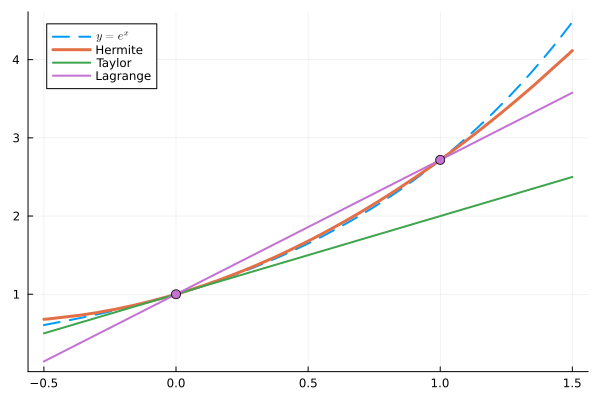

:::
:::

<!-- L09 -->
::: {.exercise-box #bank-exr-Taylor-Hermite}
**@exr-Taylor-Hermite**

What is the least degree polynomial interpolant on $X = \{\{x_0, x_0, \dots, x_0\}\}$ (where $x_0$ is repeated $n+1$ times)?

::: {.exercise-solution style="display: none;"}

The Taylor polynomial
$$
    T_f(x) = \sum_{j=0}^n \frac{f^{(j)}(x_0)}{j!} (x - x_0)^j \in \mathcal P_n
$$
satisfies $T_f^{(l)}(x_0) = f^{(l)}(x_0)$ for $l = 0, \dots, n$. So Hermite interpolation on a single node repeated $n+1$ times is Taylor expansion, and Lagrange interpolation (all $m_j = 1$) is the other extreme.

:::
:::

<!-- L09 -->
::: {.exercise-box #bank-exr-Hermite-1-Newton}
**@exr-Hermite-1-Newton**

Return to @exr-Hermite-1: compute the Hermite interpolant of $f(x) = e^x$ on $\{\{0, 0, 1\}\}$ again, this time using the divided difference table and @thm-Newton-form-Hermite.

::: {.exercise-solution style="display: none;"}

With $x_0 = x_1 = 0$ and $x_2 = 1$, the divided difference table is

$$
\begin{array}{c|ccc}
    x_j & f(x_j) & \text{1st} & \text{2nd} \\ \hline
    0 & 1 & & \\
      & & 1 & \\
    0 & 1 & & e - 2 \\
      & & e - 1 & \\
    1 & e & &
\end{array}
$$

where $f[0,0] = f'(0) = 1$ (the nodes are equal), $f[0,1] = \frac{e - 1}{1 - 0} = e - 1$, and $f[0,0,1] = \frac{f[0,1] - f[0,0]}{1 - 0} = e - 2$. With $\pi_1(x) = x$ and $\pi_2(x) = x^2$, the Newton form is
$$
    p(x) = 1 + 1 \cdot x + (e - 2) x^2,
$$
which agrees with @exr-Hermite-1. This time we did not need to solve a linear system, and adding another condition (for example $p'(1) = f'(1)$) only adds one new row to the table and one new term to $p$ (see @exr-l09-hermite-cubic).

:::
:::

<!-- L09 -->
::: {.exercise-box #bank-exr-Hermite-2}
**@exr-Hermite-2**

What is the Hermite interpolant of $f(x) = \sin x$ on $\{\{ 0,0,\pi, \pi\}\}$? Hint: you can compute the divided difference tables in the same way as before.

::: {.exercise-solution style="display: none;"}

With $x_0 = x_1 = 0$ and $x_2 = x_3 = \pi$, the divided difference table is

$$
\begin{array}{c|cccc}
    x_j & f(x_j) & \text{1st} & \text{2nd} & \text{3rd} \\ \hline
    0 & 0 & & & \\
      & & 1 & & \\
    0 & 0 & & -\frac{1}{\pi} & \\
      & & 0 & & 0 \\
    \pi & 0 & & -\frac{1}{\pi} & \\
      & & -1 & & \\
    \pi & 0 & & &
\end{array}
$$

where

$$
\begin{align}
    f[0,0] &= f'(0) = \cos 0 = 1, \nonumber\\
    f[0,\pi] &= \frac{\sin \pi - \sin 0}{\pi - 0} = 0, \nonumber\\
    f[\pi,\pi] &= f'(\pi) = \cos \pi = -1, \nonumber\\
    f[0,0,\pi] &= \frac{f[0,\pi] - f[0,0]}{\pi - 0} = -\frac1\pi, \nonumber\\
    f[0,\pi,\pi] &= \frac{f[\pi,\pi] - f[0,\pi]}{\pi - 0} = -\frac1\pi, \nonumber\\
    f[0,0,\pi,\pi] &= \frac{f[0,\pi,\pi] - f[0,0,\pi]}{\pi - 0} = 0. \nonumber
\end{align}
$$

By @thm-Newton-form-Hermite (with $\pi_1 = x$, $\pi_2 = x^2$, $\pi_3 = x^2(x-\pi)$),

$$
\begin{align}
    p(x) &= 0 + 1 \cdot x - \frac1\pi x^2 + 0 \cdot x^2(x-\pi) 
    \nonumber\\&
    = x - \frac{x^2}{\pi}.
\end{align}
$$

Check: $p(0) = 0$, $p'(0) = 1$, $p(\pi) = 0$, and $p'(\pi) = 1 - 2 = -1$. The interpolant has degree $2$ (not $3$) because the leading divided difference happens to vanish (by symmetry of $\sin$ about $\frac\pi2$).

<details><summary>Code</summary>

```julia
p = Polynomial([0, 1, -1/π])

plot(sin, -π/2, 3π/2; label=L"y = \sin x", lw=2, linestyle=:dash)
plot!(p, -π/2, 3π/2; label=L"y = p(x)", lw=3)
scatter!([0, π], [0, 0]; markersize=5, primary=false)
```
</details>


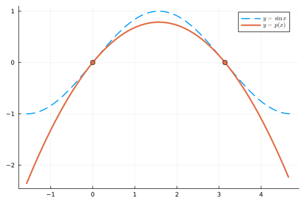

:::
:::

<!-- L09 -->
::: {.exercise-box #bank-exr-l09-hermite-exist .difficult}
**@exr-l09-hermite-exist**

In this exercise, we prove @thm-Hermite. As in the notes, let $z_0, \dots, z_k$ be distinct nodes with multiplicities $m_0, \dots, m_k \geq 1$, and let $n + 1 = \sum_{j=0}^k m_j$.

1. Let $r \in \mathcal P_n$ and suppose that $r^{(l)}(z) = 0$ for $l = 0, \dots, m-1$. Show that $r(x) = (x - z)^m s(x)$ for some polynomial $s$.
2. Suppose that $r \in \mathcal P_n$ satisfies $r^{(l)}(z_j) = 0$ for all $l = 0,\dots,m_j - 1$ and $j = 0,\dots,k$. Show that $r = 0$.
3. Deduce that the Hermite interpolation problem has at most one solution in $\mathcal P_n$.
4. Consider the map $L : \mathcal P_n \to \mathbb R^{n+1}$ defined by $L p := \big( p^{(l)}(z_j) \big)_{j = 0,\dots,k, \; l = 0, \dots, m_j - 1}$. Show that $L$ is linear and injective, and conclude that the Hermite interpolation problem has exactly one solution in $\mathcal P_n$.

::: {.exercise-hint style="display: none;"}

**1.** Write $r$ as its Taylor polynomial about $z$ (which is exact because $r$ is a polynomial). 
**2.** Apply 1 at $z_0$ and then show that $s$ still has zeros of order $m_j$ at $z_j$ for $j \geq 1$.
**4.** Use the fact that injective linear maps between vector spaces of the same finite dimension is also surjective.

:::

::: {.exercise-solution style="display: none;"}

1. Since $r \in \mathcal P_n$, Taylor's theorem is exact: 
$$
\begin{align}
    r(x) &= \sum_{l=0}^n \frac{r^{(l)}(z)}{l!} (x - z)^l \nonumber\\
    &= \sum_{l=m}^n \frac{r^{(l)}(z)}{l!} (x - z)^l \nonumber\\
    &= (x-z)^m s(x)
\end{align}
$$
where $s(x) := \sum_{l=m}^n \frac{r^{(l)}(z)}{l!} (x - z)^{l-m}$.

2. By 1, $r(x) = (x - z_0)^{m_0} s_0(x)$. Fix $j \geq 1$ and write $u(x) := (x - z_0)^{m_0}$ (with $u(z_j) \not= 0$). By the Leibniz rule,
$$
\begin{align}
    r^{(l)}(z_j) &= \sum_{i=0}^l \binom{l}{i} u^{(l-i)}(z_j) \, s_0^{(i)}(z_j) 
    \nonumber\\
    &= u(z_j) \, s_0^{(l)}(z_j) + \sum_{i=0}^{l-1} \binom{l}{i} u^{(l-i)}(z_j) \, s_0^{(i)}(z_j).
\end{align}
$$
By induction on $l = 0, \dots, m_j - 1$, we obtain $s_0^{(l)}(z_j) = 0$. Therefore, $s_0$ satisfies the same conditions at $z_1, \dots, z_k$ and, repeating the argument, we have
$$
    r(x) = (x - z_0)^{m_0} (x - z_1)^{m_1} \cdots (x - z_k)^{m_k} s(x)
$$
for some polynomial $s$. If $s \not= 0$, then $r$ has degree at least $\sum_j m_j = n+1$, which contradicts $r \in \mathcal P_n$. Therefore $s = 0$ and $r = 0$.

3. If $p, q \in \mathcal P_n$ both solve the Hermite interpolation problem, then $r := p - q \in \mathcal P_n$ satisfies $r^{(l)}(z_j) = f^{(l)}(z_j) - f^{(l)}(z_j) = 0$ for all $j$ and $l = 0, \dots, m_j-1$. By 2, $r = 0$ and so $p = q$.

4. Differentiation and evaluation are linear and so $L$ is linear. If $L p = 0$, then $p = 0$ by 2, and so $L$ is injective. Since $\dim \mathcal P_n = n + 1 = \dim \mathbb R^{n+1}$, the rank-nullity theorem shows that $L$ is also surjective. In particular, there exists $p \in \mathcal P_n$ with $L p = \big( f^{(l)}(z_j) \big)_{j,l}$, which is exactly a solution to the Hermite interpolation problem. By 3, this solution is unique.

:::
:::

<!-- L09 -->
::: {.exercise-box #bank-exr-l09-hermite-error .difficult}
**@exr-l09-hermite-error**

In this exercise, we prove the error estimate for Hermite interpolation (compare with the Lagrange case in Lecture 6). We say that $g$ has a *zero of order $m$* at $z$ if $g(z) = g'(z) = \dots = g^{(m-1)}(z) = 0$.

1. (Rolle's theorem with multiplicities) Suppose that $g \in C^1([a,b])$ has zeros at distinct points $w_1 < \dots < w_r$ in $[a,b]$ of orders $k_1, \dots, k_r$, and let $N := k_1 + \dots + k_r$. Show that $g'$ has zeros in $[w_1, w_r]$ whose orders add up to at least $N - 1$.
2. Let $f \in C^{n+1}([a,b])$, let $X = \{\{x_0, \dots, x_n\}\} \subset [a,b]$ be a multiset, and let $p \in \mathcal P_n$ be the Hermite interpolant of $f$ on $X$. Define the node polynomial $\ell_X(x) := (x - x_0)(x - x_1) \cdots (x - x_n)$ (so repeated nodes give repeated factors). Show that, for every $x \in [a,b]$, there exists $\xi_x \in [\min (\{x\} \cup X), \max (\{x\} \cup X)]$ with
$$
    f(x) - p(x) = \frac{f^{(n+1)}(\xi_x)}{(n+1)!} \ell_X(x).
$$

::: {.exercise-hint style="display: none;"}

1. At each $w_i$ the derivative $g'$ has a zero of order $k_i - 1$, and Rolle's theorem gives one more zero strictly between each pair $w_i < w_{i+1}$. 
2. Copy the proof from Lecture 6: for $x \not\in X$, consider 
$$
    g(t) := f(t) - p(t) - \big[ f(x) - p(x) \big] \frac{\ell_X(t)}{\ell_X(x)}
$$ 
and count its zeros with their orders.

:::

::: {.exercise-solution style="display: none;"}

1. At each $w_i$, $g'$ has a zero of order $k_i - 1$ (because $g', \dots, g^{(k_i-1)}$ vanish at $w_i$). Moreover, for each $i = 1, \dots, r-1$, $g(w_i) = g(w_{i+1}) = 0$ and so, by Rolle's theorem, $g'$ has a zero in $(w_i, w_{i+1})$, which is different from all of the $w_i$. Adding these up, the orders of the zeros of $g'$ in $[w_1, w_r]$ add up to at least
$$
    \sum_{i=1}^r (k_i - 1) + (r - 1) = N - 1.
$$

2. If $x \in X$, then both sides are zero (take any $\xi_x$). Otherwise $\ell_X(x) \not= 0$ and we can define
$$
    g(t) := f(t) - p(t) - \big[ f(x) - p(x) \big] \frac{\ell_X(t)}{\ell_X(x)}.
$$
Then $g \in C^{n+1}$. If $z$ appears $m$ times in $X$, then $f - p$ has a zero of order $m$ at $z$ (by the Hermite conditions) and so does $\ell_X$ (it contains the factor $(t - z)^m$). Therefore $g$ has a zero of order $m$ at $z$. Moreover, $g(x) = 0$. So the orders of the zeros of $g$ add up to (at least) $(n + 1) + 1 = n + 2$. Applying 1 $n+1$ times, $g^{(n+1)}$ has a zero $\xi_x$ in $[\min (\{x\} \cup X), \max (\{x\} \cup X)]$. Since $p \in \mathcal P_n$ and $\ell_X$ is monic of degree $n + 1$, we have $p^{(n+1)} = 0$ and $\ell_X^{(n+1)} = (n+1)!$, and so
$$
    0 = g^{(n+1)}(\xi_x) = f^{(n+1)}(\xi_x) - \big[ f(x) - p(x) \big] \frac{(n+1)!}{\ell_X(x)}.
$$
Rearranging gives the result.

:::
:::

<!-- L09 -->
::: {.exercise-box #bank-exr-l09-hermite-cubic name="Cubic Hermite interpolation"}
**@exr-l09-hermite-cubic**

Let $X = \{\{0, 0, 1, 1\}\}$ and suppose that we know $f(0) = y_0$, $f'(0) = s_0$, $f(1) = y_1$ and $f'(1) = s_1$.

1. Compute the divided difference table and show that the Hermite interpolant of $f$ on $X$ is
$$
\begin{align}
    p(x) &= y_0 + s_0 x + (d - s_0) x^2 + (s_0 + s_1 - 2d) \, x^2 (x - 1)
\end{align}
$$
where $d := y_1 - y_0$.
2. Write down $p$ for $f(x) = e^x$ and compare it with @exr-Hermite-1.
3. Use @exr-l09-hermite-error to show that $\max_{x \in [0,1]} |e^x - p(x)| \leq \frac{e}{384}$.
4. More generally, suppose that $p$ is the Hermite interpolant of $f$ on $\{\{a, a, b, b\}\}$. Show that $\max_{x \in [a,b]} |f(x) - p(x)| \leq \frac{(b-a)^4}{384} \max_{[a,b]} |f^{(4)}|$. What does this tell you about approximating $f$ on $[a,b]$ by a cubic Hermite interpolant on each $n$ subintervals of length $h = \frac{b-a}{n}$?

::: {.exercise-solution style="display: none;"}

1. With $x_0 = x_1 = 0$ and $x_2 = x_3 = 1$, the table is
$$
\begin{array}{c|cccc}
    x_j & f(x_j) & \text{1st} & \text{2nd} & \text{3rd} \\ \hline
    0 & y_0 & & & \\
      & & s_0 & & \\
    0 & y_0 & & d - s_0 & \\
      & & d & & s_0 + s_1 - 2d \\
    1 & y_1 & & s_1 - d & \\
      & & s_1 & & \\
    1 & y_1 & & &
\end{array}
$$
since $f[0,0] = f'(0) = s_0$, $f[0,1] = \frac{y_1 - y_0}{1 - 0} = d$, $f[1,1] = f'(1) = s_1$, $f[0,0,1] = \frac{d - s_0}{1 - 0}$, $f[0,1,1] = \frac{s_1 - d}{1 - 0}$, and $f[0,0,1,1] = (s_1 - d) - (d - s_0)$. By @thm-Newton-form-Hermite with $\pi_1 = x$, $\pi_2 = x^2$ and $\pi_3 = x^2(x-1)$, we get the formula for $p$. (Check: $p(1) = y_0 + s_0 + d - s_0 = y_1$ and $p'(1) = s_0 + 2(d - s_0) + (s_0 + s_1 - 2d) = s_1$.)

2. Here $y_0 = s_0 = 1$, $y_1 = s_1 = e$ and $d = e - 1$, so
$$
    p(x) = 1 + x + (e - 2) x^2 + (3 - e) \, x^2 (x - 1).
$$
The first three terms are exactly the interpolant from @exr-Hermite-1 on $\{\{0, 0, 1\}\}$: adding the condition $p'(1) = f'(1)$ only adds one new term to the Newton form.

3. By @exr-l09-hermite-error, $e^x - p(x) = \frac{e^{\xi_x}}{4!} x^2 (x-1)^2$ for some $\xi_x \in [0,1]$. The function $x(1 - x)$ has maximum $\frac14$ on $[0,1]$ (at $x = \frac12$), and so $|e^x - p(x)| \leq \frac{e}{24} \cdot \frac{1}{16} = \frac{e}{384} \approx 7.1 \times 10^{-3}$. (Numerically, the maximum error is about $4.4 \times 10^{-3}$.)

4. In the same way, $|f(x) - p(x)| \leq \frac{\max |f^{(4)}|}{24} (x - a)^2 (x - b)^2$ and $(x-a)(b-x) \leq \big(\frac{b - a}{2}\big)^2$, which gives the bound $\frac{(b-a)^4}{16 \cdot 24} \max |f^{(4)}|$. On $n$ subintervals of length $h$, the error is at most $\frac{h^4}{384} \max_{[a,b]} |f^{(4)}|$: halving $h$ divides the error bound by $16$. Moreover, neighbouring cubics share their values and slopes at the break points, so the resulting piecewise cubic is continuously differentiable. (This is *piecewise cubic Hermite interpolation*.)

:::
:::

<!-- L09 -->
::: {.exercise-box #bank-exr-l09-dd-mean-value .difficult}
**@exr-l09-dd-mean-value**

1. Let $f \in C^n([a,b])$ and let $X = \{\{x_0, \dots, x_n\}\} \subset [a,b]$ be a multiset. Show that there exists $\xi \in [\min X, \max X]$ with
$$
    f[x_0, \dots, x_n] = \frac{f^{(n)}(\xi)}{n!}.
$$
2. Deduce that $f[x_0, x_0 + h] \to f'(x_0)$ and, more generally, 
$$
    f[x_0, x_0 + h, \dots, x_0 + nh] \to \frac{f^{(n)}(x_0)}{n!}
$$ 
as $h \to 0$. Explain why this makes the first case of @thm-divided-diffs-recursion a natural definition.

::: {.exercise-hint style="display: none;"}

1. Let $p$ be the Hermite interpolant of $f$ on $X$ and apply part 1 of @exr-l09-hermite-error to $g := f - p$. What is $p^{(n)}$?

:::

::: {.exercise-solution style="display: none;"}

1. Let $p \in \mathcal P_n$ be the Hermite interpolant of $f$ on $X$. Then $g := f - p$ has zeros whose orders add up to $n + 1$ (a zero of order $m$ at each node appearing $m$ times). Applying part 1 of @exr-l09-hermite-error $n$ times, $g^{(n)}$ has a zero $\xi \in [\min X, \max X]$. Since $p(x) = f[x_0, \dots, x_n] x^n + q(x)$ with $q \in \mathcal P_{n-1}$, we have $p^{(n)} = n! \, f[x_0,\dots,x_n]$ and so $0 = f^{(n)}(\xi) - n! \, f[x_0, \dots, x_n]$. (If all the nodes are equal, then $\xi = x_0$ and this is the first case of @thm-divided-diffs-recursion.)

2. By 1, $f[x_0, x_0 + h, \dots, x_0 + nh] = \frac{f^{(n)}(\xi_h)}{n!}$ for some $\xi_h$ between $x_0$ and $x_0 + nh$. As $h \to 0$, $\xi_h \to x_0$ and, since $f^{(n)}$ is continuous, $f^{(n)}(\xi_h) \to f^{(n)}(x_0)$. So the divided difference on $n+1$ nearby nodes converges to $\frac{f^{(n)}(x_0)}{n!}$ as the nodes merge. Defining $f[x_0, \dots, x_0] := \frac{f^{(n)}(x_0)}{n!}$ makes the divided difference continuous in the nodes, and Hermite interpolation is the limit of Lagrange interpolation as nodes come together.

:::
:::

<!-- L09 -->
::: {.exercise-box #bank-exr-l09-hermite-code}
**@exr-l09-hermite-code**

1. Write a Julia function `hermite_dd(x, df)` which takes a vector of nodes `x` (sorted so that equal nodes are next to each other) and a function `df(l, z)` returning $f^{(l)}(z)$, and returns the Newton coefficients $f[x_0], f[x_0,x_1], \dots, f[x_0,\dots,x_n]$ using the divided difference table.
2. Write a function `newton_eval(c, x, t)` which evaluates $\sum_{k=0}^n c_k \pi_k(t)$ using $O(n)$ operations.
3. Check your code against @exr-Hermite-1, @exr-Hermite-2, and @exr-l09-hermite-cubic, and compute $\max_{t \in [0,1]} |e^t - p(t)|$ for the cubic Hermite interpolant of $e^x$ on $\{\{0,0,1,1\}\}$.

::: {.exercise-hint style="display: none;"}

2. Use nested multiplication (Horner's method): $c_0 + (t - x_0)\big(c_1 + (t - x_1)\big(c_2 + \cdots\big)\big)$.

:::

::: {.exercise-solution style="display: none;"}

<details><summary>Code</summary>

```julia
function hermite_dd( x, df )
    n = length(x) - 1
    T = zeros(n+1, n+1)              # T[j+1, k+1] = f[x_j, ..., x_{j+k}]
    for j ∈ 0:n
        T[j+1, 1] = df(0, x[j+1])
    end
    for k ∈ 1:n, j ∈ 0:(n-k)
        if x[j+k+1] == x[j+1]        # all nodes equal
            T[j+1, k+1] = df(k, x[j+1]) / factorial(k)
        else
            T[j+1, k+1] = (T[j+2, k] - T[j+1, k]) / (x[j+k+1] - x[j+1])
        end
    end
    return T[1, :]                   # top diagonal
end

function newton_eval( c, x, t )
    p = c[end]
    for k ∈ (length(c)-1):-1:1
        p = c[k] + (t - x[k]) * p
    end
    return p
end

dsin(l, z) = (sin(z), cos(z), -sin(z), -cos(z))[l % 4 + 1]
dexp(l, z) = exp(z)

X = [0, 0, 1, 1]
c = hermite_dd(X, dexp)
t = range(0, 1, length=10001)
err = maximum( abs.( exp.(t) .- newton_eval.(Ref(c), Ref(X), t) ) )

println("Hermite-1, e^x on {{0,0,1}}:")
println("  computed: ", hermite_dd([0, 0, 1], dexp))
println("  exact:    ", [1, 1, ℯ - 2])
println("Hermite-2, sin x on {{0,0,π,π}}:")
println("  computed: ", hermite_dd([0, 0, π, π], dsin))
println("  exact:    ", [0, 1, -1/π, 0])
println("Cubic Hermite, e^x on {{0,0,1,1}}:")
println("  computed: ", c)
println("  exact:    ", [1, 1, ℯ - 2, 3 - ℯ])
println("max |e^t - p(t)| on [0,1] = ", err, "  (bound e/384 = ", ℯ/384, ")")
```
</details>


```
Hermite-1, e^x on {{0,0,1}}:
  computed: [1.0, 1.0, 0.7182818284590451]
  exact:    [1.0, 1.0, 0.7182818284590451]
Hermite-2, sin x on {{0,0,π,π}}:
  computed: [0.0, 1.0, -0.3183098861837907, 0.0]
  exact:    [0.0, 1.0, -0.3183098861837907, 0.0]
Cubic Hermite, e^x on {{0,0,1,1}}:
  computed: [1.0, 1.0, 0.7182818284590451, 0.2817181715409549]
  exact:    [1.0, 1.0, 0.7182818284590451, 0.2817181715409549]
max |e^t - p(t)| on [0,1] = 0.004371001067176472  (bound e/384 = 0.007078858928278763)

```


The table needs $O(n^2)$ operations and `newton_eval` needs $O(n)$ operations per point.

:::
:::

## Lecture 10

<!-- L10 -->
::: {.exercise-box #bank-exr-l10-recap name="Recap of last week"}
**@exr-l10-recap**

1. Compute the divided difference table for $f(x) = x^2$ on $\{0, 1, 2\}$ and write down the Newton form of the interpolant. What do you notice?
2. What are $f[x_0, x_0]$ and $f[x_0, x_0, x_0]$?
3. Why do we prefer the barycentric formula @eq-Barycentric to the naive Lagrange formula?
4. What is the Hermite interpolant of $f$ on $\{\{a, a\}\}$? How many conditions does the Hermite interpolant on $\{\{0, 0, 1\}\}$ satisfy, and what is its degree?
5. The next iterate of Newton's method is the root of which interpolant of $f$? What about the secant method?

::: {.exercise-solution style="display: none;"}

1. $f[0] = f(0) = 0$, $f[1] = f(1) = 1$, $f[2] = f(2) = 4$; $f[0,1] = \frac{f(1)-f(0)}{1-0} = 1$, $f[1,2] = \frac{f(1)-f(2)}{1-2} = 3$; $f[0,1,2] = \frac{f[1,2] - f[0,1]}{2-0} = \frac{3 - 1}{2 - 0} = 1$. So $p(x) = 0 + 1 \cdot x + 1 \cdot x(x-1) = x^2$: the interpolant is $f$ itself, as it must be since $f \in \mathcal P_2$.
2. $f[x_0, x_0] = f'(x_0)$ and $f[x_0, x_0, x_0] = \frac{f''(x_0)}{2}$.
3. Once the weights are known, the barycentric formula costs $O(n)$ operations per evaluation (the naive formula costs $O(n^2)$), it is numerically stable, and the weights may be rescaled to avoid overflow/underflow (@exr-Bary-1, @exr-Bary-weights).
4. The tangent line $p(x) = f(a) + f'(a)(x - a)$ (the degree $1$ Taylor polynomial). On $\{\{0,0,1\}\}$ there are $3$ conditions ($p(0) = f(0)$, $p'(0) = f'(0)$, $p(1) = f(1)$) and $p \in \mathcal P_2$.
5. Newton: $x_{n+1}$ is the root of the Hermite interpolant on $\{\{x_n, x_n\}\}$ (the tangent line). Secant: $x_{n+1}$ is the root of the Lagrange interpolant on $\{x_{n-1}, x_n\}$ (the secant line).

:::
:::

<!-- L10 -->
::: {.exercise-box #bank-exr-l10-why-quadrature name="Why approximate integrals?"}
**@exr-l10-why-quadrature**

Can you compute $\int_0^1 e^{-x^2} \,\mathrm{d}x$ or $\int_0^1 \frac{\sin x}{x} \,\mathrm{d}x$ exactly?

::: {.exercise-solution style="display: none;"}

No: neither integrand has an antiderivative that can be written in terms of elementary functions. (Also, in practice we may only know $f$ at some points.) This is why we need quadrature rules.

(One defines

\begin{align}
    \mathrm{erf}(x) &:= \frac{2}{\sqrt{\pi}} \int_0^x e^{-t^2} \mathrm{d}t \nonumber\\
    %
    \mathrm{Si}(x) &:= \int_0^x \frac{\sin t}{t} \mathrm{d}t
\end{align}

with $\lim_{x\to\infty}\mathrm{erf}(x)=1$ and $\mathrm{Si}(x) \to \frac{\pi}{2}$.)

:::
:::

<!-- L10 -->
::: {.exercise-box #bank-exr-l10-model-integral}
**@exr-l10-model-integral**

Show that $\int_0^{2\pi} \frac{1}{2\pi}(x + x \sin x) \,\mathrm{d}x = \pi - 1$.

::: {.exercise-solution style="display: none;"}

Integrating by parts gives 

\begin{align}
\int_0^{2\pi} x \sin x \,\mathrm{d}x 
%
&= \int_0^{2\pi} x (-\cos' x) \,\mathrm{d}x \nonumber\\
%
&= \big[ -x \cos x \big]_0^{2\pi} + \int_0^{2\pi} \cos x \,\mathrm{d}x \nonumber\\
%
&= -2\pi.
\end{align}

Therefore the integral of $(x+x\sin x)/2\pi$ on $[0,2\pi]$ is $\frac{1}{2\pi} \big( 2\pi^2 - 2\pi \big) = \pi - 1$.

:::
:::

<!-- L10 -->
::: {.exercise-box #bank-exr-l10-mvt name="Interpolation error with one node"}
**@exr-l10-mvt**

Write down the interpolation error formula for $f - p$ when $p$ interpolates $f$ on $n+1$ nodes (@thm-Lagrange-interpolation). What does it say when $n = 0$ and $X = \{a\}$?

::: {.exercise-solution style="display: none;"}

We have: for $x$, there exists $\xi_x$ between $\min\{ x, \min X\}$ and $\max\{x,\max X\}$ such that 

\begin{align}
f(x) - p(x) &= \frac{f^{(n+1)}(\xi_x)}{(n+1)!} \ell_X(x)
\end{align}

where $\ell_X$ is the node polynomial on $X$. For $n = 0$ and $X = \{a\}$, $p = f(a)$ and this reads $f(x) - f(a) = f'(\xi_x)(x - a)$ for some $\xi_x$ between $a$ and $x$ (which is just the mean value theorem)

:::
:::

<!-- L10 -->
::: {.exercise-box #bank-exr-l10-rectangular-error name="Error estimate"}
**@exr-l10-rectangular-error**

Suppose $f \in C^1([a,b])$. Show that

$$
\begin{align}
    \left| \int_{a}^b f - (b-a) f(a) \right| \leq \| f'\|_{L^\infty([a,b])} \frac{(b-a)^2}{2}.
\end{align}
$$

::: {.exercise-solution style="display: none;"}

Since $p_0$ is a degree zero interpolating polynomial, we may apply the error bound we had for interpolation (@thm-Lagrange-interpolation): 

$$
\begin{align}
    f(x) - p_0(x) = f'(\xi_x) (x - a) 
\end{align}
$$

for some $\xi_x \in [a, x]$ (in this case, this is just the mean value theorem). Therefore, integrating this over $[a,b]$, we have the bound

$$
\begin{align}
    \left| \int_{a}^b \big[ f(x) - p_0(x) \big] \mathrm{d}x \right| 
    %
    &\leq \| f'\|_{L^\infty([a,b])} \int_a^b |x - a| \mathrm{d}x \nonumber\\
    &= \| f'\|_{L^\infty([a,b])} \int_{0}^{b-a} t \,\mathrm{d}t \nonumber\\
    %
    &= \| f'\|_{L^\infty([a,b])} \frac{(b-a)^2}{2}. \nonumber
\end{align}
$$

:::
:::

<!-- L10 -->
::: {.exercise-box #bank-exr-l10-riemann}
**@exr-l10-riemann**

Approximate $\int_0^1 x \,\mathrm{d}x$ by the composite rectangular rule with $n$ subintervals of equal length. What is the error?

::: {.exercise-solution style="display: none;"}

First, note that $\int_0^1 x \mathrm{d}x = \frac12$.

The composite rectangular rule on $[0,1]$ is $\frac1n \sum_{j=0}^{n-1} \frac{j}{n} = \frac{n-1}{2n} = \frac12 - \frac{1}{2n}$, so the error is exactly $\frac{1}{2n}$: the rate $O(n^{-1})$ of @thm-rectangular-composite (and the constant $\frac{\|f'\|_{L^\infty}}{2}(b-a)^2 = \frac12$ is attained).

:::
:::

<!-- L10 -->
::: {.exercise-box #bank-exr-l10-trapezoid-rule}
**@exr-l10-trapezoid-rule**

1. Write down the polynomial $p_1$ of degree at most $1$ interpolating $f$ on $X = \{a, b\}$.
2. Show that $\int_a^b p_1(x) \,\mathrm{d}x = \frac{b-a}{2} \big( f(a) + f(b) \big)$.

::: {.exercise-hint style="display: none;"}

You can either go through the details in the integration, or draw a picture and calculate the area of the trapezium with points $(a,0), (a,f(a)), (b, f(b)), (b,0)$. If you do the integration explicitly, the Newton form is probably slightly easier...

:::

::: {.exercise-solution style="display: none;"}

*Lagrange form*:

1. We have $p_1(x) = \frac{x-b}{a-b}f(a) + \frac{x-a}{b-a} f(b)$.

2. We have
$$
\begin{align}
    \int_a^b \frac{x-b}{a-b} \,\mathrm{d}x 
    %
    &= \frac{1}{a-b} \Big[ \frac{(x-b)^2}{2} \Big]_a^b 
    %
    \nonumber\\
    %
    &= - \frac{(a-b)^2}{2(a-b)} = \frac{b-a}{2}
    \nonumber\\
    \int_a^b \frac{x-a}{b-a} \,\mathrm{d}x &= \frac{1}{b-a} \Big[ \frac{(x-a)^2}{2} \Big]_a^b 
    \nonumber\\
    &= \frac{b-a}{2}, \nonumber
\end{align}
$$
and so $\int_a^b p_1 = \frac{b-a}{2} f(a) + \frac{b-a}{2} f(b)$. 

*Newton form*:

1. $p_1(x) = f(a) + \frac{f(b)-f(a)}{b-a} (x-a)$, 
2. Integrating gives 
$$
\begin{align}
    \int_a^b (x-a) \mathrm{d}x &= \frac12 (x-a)^2\Big|_a^b \nonumber\\
    %
    &= \frac12 (b-a)^2
\end{align}
$$
and the result follows.

:::
:::

<!-- L10 -->
::: {.exercise-box #bank-exr-l10-node-sign}
**@exr-l10-node-sign**

What is the sign of $(x-a)(x-b)$ on $[a,b]$? Compute $\int_a^b |(x-a)(x-b)| \,\mathrm{d}x$.

::: {.exercise-hint style="display: none;"}

Make the substitution $t := x - \frac{a+b}{2}$ and define $h := b-a$.

:::

::: {.exercise-solution style="display: none;"}

We have $(x-a)(x-b) \leq 0$ on $[a,b]$, so 

\begin{align}
\int_a^b |(x-a)(x-b)| \,\mathrm{d}x 
%
&= -\int_a^b (x-a)(x-b) \,\mathrm{d}x \nonumber\\
%
&= \int_{-h/2}^{h/2} \big( \tfrac{h^2}{4} -t^2 \big) \mathrm{d}t \nonumber\\
%
&= \tfrac{h^3}{4} - \Big[ \frac{t^3}{3} \Big]_{-h/2}^{h/2} \nonumber\\
%
&= \tfrac{h^3}{4} - \frac{h^3}{12}
\nonumber\\
%
&= \frac{(b-a)^3}{6}.
\end{align}

:::
:::

<!-- L10 -->
::: {.exercise-box #bank-exr-l10-midpoint name="Midpoint rule"}
**@exr-l10-midpoint**

The *midpoint rule* is $\int_a^b f \approx (b-a) f\big(\tfrac{a+b}{2}\big)$.

1. Show that the midpoint rule is exact for all polynomials of degree at most $1$.
2. Suppose $f \in C^2([a,b])$. Show that
$$
    \left| \int_a^b f - (b-a) f\big(\tfrac{a+b}{2}\big) \right| \leq \frac{\|f''\|_{L^\infty([a,b])}}{24} (b-a)^3.
$$
3. Write down the composite midpoint rule on $n$ subintervals of equal length and show that its error is bounded by $\frac{\|f''\|_{L^\infty([a,b])}}{24} \frac{(b-a)^3}{n^2}$. Compare with @thm-trapezoid-composite.

::: {.exercise-hint style="display: none;"}

For 2, use Taylor's theorem about $m = \frac{a+b}{2}$: 

\begin{align}
    f(x) = f(m) + f'(m)(x - m) + \frac{f''(\xi_x)}{2}(x-m)^2.
\end{align}

:::

::: {.exercise-solution style="display: none;"}

Let $m = \frac{a+b}{2}$.

1. For $f = 1$: $\int_a^b 1 = b - a = (b-a) \cdot 1$. For $f = x - m$: 
$$
\begin{align}
    \int_a^b (x - m) \,\mathrm{d}x &= 0 
    \nonumber\\
    %
    &= (b-a)(m - m).
\end{align}
$$

1. By Taylor's theorem, 
$$
\begin{align}
    f(x) = f(m) + f'(m)(x-m) + \frac{f''(\xi_x)}{2} (x-m)^2
\end{align}
$$ 
for some $\xi_x$ between $m$ and $x$. Integrating and using $\int_a^b (x - m) \,\mathrm{d}x = 0$,
$$
\begin{align}
    \left| \int_a^b f - (b-a) f(m) \right| 
    %
    &= \left| \int_a^b \frac{f''(\xi_x)}{2} (x-m)^2 \,\mathrm{d}x \right| \nonumber\\
    %
    &\leq \frac{\|f''\|_{L^\infty([a,b])}}{2} \int_a^b (x - m)^2 \,\mathrm{d}x 
    \nonumber\\
    %
    &= \frac{\|f''\|_{L^\infty([a,b])}}{2} \frac{(b-a)^3}{12}.
\end{align}
$$

1. With $x_j = a + j \frac{b-a}{n}$, the composite rule is $\frac{b-a}{n} \sum_{j=0}^{n-1} f\big( \frac{x_j + x_{j+1}}{2} \big)$. Applying 2 on each subinterval of length $\frac{b-a}{n}$ and summing the $n$ errors gives
$$
\begin{align}
    n \cdot \frac{\|f''\|_{L^\infty([a,b])}}{24} \Big( \frac{b-a}{n} \Big)^3 
    %
    &= \frac{\|f''\|_{L^\infty([a,b])}}{24} \frac{(b-a)^3}{n^2}.
\end{align}
$$
This is the same rate $O(n^{-2})$ as the composite trapezoid rule, but with half the constant (and one fewer function evaluation).

:::
:::

<!-- L10 -->
::: {.exercise-box #bank-exr-l10-weights name="Properties of interpolatory weights" .difficult}
**@exr-l10-weights**

Let $x_0, \dots, x_n \in [a,b]$ be distinct and let $w_j = \int_a^b \ell_j$ be the weights in @eq-interpolatory-quadrature.

1. Show that $\{w_j\}$ are the *unique* weights for which $\sum_{j=0}^n w_j f(x_j)$ is exact for all $f \in \mathcal P_n$.
2. Show that $\sum_{j=0}^n w_j = b - a$.
3. Let $\hat x_j \in [0,1]$ and let $\hat w_j$ be the corresponding weights on $[0,1]$. Show that the nodes $x_j = a + (b-a) \hat x_j$ on $[a,b]$ have weights $w_j = (b-a) \hat w_j$.
4. Suppose the nodes are symmetric: $x_{n-j} = a + b - x_j$ for all $j$. Show that $w_{n-j} = w_j$.

::: {.exercise-hint  style="display: none;"}

1. What happens if you apply the rule to $f(x) = \ell_j(x)$?
2. What happens if you apply the rule to $f(x) = 1$?
3. Use $w_j = \int_a^b \ell_j$,
4. Show that $\ell_{n-j}(x) = \ell_j(a + b - x)$ by checking the values of both sides at the nodes.

:::

::: {.exercise-solution style="display: none;"}

1. If $f \in \mathcal P_n$ then $f$ is its own interpolant, $f = \sum_j \ell_j f(x_j)$, and so $\int_a^b f = \sum_j w_j f(x_j)$ and the rule is exact. Conversely, if $\sum_j v_j f(x_j)$ is exact on $\mathcal P_n$, then applying it to $\ell_j \in \mathcal P_n$ gives $v_j = \sum_k v_k \ell_j(x_k) = \int_a^b \ell_j = w_j$, as required.

2. Apply 1 to $f = 1$: $b - a = \int_a^b 1 = \sum_j w_j$.

3. Write $x = a + (b-a) t$. Since $x - x_j = (b-a)(t - \hat x_j)$, we have
$$
\begin{align}
    \ell_j(x) &= \prod_{k \not= j} \frac{x - x_k}{x_j - x_k} 
    \nonumber\\
    %
    &= \prod_{k\not=j} \frac{t - \hat x_k}{\hat x_j - \hat x_k} 
    \nonumber\\
    %
    &= \hat \ell_j(t).
\end{align}
$$
Therefore 
$$
\begin{align}
    w_j = \int_a^b \ell_j(x) \,\mathrm{d}x = (b-a) \int_0^1 \hat\ell_j(t) \,\mathrm{d}t = (b-a) \hat w_j.
\end{align}
$$

1. Let $q(x) := \ell_j(a + b - x) \in \mathcal P_n$. Then $q(x_{n-k}) = \ell_j(x_k) = \delta_{jk}$. That is, $q(x_k) = \delta_{k, n-j}$, so $q = \ell_{n-j}$. Substituting $y = a + b - x$,
$$
\begin{align}
    w_{n-j} &= \int_a^b \ell_j(a+b-x) \,\mathrm{d}x \nonumber\\
    %
    &= \int_a^b \ell_j(y) \,\mathrm{d}y \nonumber\\
    %
    &= w_j.
\end{align}
$$

:::
:::

## Quiz 3

<!-- Q3 -->
::: {.exercise-box #bank-q3-1 release="now"}
**Quiz 3: Exercise 1**

Let $f(x) = |x|$ and $X = \{x_0, x_1, x_2\} = \{-1, 0, 1\}$. Find the polynomial interpolant $I_Xf \in \mathcal P_2$ of $f$ on $X$ in (i) Lagrange form, (ii) Barycentric form, and (iii) Newton form.

*Hints:* For $x \notin X$,

\begin{align}
 I_Xf(x) &= \sum_{j=0}^2 f(x_j)\, \ell_j(x) && \text{(Lagrange)} \nonumber\\
 &= \left. \sum_{j=0}^2 \frac{\lambda_j f(x_j)}{x - x_j} \middle/ \sum_{j=0}^2 \frac{\lambda_j}{x - x_j} \right. && \text{(Barycentric)} \nonumber\\
 &= f(x_0) + f[x_0, x_1]\,(x - x_0) + f[x_0, x_1, x_2]\,(x - x_0)(x - x_1) && \text{(Newton)} \nonumber
\end{align}

where $\ell_j(x) = \prod_{k \neq j} \frac{x - x_k}{x_j - x_k}$ are the Lagrange polynomials, $\lambda_j = \frac{1}{\prod_{k\neq j}(x_j - x_k)}$ are the Barycentric weights, and $f[x_j] = f(x_j)$, $f[x_0, \dots, x_n] = \frac{f[x_1, \dots, x_n] - f[x_0, \dots, x_{n-1}]}{x_n - x_0}$ are the divided differences. You may use:
$$
\ell_0(x) = \frac{x(x-1)}{2}, \quad \ell_2(x) = \frac{x(x+1)}{2},
\qquad
\lambda_0 = \frac12, \quad \lambda_1 = -1, \quad \lambda_2 = \frac12,
\qquad
\begin{array}{c|ccc}
 x_j & f(x_j) & \text{1st} & \text{2nd} \\ \hline
 -1 & 1 & & \\
    & & -1 & \\
 0 & 0 & & 1 \\
   & & 1 & \\
 1 & 1 & &
\end{array}
$$

::: {.exercise-solution style="display: none;"}

We have $f(-1) = 1$, $f(0) = 0$, $f(1) = 1$. (In each case, the answer simplifies to $I_Xf(x) = x^2$.)

(i) The Lagrange polynomials are
$$
\begin{align}
    \ell_0(x) &= \frac{x(x-1)}{(-1)(-2)} = \frac{x(x-1)}{2}, \nonumber\\
    \ell_1(x) &= \frac{(x+1)(x-1)}{(1)(-1)} = 1 - x^2, \nonumber\\
    \ell_2(x) &= \frac{(x+1)x}{(2)(1)} = \frac{x(x+1)}{2}, \nonumber
\end{align}
$$
and so $I_Xf(x) = 1 \cdot \ell_0(x) + 0 \cdot \ell_1(x) + 1 \cdot \ell_2(x) = \frac{x(x-1)}{2} + \frac{x(x+1)}{2} \;(= x^2)$.

(ii) $\lambda_0 = \frac{1}{(-1-0)(-1-1)} = \frac12$, $\lambda_1 = \frac{1}{(0+1)(0-1)} = -1$, $\lambda_2 = \frac{1}{(1+1)(1-0)} = \frac12$, so for $x \notin X$,

\begin{align}
    I_Xf(x) = \frac{\frac{1/2}{x+1} + \frac{1/2}{x-1}}{\frac{1/2}{x+1} - \frac{1}{x} + \frac{1/2}{x-1}}
    \qquad \Big( = \frac{\frac{x}{x^2-1}}{\frac{1}{x(x^2-1)}} = x^2 \Big). \nonumber
\end{align}

(Any multiple of the weights, e.g. $1, -2, 1$, is also fine.)

(iii) $f[x_1, x_2] = \frac{1 - 0}{1 - 0} = 1$ and $f[x_0, x_1, x_2] = \frac{1 - (-1)}{1 - (-1)} = 1$:

$$
\begin{array}{c|ccc}
    x_j & f(x_j) & \text{1st} & \text{2nd} \\ \hline
    -1 & 1 & & \\
       & & -1 & \\
    0 & 0 & & 1 \\
      & & 1 & \\
    1 & 1 & &
\end{array}
$$

So $I_Xf(x) = 1 - (x+1) + (x+1)x \;(= x^2)$.

:::
:::

<!-- Q3 -->
::: {.exercise-box #bank-q3-2 release="now"}
**Quiz 3: Exercise 2**

In this question, we prove that $\cos\frac\pi8 = \frac{\sqrt{2 + \sqrt2}}{2}$. Recall that the Chebyshev polynomials satisfy $T_n(\cos\theta) = \cos n\theta$.

(a) Show that $T_m\big(T_n(x)\big) = T_{mn}(x)$ for all $x \in [-1,1]$ and $m, n \geq 0$.

We saw that $T_4\big(\cos\frac\pi8\big) = \cos\frac\pi2 = 0$.  
Moreover, by using (a) and $T_2(x) = 2x^2 - 1$, we have $T_4(x) = T_2\big(T_2(x)\big) = 8x^4 - 8x^2 + 1$.

(b) Show that the zeros of $8x^4 - 8x^2 + 1$ are $\pm\frac{\sqrt{2 \pm \sqrt2}}{2}$.  
*Hint:* let $y = x^2$. You may use the fact that the solutions of $8y^2 - 8y + 1 = 0$ are $y = \frac{2 \pm \sqrt2}{4}$.  
(c) The zeros of $T_4$ are $\cos\frac{(2j+1)\pi}{8}$ for $j = 0, 1, 2, 3$. Explain why $\cos\frac\pi8 = \frac{\sqrt{2 + \sqrt2}}{2}$.

::: {.exercise-solution style="display: none;"}

(a) Let $x = \cos\theta$. Then $T_n(x) = \cos n\theta$ and so

\begin{align}
    T_m\big(T_n(x)\big) = T_m(\cos n\theta) = \cos(mn\theta) = T_{mn}(\cos\theta) = T_{mn}(x). \nonumber
\end{align}

(Strictly, we use $T_m(\cos\varphi) = \cos m\varphi$ with $\varphi = n\theta$, which may lie outside $[0,\pi]$. This is fine: the identity holds for all real $\varphi$, since $\cos\varphi = \cos\varphi'$ for some $\varphi' = \pm\varphi + 2\pi k \in [0,\pi]$ and then $\cos m\varphi' = \cos m\varphi$.)

(Given.) $T_4(x) = 2(2x^2 - 1)^2 - 1 = 8x^4 - 8x^2 + 1$ and $T_4(\cos\frac\pi8) = \cos\frac{4\pi}{8} = \cos\frac\pi2 = 0$.

(b) With $y = x^2$, $8x^4 - 8x^2 + 1 = 8y^2 - 8y + 1 = 0$, so $y = \frac{8 \pm \sqrt{64 - 32}}{16} = \frac{2 \pm \sqrt2}{4}$. Both are positive, so $x = \pm\sqrt{y} = \pm\frac{\sqrt{2 \pm \sqrt2}}{2}$.

(c) Since $T_4(\cos\frac\pi8) = 0$, $\cos\frac\pi8$ is one of the zeros in (b). Since $\cos$ is decreasing on $[0,\pi]$, $\cos\frac\pi8$ is the largest of the zeros $\cos\frac{(2j+1)\pi}{8}$, and the largest of $\pm\frac{\sqrt{2 \pm \sqrt2}}{2}$ is $\frac{\sqrt{2 + \sqrt2}}{2}$. Therefore $\cos\frac\pi8 = \frac{\sqrt{2+\sqrt2}}{2}$.

:::
:::

<!-- Q3 -->
::: {.exercise-box #bank-q3-3 release="now"}
**Quiz 3: Exercise 3**

(a) Write down the cubic polynomial $p \in \mathcal P_3$ with $p(0) = 1$, $p'(0) = 0$, $p(1) = 0$, and $p'(1) = 0$.  
*Hint:* use the nodes $X = \{\{0, 0, 1, 1\}\}$. You may use the template:
$$
\begin{array}{c|cccc}
    x_j & f(x_j) & \text{1st} & \text{2nd} & \text{3rd} \\ \hline
    0 & \underline{\qquad} & & & \\
      & & \underline{\qquad} & & \\
    0 & \underline{\qquad} & & \underline{\qquad} & \\
      & & \underline{\qquad} & & \underline{\qquad} \\
    1 & \underline{\qquad} & & \underline{\qquad} & \\
      & & \underline{\qquad} & & \\
    1 & \underline{\qquad} & & &
\end{array}
$$
(b) Explain why $q(x) = 1-p(x)$ satisfies $q \in \mathcal P_3$ with $q(0) = 0$, $q'(0) = 0$, $q(1) = 1$, $q'(1) = 0$.

::: {.exercise-solution style="display: none;"}

(a) This is the Hermite interpolant on $X = \{\{0,0,1,1\}\}$ of any $f$ with $f(0) = 1$, $f'(0) = 0$, $f(1) = 0$, $f'(1) = 0$:

$$
\begin{array}{c|cccc}
    x_j & f(x_j) & \text{1st} & \text{2nd} & \text{3rd} \\ \hline
    0 & 1 & & & \\
      & & 0 & & \\
    0 & 1 & & -1 & \\
      & & -1 & & 2 \\
    1 & 0 & & 1 & \\
      & & 0 & & \\
    1 & 0 & & &
\end{array}
$$

where $f[0,0] = f'(0) = 0$, $f[0,1] = \frac{0 - 1}{1 - 0} = -1$, $f[1,1] = f'(1) = 0$, $f[0,0,1] = \frac{-1 - 0}{1 - 0} = -1$, $f[0,1,1] = \frac{0 - (-1)}{1 - 0} = 1$, $f[0,0,1,1] = \frac{1 - (-1)}{1 - 0} = 2$. Therefore

\begin{align}
    p(x) &= 1 + 0 \cdot x - x^2 + 2x^2(x-1) \nonumber\\
    &= 1 - 3x^2 + 2x^3. \nonumber
\end{align}

(b) Since $p \in \mathcal P_3$, $q = 1 - p \in \mathcal P_3$ (here $q(x) = 3x^2 - 2x^3$). Moreover, $q' = -p'$ and so $q(0) = 1 - p(0) = 1 - 1 = 0$, $q'(0) = -p'(0) = 0$, $q(1) = 1 - p(1) = 1 - 0 = 1$ and $q'(1) = -p'(1) = 0$. (So, by uniqueness, $q$ is the Hermite interpolant of this data.)

:::
:::

## Lecture 11

<!-- L11 -->
::: {.exercise-box #bank-exr-l11-guess-simpson}
**@exr-l11-guess-simpson**

Suppose you know $f(0)$, $f(\tfrac12)$ and $f(1)$. Find weights $\hat w_0, \hat w_1, \hat w_2$ so that 

\begin{align}
    \int_0^1 f(x) \mathrm{d}x 
    %
    &\approx \hat w_0 f(0) + \hat w_1 f(\tfrac{1}2) + \hat w_2 f(1)
\end{align} 

is exact for $f = 1$, $x$ and $x^2$.

::: {.exercise-hint style="display: none;"}

Notice that 

\begin{align}
    \int_0^1 f(x)\mathrm{d}x = \begin{cases} 
        1 &\text{if } f = 1, \nonumber\\
        1/2 &\text{if } f = x, \nonumber\\
        1/3 &\text{if } f = x^2 
    \end{cases}
\end{align}

and solve the resulting linear system of equations.

:::

::: {.exercise-solution style="display: none;"}

Exactness for $1, x, x^2$ gives

$$
\begin{align}
    1 &= \hat w_0 + \hat w_1 + \hat w_2 , \nonumber\\
    \tfrac12 &= 0 \cdot \hat w_0 + \tfrac12 \hat w_1 + 1 \cdot \hat w_2, \nonumber\\
    \tfrac13 &= 0^2 \hat w_0 + (\tfrac12)^2 \hat w_1 + 1^2 \hat w_2 \nonumber
\end{align}
$$

Subtracting the last two equations gives $\frac14 \hat w_1 = \frac16$, so $\hat w_1 = \frac23$, then $\hat w_2 = \frac16$ and $\hat w_0 = \frac16$. 

This is Simpson's rule (it was already known to Kepler in 1615 as his *barrel rule* for the volume of wine barrels).

:::
:::

<!-- L11 -->
::: {.exercise-box #bank-exr-l11-cubic-preview}
**@exr-l11-cubic-preview**

1. What is the quadratic interpolant of $f(x) = x^2$ on $\{-1, 0, 1\}$?
2. What is the cubic interpolant $p$ of $f(x) = x^3$ on $\{-1, 0, 1\}$? Compare $\int_{-1}^1 f$ and $\int_{-1}^1 p$.
3. Why is $\int_a^b \big(x - \tfrac{a+b}{2}\big)^3 \,\mathrm{d}x = 0$?

::: {.exercise-solution style="display: none;"}

1. $p(x) = x^2$: since $f \in \mathcal P_2$, the interpolant is $f$ itself.
2. $f(-1) = -1$, $f(0) = 0$, $f(1) = 1$, so $p(x) = x$. Both integrals vanish: $\int_{-1}^1 x^3 = 0 = \int_{-1}^1 x$. So integrating the quadratic interpolant gives the exact integral of this cubic.
3. With $t = x - \frac{a+b}{2}$ the integral is $\int_{-h}^{h} t^3 \,\mathrm{d}t$ with $h = \frac{b-a}{2}$, and $t \mapsto t^3$ is odd.

:::
:::

<!-- L11 -->
::: {.exercise-box #bank-exr-l11-sharp name="The error bounds are sharp"}
**@exr-l11-sharp**

1. Compute the error of the trapezoid rule for $f(x) = x^2$ on $[0,1]$ and compare it with the bound in @thm-trapezoid-error.
2. Compute the error of Simpson's rule for $f(x) = x^4$ on $[0,1]$ and compare it with the bound in @thm-simpson-error.
3. Explain why this shows that Simpson's rule is not exact for all polynomials of degree $4$.

::: {.exercise-solution style="display: none;"}

1. $\int_0^1 x^2 \,\mathrm{d}x = \frac13$ and the trapezoid rule gives $\frac12 (0 + 1) = \frac12$, so the error is $\frac12 - \frac13 = \frac16$. The bound is $\frac{\|f''\|_{L^\infty}}{12} (1 - 0)^3 = \frac{2}{12} = \frac16$, so the bound is attained.

2. $\int_0^1 x^4 \,\mathrm{d}x = \frac15$ and Simpson's rule gives $\frac16 \big( 0 + 4 \cdot \frac1{16} + 1 \big) = \frac16 \cdot \frac54 = \frac{5}{24}$, so the error is $\frac{5}{24} - \frac15 = \frac{1}{120}$. The bound is $\frac{\|f''''\|_{L^\infty}}{2880} = \frac{24}{2880} = \frac{1}{120}$, so again the bound is attained.

3. The error in 2 is non-zero, so Simpson's rule is not exact for $x^4 \in \mathcal P_4$. Together with @thm-simpson-cubic, Simpson's rule is exact on $\mathcal P_3$ but not on $\mathcal P_4$.

:::
:::

<!-- L11 -->
::: {.exercise-box #bank-exr-l11-simpson-38 name="Simpson's 3/8 rule"}
**@exr-l11-simpson-38**

Let $h = \frac{b-a}{3}$ and consider the Newton–Cotes rule with the four nodes $a, a + h, a + 2h, b$.

1. Show that the rule is
$$
    \int_a^b f \approx \frac{b-a}{8} \big[ f(a) + 3 f(a+h) + 3 f(a+2h) + f(b) \big].
$$
2. Show that this rule is exact for all polynomials of degree at most $3$, but not for $x^4$.
3. Compute the error of this rule for $f(x) = x^4$ on $[0,1]$ and compare it with the error of Simpson's rule from @exr-l11-sharp.

::: {.exercise-hint style="display: none;"}

Use @exr-l10-weights: it is enough to find the weights on $[0,1]$, and the weights are symmetric, so there are only two unknowns $\hat w_0 = \hat w_3$ and $\hat w_1 = \hat w_2$.

:::

::: {.exercise-solution style="display: none;"}

1. By @exr-l10-weights (3), it is enough to work on $[0,1]$ with nodes $0, \frac13, \frac23, 1$. By @exr-l10-weights (4), $\hat w_0 = \hat w_3 =: \alpha$ and $\hat w_1 = \hat w_2 =: \beta$. Exactness on $1$ and $x^2$ gives
$$
\begin{align}
    1 &= 2\alpha + 2\beta, \nonumber\\
    \frac13 &= \alpha \Big(0 + 1\Big) + \beta \Big( \frac19 + \frac49 \Big) \nonumber\\
    &= \alpha + \frac59 \beta.
\end{align}
$$
From the first, $\alpha = \frac12 - \beta$, so $\frac13 = \frac12 - \frac49 \beta$, i.e. $\beta = \frac38$ and $\alpha = \frac18$. Scaling by $b-a$ gives the stated rule.

2. The rule is interpolatory with $4$ nodes, so it is exact on $\mathcal P_3$ by @exr-l10-weights (1). For $x^4$, see 3.

3. On $[0,1]$ the rule gives $\frac18 \big[ 0 + 3 \cdot \frac1{81} + 3 \cdot \frac{16}{81} + 1 \big] = \frac18 \cdot \frac{132}{81} = \frac{11}{54}$, whereas $\int_0^1 x^4 = \frac15$. The error is $\frac{11}{54} - \frac15 = \frac{1}{270} \not= 0$, so the rule is not exact on $\mathcal P_4$.

Simpson's rule has error $\frac1{120}$ using $3$ function evaluations, while the 3/8 rule has the smaller error $\frac1{270}$ but uses $4$. Both rules are exact on $\mathcal P_3$ (but not $\mathcal P_4$), so their composite versions both converge at rate $O(n^{-4})$.

:::
:::

<!-- L11 -->
::: {.exercise-box #bank-exr-l11-radau name="Choosing the nodes as well"}
**@exr-l11-radau**

Consider rules on $[0,1]$ of the form $\int_0^1 f \approx w_0 f(0) + w_1 f(x_1)$ where $w_0, w_1$ **and** $x_1 \in (0,1]$ are free.

1. Find $w_0, w_1, x_1$ so that the rule is exact for all polynomials of degree at most $2$.
2. Show that the resulting rule is not exact for $x^3$.
3. Compare with the trapezoid rule (which also uses two nodes, one of which is $0$). What is the largest degree $d$ for which you could hope to find a rule $w_0 f(y_0) + w_1 f(y_1)$ (with both nodes free) that is exact on $\mathcal P_d$?

::: {.exercise-hint style="display: none;"}

1. Write down the three equations obtained from exactness on $1, x, x^2$. 
3. Count the unknowns.

:::

::: {.exercise-solution style="display: none;"}

1. Exactness on $1, x, x^2$ gives
$$
\begin{align}
    w_0 + w_1 &= 1, \nonumber\\ w_1 x_1 &= \frac12, \nonumber\\ w_1 x_1^2 &= \frac13.
\end{align}
$$
Dividing the third by the second gives $x_1 = \frac23$, then $w_1 = \frac34$ and $w_0 = \frac14$. The rule is $\int_0^1 f \approx \frac14 f(0) + \frac34 f\big(\frac23\big)$.

2. $\frac34 \big(\frac23\big)^3 = \frac{2}{9} \not= \frac14 = \int_0^1 x^3$.

3. The trapezoid rule $\frac12 \big( f(0) + f(1) \big)$ is exact on $\mathcal P_1$ only: by freeing the second node we gained one degree of exactness. With both nodes free there are $4$ unknowns $w_0, w_1, y_0, y_1$ and exactness on $\mathcal P_d$ imposes $d+1$ equations, so we may hope for $d = 3$. This is *Gaussian quadrature*, which we will see next time: the nodes $y_{0,1} = \frac12 \mp \frac{1}{2\sqrt3}$ with $w_0 = w_1 = \frac12$ give a rule exact on $\mathcal P_3$.

:::
:::

<!-- L11 -->
::: {.exercise-box #bank-exr-l11-high-order .difficult}
**@exr-l11-high-order**

In this exercise, we see why we use composite rules rather than Newton–Cotes rules with many nodes.

1. Write a Julia function `nc_weights(n)` which returns the weights $\hat w_0, \dots, \hat w_n$ of the Newton–Cotes rule on $[0,1]$ with nodes $\hat x_j = \frac{j}{n}$. (You may solve the linear system obtained from exactness on $1, x, \dots, x^n$, or integrate the Lagrange polynomials using `Polynomials.jl`.)
2. For $n = 1, \dots, 12$, print the weights. For which $n$ do negative weights first appear? Plot $\sum_j |\hat w_j|$ against $n$.
3. Suppose that the values $f(x_j)$ are only known up to errors $|\varepsilon_j| \leq \varepsilon$. Show that the computed quadrature differs from $\sum_j w_j f(x_j)$ by at most $\varepsilon \sum_j |w_j|$. Why is it desirable to have positive weights?
4. Apply the Newton–Cotes rule with $n + 1$ nodes on $[-1,1]$ to Runge's function $f(x) = \frac{1}{1 + 25x^2}$ (@exm-Runge) for $n = 2, 4, \dots, 20$ and plot the error (the exact integral is $\frac25 \arctan 5$). Compare with the composite Simpson rule using the same nodes.

::: {.exercise-hint style="display: none;"}

1. Exactness on $x^k$ means 
$$
\begin{align}
    \sum_{j=0}^n \hat w_j \hat x_j^k &= \int_0^1 x^k \, \mathrm{d}x 
    \nonumber\\
    &= \frac{1}{k+1}
\end{align}
$$ 
for $k = 0, \dots, n$. In other words, $V^T \hat w = m$ where $m = \big(1, \frac12, \dots, \frac{1}{n+1}\big)^T$ and $V$ is the *Vandermonde matrix*
$$
    V = \begin{pmatrix} 1 & \hat x_0 & \hat x_0^2 & \cdots & \hat x_0^n \\ 1 & \hat x_1 & \hat x_1^2 & \cdots & \hat x_1^n \\ \vdots & \vdots & \vdots & & \vdots \\ 1 & \hat x_n & \hat x_n^2 & \cdots & \hat x_n^n \end{pmatrix}.
$$
($V_{jk} = \hat x_j^k$ for $0 \leq j, k \leq n$). Exact rational arithmetic (e.g. `(0:n) .// big(n)`) avoids the ill-conditioning of $V$.
4. Use @exr-l10-weights (3) to convert the weights on $[0,1]$ to weights on $[-1,1]$.

:::

::: {.exercise-solution style="display: none;"}

1. For example, using the Vandermonde system in exact rational arithmetic:


<details><summary>Code</summary>

```julia
function nc_weights(n)
    x = (0:n) .// big(n)   # BigInt: Rational{Int64} overflows for n ≥ 11
    V = [ x[j+1]^k for k in 0:n, j in 0:n ]
    m = [ 1 // (k+1) for k in 0:n ]
    return V \ m
end
```
</details>


```
nc_weights (generic function with 1 method)
```

2. Negative weights first appear for $n = 8$:
$\hat w = \frac{1}{28350} (989, 5888, -928, 10496, -4540, 10496, -928, 5888, 989)$. The sum $\sum_j \hat w_j = 1$ always (@exr-l10-weights), but $\sum_j |\hat w_j| > 1$ as soon as there are negative weights ($n = 8$ and $n \geq 10$): it is about $2.3$ for $n = 12$ and grows exponentially as $n \to \infty$.

<details><summary>Code</summary>

```julia
W = [ nc_weights(n) for n in 1:12 ]
for n in 1:12
    println("n = ", n, ": ", join(W[n], ", "))
end
println("negative weights first appear for n = ", findfirst( w -> any(w .< 0), W ))

scatter( 1:12, [ Float64(sum(abs.(w))) for w in W ], markersize=5, xlabel=L"n", label=L"\sum_j |\hat w_j|" )
```
</details>


```
n = 1: 1//2, 1//2
n = 2: 1//6, 2//3, 1//6
n = 3: 1//8, 3//8, 3//8, 1//8
n = 4: 7//90, 16//45, 2//15, 16//45, 7//90
n = 5: 19//288, 25//96, 25//144, 25//144, 25//96, 19//288
n = 6: 41//840, 9//35, 9//280, 34//105, 9//280, 9//35, 41//840
n = 7: 751//17280, 3577//17280, 49//640, 2989//17280, 2989//17280, 49//640, 3577//17280, 751//17280
n = 8: 989//28350, 2944//14175, -464//14175, 5248//14175, -454//2835, 5248//14175, -464//14175, 2944//14175, 989//28350
n = 9: 2857//89600, 15741//89600, 27//2240, 1209//5600, 2889//44800, 2889//44800, 1209//5600, 27//2240, 15741//89600, 2857//89600
n = 10: 16067//598752, 26575//149688, -16175//199584, 5675//12474, -4825//11088, 17807//24948, -4825//11088, 5675//12474, -16175//199584, 26575//149688, 16067//598752
n = 11: 434293//17418240, 4495513//29030400, -3237113//87091200, 560593//1935360, -1599257//14515200, 2582261//14515200, 2582261//14515200, -1599257//14515200, 560593//1935360, -3237113//87091200, 4495513//29030400, 434293//17418240
n = 12: 1364651//63063000, 12504//79625, -105387//875875, 893128//1576575, -1144251//1401400, 1215504//875875, -522602//375375, 1215504//875875, -1144251//1401400, 893128//1576575, -105387//875875, 12504//79625, 1364651//63063000
negative weights first appear for n = 8

```

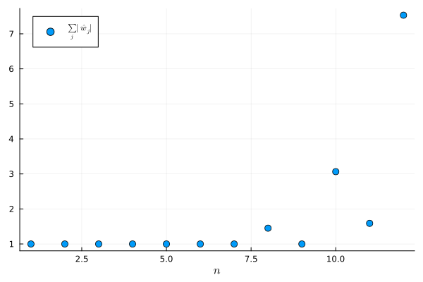

3. $\big| \sum_j w_j (f(x_j) + \varepsilon_j) - \sum_j w_j f(x_j) \big| = \big| \sum_j w_j \varepsilon_j \big| \leq \varepsilon \sum_j |w_j|$. If all the weights are positive, then $\sum_j |w_j| = \sum_j w_j = b - a$ and so errors in the data are not amplified. With large negative weights, small errors in $f(x_j)$ (e.g. rounding errors) can be amplified enormously.

4. The Newton–Cotes rule integrates the equispaced interpolant, which suffers from the Runge phenomenon, so the error does not go to zero as $n$ increases: in fact, it grows (to about $6$ for $n = 20$). The composite Simpson rule with the same nodes converges at rate $O(n^{-4})$ by @thm-simpson-error.

<details><summary>Code</summary>

```julia
f = x -> 1 / ( 1 + 25x^2 )
I = (2/5) * atan(5)

function newton_cotes(f, a, b, n)
    w = (b - a) .* Float64.( nc_weights(n) )   # weights on [a,b] (@exr-l10-weights (3))
    x = range(a, b, n+1)
    return sum( w .* f.(x) )
end

function simpson(f, a, b, n)                   # composite Simpson rule on n subintervals (n even)
    x = range(a, b, n+1)
    h = (b - a) / n
    return h/3 * ( f(x[1]) + 4sum( f.(x[2:2:n]) ) + 2sum( f.(x[3:2:n-1]) ) + f(x[n+1]) )
end

N = 2:2:20
E_nc = [ abs( newton_cotes(f, -1, 1, n) - I ) for n in N ]
E_s  = [ abs( simpson(f, -1, 1, n) - I ) for n in N ]

scatter( N, E_nc, yaxis=:log, markersize=5, xlabel=L"n", label="Newton–Cotes" )
scatter!( N, E_s, markersize=5, label="composite Simpson" )
```
</details>


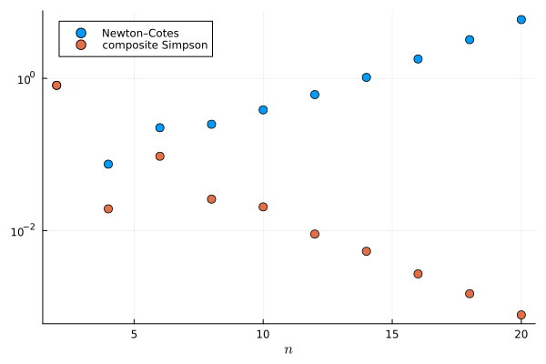

:::
:::

## Midterm (Fall 2025)

<!-- midterm-2025 -->
::: {.exercise-box #bank-midterm-2025-a1 release="now"}
**Midterm (Fall 2025): Question A1**

*Compulsory section, 2 pts.* Suppose that a quantity $x \not= 0$ is approximated by $\widetilde{x}$. What is the relative error in this approximation?

::: {.exercise-solution style="display: none;"}

\begin{align}
    \frac{|x - \widetilde{x}|}{|x|}
\end{align}

:::
:::

<!-- midterm-2025 -->
::: {.exercise-box #bank-midterm-2025-a3 release="now"}
**Midterm (Fall 2025): Question A3**

*Compulsory section, 3 pts.* How many floating point numbers are there in the interval $[1,2)$ with binary precision $k = 3$?

::: {.exercise-solution style="display: none;"}

Floating point numbers are of the form $(-1)^s( 1 + f ) 2^{n}$ where $f = 0 . b_1 b_2 \dots b_k$ in binary. Therefore, there are $2^k$ floating point numbers in the interval $[1,2)$. When the binary precision is $3$, there are $8$ floating point numbers in the interval.

:::
:::

<!-- midterm-2025 -->
::: {.exercise-box #bank-midterm-2025-a4 release="now"}
**Midterm (Fall 2025): Question A4**

*Compulsory section, 3 pts.* What is the relative condition number of the function $f(x) = x - 1$?

::: {.exercise-solution style="display: none;"}

\begin{align}
    \kappa_f(x) = \left| \frac{x f'(x)}{f(x)} \right| = \left| \frac{x}{x-1} \right|
\end{align}

:::
:::

<!-- midterm-2025 -->
::: {.exercise-box #bank-midterm-2025-a5 release="now"}
**Midterm (Fall 2025): Question A5**

*Compulsory section, 3 pts.* What scaling would you use in a graph to verify algebraic decay (i.e. $O(n^{-\alpha})$ for some $\alpha > 0$)?

(a). Linear scale,
(b). Semi-logarithmic with the x-axis scaled,
(c). Semi-logarithmic with the y-axis scaled,
(d). Log-log plot (logarithmic scaling in both x- and y-axes).

::: {.exercise-solution style="display: none;"}

(d). I would use a log-log scale. If $y = n^{-\alpha}$, then $\log y = - \alpha \log n$ which is linear on a log-log plot.

:::
:::

<!-- midterm-2025 -->
::: {.exercise-box #bank-midterm-2025-a7 release="now"}
**Midterm (Fall 2025): Question A7**

*Compulsory section, 4 pts.* Let $f : [ 0, \tfrac\pi2 ] \to \mathbb R$ be given by $f(x) = x^2\sin x - 1$. Show that there is a $\xi \in [0,\tfrac\pi2]$ for which $f(\xi) = 0$.

::: {.exercise-solution style="display: none;"}

$f$ is a continuous function with $f(0) = -1 < 0$ and $f(\pi/2) = \pi^2/4 - 1 > 0$. By the change of sign theorem, there exists some $\xi \in [0,\pi/2]$ such that $f(\xi) = 0$.

:::
:::

<!-- midterm-2025 -->
::: {.exercise-box #bank-midterm-2025-a8 release="now"}
**Midterm (Fall 2025): Question A8**

*Compulsory section, 2 pts.* Here, we apply Newton's method to $f(x) = x^2\sin x - 1$ (from Question A7):

```
Newton iteration on f(x) = x^2 sin(x) - 1 with x1 = π/2
┌───────────┬──────────┬────────────────┬─────────────────────┐
│ iteration │ sequence │       residual │       approximate α │
│         n │     x[n] │ r[n]=|f(x[n])| │ log r[n]/log r[n-1] │
├───────────┼──────────┼────────────────┼─────────────────────┤
│       1.0 │   1.5708 │         1.4674 │                 NaN │
│       2.0 │  1.10371 │      0.0876848 │            -6.34694 │
│       3.0 │  1.06891 │     0.00165227 │             2.63171 │
│       4.0 │  1.06822 │     6.52732e-7 │             2.22338 │
│       5.0 │  1.06822 │    1.01918e-13 │             2.10043 │
└───────────┴──────────┴────────────────┴─────────────────────┘
```

Why do we use the residuals $r_n := |f(x_n)|$ instead of the errors $|x_n - \xi|$ when we are approximating the order of convergence ($\alpha$) in this method?

::: {.exercise-solution style="display: none;"}

$\xi$ is unknown in advance.

***Remark.*** Suppose that $(x_n) \to \xi$. Then, since $f(x_n) = f(x_n) - f(\xi) = f'(\eta_n) (x_n - \xi)$ for some $\eta_n$ between $x_n$ and $\xi$, we have

\begin{align}
    \lim_{n\to\infty} \frac{ \log |f(x_{n+1})| }{ \log |f(x_n)| }
    %
    &= \lim_{n\to\infty}\frac{ \log |f'(\eta_{n+1})| +  \log |x_{n+1} - \xi| }{  \log |f'(\eta_{n})| +  \log |x_{n} - \xi| } \nonumber\\
    %
    &= \lim_{n\to\infty}\frac{ \frac{\log |f'(\eta_{n+1})|}{\log |x_{n} - \xi|} +  \frac{\log |x_{n+1} - \xi|}{\log |x_{n} - \xi|} }{  \frac{\log |f'(\eta_{n})|}{\log |x_{n} - \xi|} + 1 } \nonumber\\
    %
    &= \lim_{n\to\infty} \frac{\log |x_{n+1} - \xi|}{\log |x_{n} - \xi|}.
\end{align}

As a result, we may use the residuals to estimate the order of convergence.

:::
:::

<!-- midterm-2025 -->
::: {.exercise-box #bank-midterm-2025-a9 release="now"}
**Midterm (Fall 2025): Question A9**

*Compulsory section, 4 pts.* Let $g(x) := 1 + \frac{1}{x}$ and define $x_1 = 1$ and $x_{n+1} = g(x_n)$. Suppose that $(x_n) \to \xi$. What is the value of $\xi$?

::: {.exercise-solution style="display: none;"}

We have $x_{n+1}\to \xi$ as $n \to \infty$. Since $g$ is continuous, we have $g(x_n)\to g(\xi)$ as $n \to \infty$. Therefore, $\xi = 1+ \frac{1}\xi$ which is equivalent to $\xi^2 - \xi - 1 = 0$ and so $\xi = \frac{1 \pm \sqrt{5}}2$. If $x_n > 0$ then $x_{n+1} >0$. Since $x_1 > 0$ we have $x_n > 0$ for all $n$ and thus $\xi \geq 0$. Therefore, $\xi = \frac{1+\sqrt{5}}{2}$ (the golden ratio).

***Remark.*** It turns out the the sequence does indeed converge (can you find an interval on which $g$ is a contraction and apply the contraction mapping theorem?)

```
x[n+1] = g(x[n]) with x_1 = 1.0
┌───────────┬──────────┬────────────────┬─────────────────────┐
│ iteration │ sequence │       residual │       approximate α │
│         n │     x[n] │ r[n]=|f(x[n])| │ log r[n]/log r[n-1] │
├───────────┼──────────┼────────────────┼─────────────────────┤
│       1.0 │      1.0 │            1.0 │                 NaN │
│       2.0 │      2.0 │            0.5 │                -Inf │
│       3.0 │      1.5 │       0.166667 │             2.58496 │
│       4.0 │  1.66667 │      0.0666667 │             1.51139 │
│       5.0 │      1.6 │          0.025 │             1.36219 │
│       6.0 │    1.625 │     0.00961538 │             1.25902 │
│       7.0 │  1.61538 │       0.003663 │             1.20779 │
│       8.0 │  1.61905 │     0.00140056 │             1.17139 │
│       9.0 │  1.61765 │    0.000534759 │             1.14653 │
│      10.0 │  1.61818 │     0.00020429 │             1.12773 │
│      11.0 │  1.61798 │     7.80275e-5 │             1.11329 │
└───────────┴──────────┴────────────────┴─────────────────────┘
ξ = 1.618033988749895
```

***Remark.*** Notice that the first few terms of the sequence $(x_n)$ are given by

\begin{align*}
    x_2 &= 1 + \frac{1}{x_1}, \qquad
    x_{3} = 1 + \frac{1}{x_2} = 1 + \frac{1}{1 + \frac{1}{x_1}}, \qquad
    x_{4} = 1 + \frac{1}{x_3} =  1 + \frac{1}{1 + \frac{1}{1 + \frac{1}{x_1}}}, \cdots.
\end{align*}

As a result, you have given meaning to the *infinite continued fraction*

\begin{align*}
    \xi := 1 + \frac{1}{1 + \frac{1}{1 + \frac{1}{1 + \ddots}}}
\end{align*}

:::
:::

<!-- midterm-2025 -->
::: {.exercise-box #bank-midterm-2025-a10 release="now"}
**Midterm (Fall 2025): Question A10**

*Compulsory section, 4 pts.* Write down the Lagrange form of the polynomial of degree at most $n$ interpolating $f$ on $X = \{ x_0, \dots, x_n \}$.

::: {.exercise-solution style="display: none;"}

The Lagrange polynomials are $\ell_j(x) := \prod_{0\leq k \leq n \, : \, k\not= j} \frac{x-x_k}{x_j - x_k}$ and the polynomial interpolation, $p$, of $f$ on $X$ is given by the following linear combination:

\begin{align}
    p(x) = \sum_{j=0}^n \ell_j(x) f(x_j)
\end{align}

:::
:::

<!-- midterm-2025 -->
::: {.exercise-box #bank-midterm-2025-a11 release="now"}
**Midterm (Fall 2025): Question A11**

*Compulsory section, 4 pts.* Consider the following finite difference table

\begin{align}
    x_0:    \quad & f[x_0] = 0,  \quad & f[x_0, x_1] = 1, \nonumber\\
    x_1:    \quad & f[x_1] = 0.            \nonumber
\end{align}

Which of the following statements are true? Select all that apply.

(a). The table does not correspond to any function $f$,
(b). The table determines a polynomial interpolant $p$ of degree at least $2$,
(c). We must have $f'(x_1) = 1$,
(d). We must have $x_0 = x_1$.

::: {.exercise-solution style="display: none;"}

(c) and (d). By the definition of divided differences, we have $f(x_0) = f(x_1) = 0$ and

\begin{align}
    1 = f[x_0,x_1] = \begin{cases}
        \frac{f(x_0) - f(x_1)}{x_0 - x_1} &\text{if } x_0 \not= x_1 \\
        f'(x_0) &\text{if } x_0 = x_1.
    \end{cases}
\end{align}

* Therefore, we must have $x_0 = x_1$ and $f'(x_0) = f'(x_1) = 1$ (third and fourth options should have been selected).
* This table only determines a polynomial, $p$, of degree at most 1 (and so the second option does not apply):

\begin{align}
    p(x) = f[x_0] + f[x_0,x_1] (x - x_0) = x - x_0.
\end{align}

One can indeed show that $p'(x_0) = 1 = f'(x_0)$ and $p(x_0) = 0 = f(x_0)$.

* $f(x) = x-x_0$ is an example of a function with the divided difference table as shown (so the first option does not apply).

:::
:::

<!-- midterm-2025 -->
::: {.exercise-box #bank-midterm-2025-a12 release="now"}
**Midterm (Fall 2025): Question A12**

*Compulsory section, 5 pts.* Write down the Trapezoid rule on $[-1,1]$ and show that it is exact for all polynomials of degree at most $1$.

::: {.exercise-solution style="display: none;"}

The trapezoid rule has weights $w_0 = w_1 = 1$ and nodes $x_0 = -1$ and $x_1 = 1$: i.e.

\begin{align}
    \int^{1}_{-1} f \approx f(-1) + f(1).
\end{align}

When $f(x) = \alpha$, the integral is $2 \alpha = f(-1) + f(+1)$,

When $f(x) = x$, since $f$ is odd, the integral is $0 = -1 + 1 = f(-1) + f(1)$.

Therefore, taking linear combinations, the rule is exact for all polynomials of degree $1$.

:::
:::

<!-- midterm-2025 -->
::: {.exercise-box #bank-midterm-2025-d release="now"}
**Midterm (Fall 2025): Question D**

*Optional section, 30 pts.* **Newton's method for repeated roots.**

1. **[2 points]** Show that $f(x) = e^x - x - 1$ satisfies $f(0) = f'(0) = 0$ and $f''(0) \not= 0$.
2. **[2 points]** Here, we apply Newton's method to $f(x) = e^x - x - 1$. What is the order of convergence?

```
┌───────────┬─────────────┬───────────────┬─────────────────────┐
│ iteration │    sequence │         error │       approximate α │
│         n │        x[n] │ e[n]=|x[n]-ξ| │ log e[n]/log e[n-1] │
├───────────┼─────────────┼───────────────┼─────────────────────┤
│       1.0 │         3.1 │           3.1 │                 NaN │
│       2.0 │     2.24624 │       2.24624 │             0.71527 │
│       3.0 │       1.512 │         1.512 │             0.51088 │
│       4.0 │    0.939627 │      0.939627 │           -0.150621 │
│       5.0 │    0.542328 │      0.542328 │               9.826 │
│       6.0 │    0.295555 │      0.295555 │             1.99205 │
│       7.0 │    0.155046 │      0.155046 │             1.52927 │
│       8.0 │   0.0795256 │     0.0795256 │             1.35817 │
    ...           ...             ...                 ...
│      12.0 │   0.0050958 │     0.0050958 │             1.15071 │
│      13.0 │  0.00255006 │    0.00255006 │             1.13113 │
│      14.0 │  0.00127557 │    0.00127557 │               1.116 │
│      15.0 │ 0.000637923 │   0.000637923 │             1.10398 │
│      16.0 │ 0.000318995 │   0.000318995 │              1.0942 │
│      17.0 │ 0.000159506 │   0.000159506 │              1.0861 │
│      18.0 │  7.97552e-5 │    7.97552e-5 │             1.07927 │
│      19.0 │  3.98781e-5 │    3.98781e-5 │             1.07345 │
│      20.0 │  1.99392e-5 │    1.99392e-5 │             1.06843 │
│      21.0 │  9.96963e-6 │    9.96963e-6 │             1.06404 │
└───────────┴─────────────┴───────────────┴─────────────────────┘
```

Consider the modified Newton's method

\begin{align*}
    x_{n+1} = x_n - 2 \frac{f(x_n)}{f'(x_n)}.
\end{align*}

3. **[2 points]** We apply this method to $f(x) = e^x - x - 1$. Compare the table to that of the standard Newton method.

```
┌───────────┬─────────────┬───────────────┬─────────────────────┐
│ iteration │    sequence │         error │       approximate α │
│         n │        x[n] │ e[n]=|x[n]-ξ| │ log e[n]/log e[n-1] │
├───────────┼─────────────┼───────────────┼─────────────────────┤
│       1.0 │         3.1 │           3.1 │                 NaN │
│       2.0 │     1.39248 │       1.39248 │            0.292634 │
│       3.0 │    0.313183 │      0.313183 │            -3.50653 │
│       4.0 │   0.0163206 │     0.0163206 │             3.54474 │
│       5.0 │  4.43937e-5 │    4.43937e-5 │             2.43539 │
│       6.0 │ 3.27151e-10 │   3.27151e-10 │             2.17918 │
└───────────┴─────────────┴───────────────┴─────────────────────┘
```

Now suppose that $f:[a,b]\to\mathbb R$ is four times continuously differentiable with root $\xi \in (a,b)$ of multiplicity $2$: that is, $f(\xi) = f'(\xi) = 0$ and $f''(\xi) \not= 0$. Further, we suppose that there exists $A > 0$ such that

\begin{align*}
    \left| \frac{f'''(x) + f^{(4)}(x) (x - \xi)}{f''(y)} \right| \leq A
\end{align*}

for all $x,y \in [a,b]$. The aim of this section is to show that the modified Newton method converges at least quadratically to $\xi$ for all $x_1 \in [a,b]$ with $|x_1 - \xi| \leq A^{-1}$. Notice that the modified Newton method can be written

\begin{align*}
    x_{n+1} - \xi &= \frac{ f'(x_n)(x_n - \xi) - 2 f(x_n) }{ f'(x_n) }.
\end{align*}

4. **[8 points]** By expanding the numerator $g(x) := f'(x) (x - \xi) - 2 f(x)$ and denominator $h(x) := f'(x)$, show that there exist $\eta_n, \theta_n$ between $x_n$ and $\xi$ such that
\begin{align*}
    x_{n+1} - \xi &=
    \frac
        {\frac1{3!} g'''(\eta_n) (x_n - \xi)^3}
        {h'(\theta_n) (x_n - \xi) }
    %
    = \frac16
    \left[ \frac
        {f'''(\eta_n) +  f^{(4)}(\eta_n) (\eta_n - \xi) }
        {f''(\theta_n)}
    \right]
    (x_n - \xi)^2.
\end{align*}
5. **[4 points]** Hence show that, if $|x_1 - \xi| \leq A^{-1}$, then $|x_{n+1} - \xi| \leq 6^{-n} |x_1 - \xi|$ and thus the modified Newton's method converges.
6. **[4 points]** Show that $(x_n)$ converges at least quadratically to $\xi$.
7. **[4 points]** What is the theoretical value of the asymptotic error constant when the modified Newton method is applied to $f(x) = e^x - x - 1$?
8. **[4 points]** Show that the modified Newton method converges in $1$ iteration for functions of the form $f(x) = (x - \xi)^2$.

::: {.exercise-solution style="display: none;"}

1. We have $f'(x) = e^x - 1$ and $f''(x) = f'''(x) = \cdots = e^x$. Therefore, $f(0) = e^0 - 0 - 1 = 0$ and $f'(0) = e^0 - 1 = 0$ and $f''(0) = e^0 = 1$.

2. The computational order of convergence appears to approach $1$.

3. We have convergence in fewer iterations ($21$ vs $6$) and the computational order of convergence seems to be around $2$.

4. We take derivatives of $g$:
\begin{align}
    g(x) &= f'(x) (x - \xi) - 2 f(x)\nonumber\\
    g'(x) &= f''(x) (x - \xi) - f'(x) \nonumber\\
    g''(x) &= f'''(x) (x - \xi) \nonumber\\
    g'''(x) &= f^{(4)}(x) (x - \xi) + f'''(x).
\end{align}
Notice that $g(\xi) = g'(\xi) = g''(\xi) = 0$ and so there exists $\eta_n$ between $x_n$ and $\xi$ such that
\begin{align}
    g(x_n) &= g(\xi) + g'(\xi) (x_n - \xi) + \frac{1}2 g''(\xi) (x_n - \xi)^2 + \frac{1}{6} g'''(\eta_n) (x_n - \xi)^3 \nonumber\\
    %
    &= \frac{1}{6} \Big[ f'''(\eta_n) +  f^{(4)}(\eta_n) (\eta_n - \xi) \Big] (x_n-\xi)^3.
\end{align}
Moreover, there exists $\theta_n$ such that $f'(x_n) = f'(\xi) + f''(\theta_n) (x_n - \xi) = f''(\theta_n) (x_n - \xi)$ and so
\begin{align}
    x_{n+1} - \xi &=
    \frac16
    \left[ \frac
        {f'''(\eta_n) +  f^{(4)}(\eta_n) (\eta_n - \xi) }
        {f''(\theta_n)}
    \right]
    (x_n - \xi)^2
\end{align}

5. By assumption,
\begin{align}
    \left| \frac
        {f'''(\eta_n) +  f^{(4)}(\eta_n) (\eta_n - \xi)}
        {f''(\theta_n)}
    \right| \leq A,
\end{align}
and so, if $|x_n - \xi| \leq A^{-1}$, then
\begin{align}
    |x_{n+1} - \xi|
    \leq
    \frac16
    A |x_n - \xi|
    |x_n - \xi|
    %
    \leq \frac16 |x_{n} - \xi|.
\end{align}
In particular, $|x_{n+1} - \xi| \leq A^{-1}$ and we may apply the bound inductively to obtain $|x_{n+1} - \xi| \leq 6^{-n} |x_1 - \xi|$ and so this modified Newton's method converges.

6. Since $\eta_n, \theta_n$ are between $x_n$ and $\xi$, and $(x_n) \to \xi$, we have
\begin{align}
    \lim_{n\to\infty}
    \frac{|x_{n+1} - \xi|}{|x_n - \xi|^2} &=
    \lim_{n\to\infty}
    \frac16
    \left| \frac
        {f'''(\eta_n) +  f^{(4)}(\eta_n) (\eta_n - \xi) }
        {f''(\theta_n)}
    \right| \nonumber\\
    %
    &=
    \frac16
    \left| \frac
        {f'''(\xi)}
        {f''(\xi)}
    \right|
\end{align}

7. Recall that, in this case, $\xi = 0$, and $f'(x) = e^x - 1$, $f''(x) = f'''(x) = e^x$. Therefore, the asymptotic error constant is $\frac16 \frac{e^0}{e^0} = \frac16$.

8. Note that $f(x)= (x - \xi)^2$ has a root of multiplicity $2$ at $\xi$. We have $x_{n+1} = x_n - 2 \frac{  (x_n - \xi)^2 }{ 2(x_n - \xi)} = x_n - (x_n - \xi) = \xi$ so that $x_{n+1} = \xi$ for all $n \geq 1$ regardless of $x_1 \in \mathbb R$.

***Remark.*** In general, if $\xi$ is a root of $f$ of multiplicity $m$, one can define the following *modified Newton method*:
\begin{align}
    x_{n+1} = x_n - m \frac{f(x_n)}{f'(x_n)}.
\end{align}
Then, if $f$ is sufficiently smooth and $x_1$ is sufficiently close to $\xi$, the modified Newton method converges quadratically with asymptotic error constant
\begin{align}
\mu = \frac{1}{m(m+1)} \left|\frac{f^{(m+1)}(\xi)}{f^{(m)}(\xi)} \right|.
\end{align}

:::
:::

## Midterm (Fall 2026)

<!-- midterm-2026 -->
::: {.exercise-box #bank-midterm-2026-a1 release="now"}
**Midterm (Fall 2026): Question A1**

*Compulsory section, 3 pts.* Consider floating point numbers with binary precision $k = 3$. What is the distance between consecutive floating point numbers in the interval $[4, 8)$? What is the machine precision $\epsilon_{\rm mach}$?

::: {.exercise-solution .draft style="display: none;"}

The floating point numbers in $[2^n, 2^{n+1})$ are $(1 + z 2^{-k}) 2^n$ for $z = 0, \dots, 2^k - 1$, so consecutive ones are $2^{n-k}$ apart. Here, $n = 2$ and $k = 3$, so the spacing is $2^{-1} = \frac12$ (the numbers are $4, 4.5, \dots, 7.5$). The machine precision is $\epsilon_{\rm mach} = 2^{-k} = \frac18$.

:::
:::

<!-- midterm-2026 -->
::: {.exercise-box #bank-midterm-2026-a2 release="now"}
**Midterm (Fall 2026): Question A2**

*Compulsory section, 2 pts.* True or false: in ``Float64`` (binary precision $k = 52$), the computation $1 + 2^{-60}$ returns exactly $1$. Explain your answer.

::: {.exercise-solution .draft style="display: none;"}

True. The next floating point number after $1$ is $1 + 2^{-52}$. Since $2^{-60}$ is much smaller than half of this spacing ($2^{-53}$), $1 + 2^{-60}$ is rounded to $1$.

:::
:::

<!-- midterm-2026 -->
::: {.exercise-box #bank-midterm-2026-a3 release="now"}
**Midterm (Fall 2026): Question A3**

*Compulsory section, 2 pts.* What is the largest $d$ such that the rectangular rule $\int_a^b f \approx (b-a) f(a)$ is exact for all polynomials of degree at most $d$?

(a) $d = 0$\
(b) $d = 1$\
(c) $d = 2$\
(d) $d = 3$

::: {.exercise-solution .draft style="display: none;"}

(a) $d = 0$. The rule is exact for constants, but for $f(x) = x - a$ it gives $0$ while $\int_a^b f = \frac{(b-a)^2}{2}$.

:::
:::

<!-- midterm-2026 -->
::: {.exercise-box #bank-midterm-2026-a4 release="now"}
**Midterm (Fall 2026): Question A4**

*Compulsory section, 7 pts.* Approximate $\int_{-1}^{+1} x^2 \, \mathrm{d}x = \frac23$ using (i) the rectangular rule, (ii) the trapezoid rule, and (iii) Simpson's rule. Compare with the exact value.

::: {.exercise-solution .draft style="display: none;"}

(i) Rectangular rule: $2 \cdot (-1)^2 = 2$.

(ii) Trapezoid rule: $\frac22 \big( (-1)^2 + 1^2 \big) = 2$.

(iii) Simpson's rule: $\frac26 \big( (-1)^2 + 4 \cdot 0^2 + 1^2 \big) = \frac23$.

Simpson's rule gives the exact value (it is exact for quadratics); the other two rules overestimate the integral by a factor of $3$.

:::
:::

<!-- midterm-2026 -->
::: {.exercise-box #bank-midterm-2026-a5 release="now"}
**Midterm (Fall 2026): Question A5**

*Compulsory section, 4 pts.* Write down Newton's method for computing $\sqrt{2}$ (i.e. a root of $f(x) = x^2 - 2$). Compute $x_2$ when $x_1 = 1$.

::: {.exercise-solution .draft style="display: none;"}

\begin{align}
    x_{n+1} = x_n - \frac{x_n^2 - 2}{2x_n} = \frac12 \Big( x_n + \frac{2}{x_n} \Big).
\end{align}

With $x_1 = 1$, we have $x_2 = 1 - \frac{1 - 2}{2} = \frac32$.

:::
:::

<!-- midterm-2026 -->
::: {.exercise-box #bank-midterm-2026-a6 release="now"}
**Midterm (Fall 2026): Question A6**

*Compulsory section, 2 pts.* The following table shows an iterative method for solving $f(x) = x^2 - 2 = 0$ (here $\xi = \sqrt{2}$):

```
 n          x[n]      e[n]=|x[n]-ξ|    log e[n]/log e[n-1]
------------------------------------------------------------
 1   1.000000000000   4.14214e-01
 2   2.000000000000   5.85786e-01         0.60678
 3   1.333333333333   8.08802e-02         4.70229
 4   1.400000000000   1.42136e-02         1.69142
 5   1.414634146341   4.20584e-04         1.82761
 6   1.414211438475   2.12390e-06         1.68028
 7   1.414213562057   3.15775e-10         1.67475
 8   1.414213562373   2.22045e-16         1.64764
```

Which of the following methods most likely produced this table?

(a) Relaxation\
(b) Secant method\
(c) Newton's method

::: {.exercise-solution .draft style="display: none;"}

(b) The secant method (with $x_1 = 1$ and $x_2 = 2$). The ratios in the last column approach about $1.65$, close to the golden ratio $1.618\dots$, the order of the secant method. Relaxation converges linearly ($\alpha = 1$) and Newton's method quadratically ($\alpha = 2$).

:::
:::

<!-- midterm-2026 -->
::: {.exercise-box #bank-midterm-2026-a7 release="now"}
**Midterm (Fall 2026): Question A7**

*Compulsory section, 4 pts.* Let $I_Xf \in \mathcal P_n$ be the polynomial interpolant of $f : [-1,1] \to \mathbb R$ on $n+1$ distinct nodes $X$. Which of the following statements are true? Please select all that apply.

(a) $I_Xf$ may have degree strictly less than $n$\
(b) If $f \in \mathcal P_n$, then $I_Xf = f$\
(c) For the Chebyshev nodes $X = \{\cos\frac{j\pi}{n}\}_{j=0}^n$, the barycentric weights alternate in sign\
(d) For equispaced nodes, $\max\limits_{x\in[-1,1]} |f(x) - I_Xf(x)| \to 0$ as $n\to\infty$ for every continuous $f$

::: {.exercise-solution .draft style="display: none;"}

(a), (b) and (c) are true; (d) is false.

(a) For example, $f = 0$ gives $I_X f = 0$.

(b) By uniqueness of the interpolant, since $f$ itself interpolates $f$ on $X$.

(c) The barycentric weights for these nodes are proportional to $(-1)^j$ (halved at the end points $j = 0, n$).

(d) Runge's function $f(x) = \frac{1}{1 + 25x^2}$ is a counterexample.

:::
:::

<!-- midterm-2026 -->
::: {.exercise-box #bank-midterm-2026-a8 release="now"}
**Midterm (Fall 2026): Question A8**

*Compulsory section, 5 pts.* Find weights $w_0, w_1$ such that the quadrature rule $\int_0^1 f \approx w_0 f(0) + w_1 f(\tfrac13)$ is exact for all polynomials of degree at most $1$. Is it exact for $f(x) = x^2$? (You may use $\int_0^1 x^n \,\mathrm{d}x = \frac{1}{n+1}$ for $n=0,1,2,...$.)

::: {.exercise-solution .draft style="display: none;"}

Exactness for $f = 1$ and $f = x$ gives $w_0 + w_1 = 1$ and $\frac{w_1}{3} = \frac12$. Therefore, $w_1 = \frac32$ and $w_0 = -\frac12$. For $f(x) = x^2$, the rule gives $\frac32 \cdot \frac19 = \frac16 \not= \frac13 = \int_0^1 x^2 \,\mathrm{d}x$, so it is not exact.

:::
:::

<!-- midterm-2026 -->
::: {.exercise-box #bank-midterm-2026-a9 release="now"}
**Midterm (Fall 2026): Question A9**

*Compulsory section, 2 pts.* The following plots show the errors of two numerical methods, P and Q, as a function of the number $n$ of function evaluations. The same data is shown on a log-log plot (left) and a semi-log plot (right).

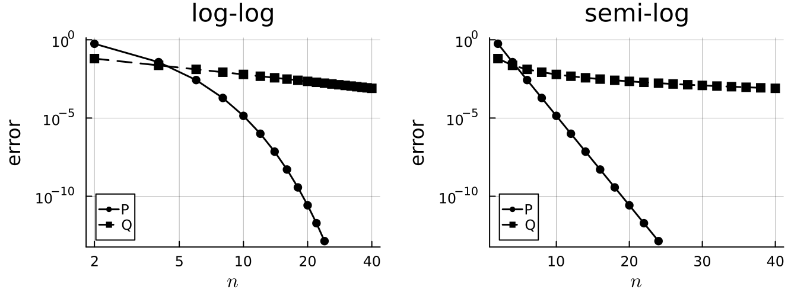{loading="lazy" width=100%}

(i) Is the decay of the error of method P algebraic or exponential?

(ii) Is the decay of the error of method Q algebraic or exponential?

::: {.exercise-solution .draft style="display: none;"}

(i) Exponential: the errors of P lie on a straight line on the semi-log plot.

(ii) Algebraic: the errors of Q lie on a straight line on the log-log plot.

***Remark.*** P is the trapezoid rule for the periodic integrand $\frac{1}{2 - \cos x}$ on $[0, 2\pi]$, and Q is the composite trapezoid rule for $\int_0^1 \sqrt{x} \,\mathrm{d}x$ (where $f''$ is unbounded at $0$), whose error is $O(n^{-3/2})$.

:::
:::

<!-- midterm-2026 -->
::: {.exercise-box #bank-midterm-2026-a10 release="now"}
**Midterm (Fall 2026): Question A10**

*Compulsory section, 5 pts.* For $b > 1$, the equation $x^2 - 2bx + 1 = 0$ has roots

$$
    \xi_\pm = b \pm \sqrt{b^2 - 1} = \frac{1}{b \mp \sqrt{b^2 - 1}},
$$

Here, we compute $\xi_-$ in ``Float64`` using both formulas:

```
       b         b - sqrt(b^2 - 1)        1 / (b + sqrt(b^2 - 1))
------------------------------------------------------------------
  b = 1e+04      5.000000055588316e-5      5.000000012500001e-5
  b = 1e+06       5.00003807246685e-7       5.00000000000125e-7
  b = 1e+08                       0.0                    5.0e-9
```

Which column do you trust? Explain why the formulas give different results.

::: {.exercise-solution .draft style="display: none;"}

We trust the second column ($\xi_- \approx \frac{1}{2b}$). The two formulas are equal in exact arithmetic (multiply $b - s$ by $b + s$ where $s = \sqrt{b^2 - 1}$). However, the first formula subtracts the nearly equal numbers $b$ and $s$: this is subtractive cancellation. The rounding error in $s$ (about $\epsilon_{\rm mach} b$) is large compared with the result $\approx \frac{1}{2b}$; for $b = 10^8$ the first formula even returns $0$. The second formula only adds positive numbers, so there is no cancellation.

:::
:::

<!-- midterm-2026 -->
::: {.exercise-box #bank-midterm-2026-a11 release="now"}
**Midterm (Fall 2026): Question A11**

*Compulsory section, 4 pts.* Consider the following divided difference table:
$$
\begin{array}{c|cc}
    \quad x_j \quad & \quad f(x_j) \quad & \quad f[x_0, x_1] \quad \\[4pt] \hline
    \quad x_0 \quad & \quad 1 \quad & \\[8pt]
        & & \quad -2 \quad \\[8pt]
    \quad x_1 \quad & \quad 1 \quad &
\end{array}
$$
Which of the following statements are true? Please select all that apply.

(a) The table does not correspond to any function $f$\
(b) We must have $x_0 = x_1$\
(c) We must have $f'(x_0) = 1$\
(d) The table determines a polynomial interpolant $p$ of degree at most $1$

::: {.exercise-solution .draft style="display: none;"}

(b) and (d) are true; (a) and (c) are false.

(b) If $x_0 \not= x_1$, then $f[x_0, x_1] = \frac{f(x_1) - f(x_0)}{x_1 - x_0} = 0 \not= -2$. Therefore, the node is repeated.

(d) $p(x) = 1 - 2(x - x_0)$ is the Hermite interpolant with $p(x_0) = 1$ and $p'(x_0) = -2$.

(a) For example, $f(x) = 1 - 2(x - x_0)$ has this table.

(c) $f'(x_0) = f[x_0, x_0] = -2$.

:::
:::

<!-- midterm-2026 -->
::: {.exercise-box #bank-midterm-2026-b release="now"}
**Midterm (Fall 2026): Question B**

*Optional section, 30 pts.* **Polynomial Interpolation.** Let $f(x) = 2^x$ and $X = \{x_0, x_1, x_2\} = \{-1, 0, 1\}$.

1. **[14 points]** Write down the polynomial interpolant $I_Xf \in \mathcal P_2$ of $f$ on $X$ in both Lagrange and Newton form. Now add the node $x_3 = 2$ and write down the polynomial $p \in \mathcal P_3$ interpolating $f$ on $\{-1, 0, 1, 2\}$. Compare $I_Xf(3)$ and $p(3)$ with $f(3)$.
2. **[5 points]** Use the interpolation error formula
$$
f(x) - I_Xf(x) = \frac{f^{(3)}(\xi_x)}{3!} (x + 1) x (x - 1)
$$
to show that $|f(x) - I_Xf(x)| \leq \frac{2 (\log 2)^3}{3!} \cdot \frac{2}{3\sqrt3}$ for all $x \in [-1,1]$. *Hint:* $f^{(3)}(x) = (\log 2)^3 \, 2^x$, and $|(x+1) x (x-1)| = |x^3 - x|$ is largest on $[-1,1]$ at $x = \pm \frac{1}{\sqrt3}$.
3. **[5 points]** Now let $Y = \{y_0, y_1, y_2\}$ with $y_0 = -\frac{\sqrt3}{2}, y_1 = 0, y_2 = \frac{\sqrt3}{2}$ (the zeros of the Chebyshev polynomial $T_3(x) = 4x^3 - 3x$). Show that $\max\limits_{x \in [-1,1]} |(x - y_0)(x - y_1)(x - y_2)| = \frac14$. What is the corresponding error bound for $|f(x) - I_Yf(x)|$? Does $X$ or $Y$ give the better error bound?
4. **[6 points]** The following semi-log plot shows the maximum error $\max\limits_{x \in [-1,1]} |f(x) - I_Xf(x)|$ when interpolating $f(x) = 2^x$ on $n+1$ equispaced nodes and on $n+1$ Chebyshev nodes $\{\cos\frac{j\pi}{n}\}_{j=0}^n$ (computed with the barycentric formula in ``Float64``).

    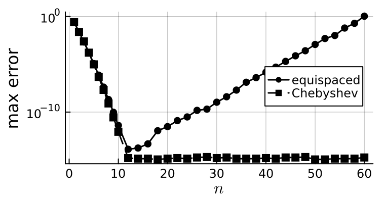{loading="lazy" width=60%}

    (i) For small $n$ ($n \leq 10$), is the decay of the error algebraic or exponential (or faster)?

    Next, we compare the time taken to evaluate $I_Xf$ at $1000$ points using two implementations: the naive implementation of the Lagrange form $I_Xf(x) = \sum_j f(x_j) \prod_{k \neq j} \frac{x - x_k}{x_j - x_k}$, and the barycentric formula.

    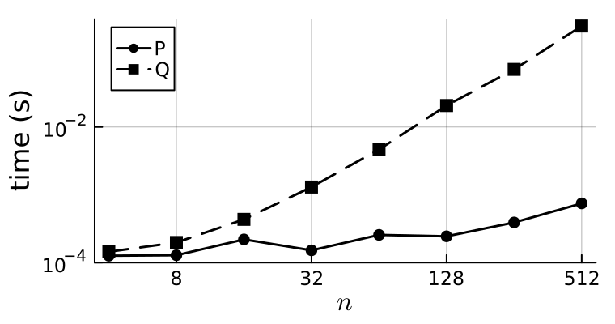{loading="lazy" width=60%}

    (ii) Which of P and Q is the naive implementation? Explain why.

::: {.exercise-solution .draft style="display: none;"}

1. *Lagrange form.* The Lagrange basis polynomials are $\ell_0(x) = \frac{x(x-1)}{2}$, $\ell_1(x) = 1 - x^2$ and $\ell_2(x) = \frac{x(x+1)}{2}$, and so $I_Xf = \frac12 \ell_0 + \ell_1 + 2\ell_2$.

    *Newton form.* $f[-1] = \frac12$, $f[0] = 1$, $f[1] = 2$; $f[-1,0] = \frac12$, $f[0,1] = 1$; $f[-1,0,1] = \frac14$. Therefore, $I_Xf(x) = \frac12 + \frac12(x+1) + \frac14(x+1)x$.

    *Adding $x_3 = 2$.* $f[1,2] = 2$, $f[0,1,2] = \frac{2 - 1}{2} = \frac12$ and $f[-1,0,1,2] = \frac{\frac12 - \frac14}{3} = \frac{1}{12}$, and so $p(x) = I_Xf(x) + \frac{1}{12}(x+1)x(x-1)$.

    Finally, $I_Xf(3) = \frac12 + 2 + 3 = \frac{11}{2}$ and $p(3) = \frac{11}{2} + \frac{1}{12} \cdot 4 \cdot 3 \cdot 2 = \frac{15}{2}$, while $f(3) = 8$: the extra node improves the extrapolation. (All forms of $I_Xf$ are the same quadratic $\frac14 x^2 + \frac34 x + 1$.)

2. On $[-1,1]$, we have $|f^{(3)}(\xi_x)| \leq (\log 2)^3 \, 2^1 = 2(\log 2)^3$, and $|x^3 - x| \leq \big| \frac{1}{3\sqrt3} - \frac{1}{\sqrt3} \big| = \frac{2}{3\sqrt3}$. Inserting both bounds into the error formula gives the result.

3. $(x + \frac{\sqrt3}{2}) \, x \, (x - \frac{\sqrt3}{2}) = x^3 - \frac34 x = \frac14 T_3(x)$, and $|T_3(x)| \leq 1$ on $[-1,1]$ with equality at $x = \pm1$. Therefore, the maximum is $\frac14$ and $|f(x) - I_Yf(x)| \leq \frac{2(\log 2)^3}{3!} \cdot \frac14$. Since $\frac14 < \frac{2}{3\sqrt3} \approx 0.385$, the Chebyshev nodes $Y$ give the better bound.

4. (i) Exponential or faster: the curves bend downwards even on the semi-log plot. (Since $2^x$ is entire, the error decays like $\frac{(\log 2)^{n+1}}{(n+1)!}$ times a factor depending on the nodes, which is faster than exponential.)

    (ii) Q is the naive implementation. On the log-log plot, the time for Q grows like $n^2$ (slope $2$) while the time for P grows like $n$ (slope $1$). Evaluating the Lagrange form at one point costs $O(n^2)$ operations ($n+1$ products of $n$ factors), while the barycentric formula costs $O(n)$ once the weights are known.

:::
:::

<!-- midterm-2026 -->
::: {.exercise-box #bank-midterm-2026-c release="now"}
**Midterm (Fall 2026): Question C**

*Optional section, 30 pts.* **Trapezoid Rule with End Point Derivatives.** Suppose $f$ is four times continuously differentiable. We will consider the following quadrature rule:

\begin{align*}
    \int_a^b f(x) \,\mathrm{d}x \approx \frac{b-a}{2} \big[ f(a) + f(b) \big] + \frac{(b-a)^2}{12} \big[ f'(a) - f'(b) \big].
\end{align*}

That is, we add a correction to the trapezoid rule which uses the derivative of $f$ at both end points.

1. **[8 points]** Show that this rule is exact for all polynomials of degree at most $1$. Then show that it is exact for $f(x) = (x - a)^2$ and $f(x) = (x-a)^3$, and hence that it is exact for all polynomials of degree at most $3$. (You may use $\int_a^b (x-a)^n \,\mathrm{d}x = \frac{(b-a)^{n+1}}{n+1}$ for $n=0,1,2,...$.)
2. **[3 points]** Let $p_3 \in \mathcal P_3$ be the Hermite interpolant of $f$ on $X = \{\{a, a, b, b\}\}$. Explain why $\int_a^b p_3$ is equal to the quadrature rule applied to $f$.
3. **[8 points]** Recall that there exists $\xi_x \in [a,b]$ such that $f(x) - p_3(x) = \frac{f''''(\xi_x)}{4!} (x - a)^2 (x - b)^2$. Show that
\begin{align*}
    \left| \int_a^b f(x)\,\mathrm{d}x - \frac{b-a}{2} \big[ f(a) + f(b) \big] - \frac{(b-a)^2}{12} \big[ f'(a) - f'(b) \big] \right| \leq \frac{\|f''''\|_{L^\infty([a,b])}}{720} (b-a)^5.
\end{align*}
*Hint:* $\int_a^b (x-a)^2 (x-b)^2 \,\mathrm{d}x = \frac{(b-a)^5}{30}$.

Let $x_j := a + j \frac{b-a}{n}$ for $j = 0, \dots, n$ and note that $\int_a^b f = \sum_{j=0}^{n-1} \int_{x_j}^{x_{j+1}} f$.

4. **[9 points]** Apply the rule on each interval $[x_j, x_{j+1}]$ to show that the corresponding composite rule is
\begin{align*}
    \int_a^b f \approx I_n' := \frac{b-a}{n} \Big[ \tfrac12 f(x_0) + \sum_{j=1}^{n-1} f(x_j) + \tfrac12 f(x_n) \Big] + \frac{1}{12}\left(\frac{b-a}{n}\right)^2 \big[ f'(a) - f'(b) \big].
\end{align*}
Why do we only need the derivative of $f$ at $a$ and $b$? Use the error estimate from Question 3 to obtain an error estimate for $I_n'$.

The following plot shows the errors in approximating $\int_0^1 e^x \,\mathrm{d}x$ with the composite trapezoid rule $I_n$ and the composite rule $I_n'$ from Question 4, together with the curves $C n^{-1}$, $C n^{-2}$, $C n^{-3}$ and $C n^{-4}$:

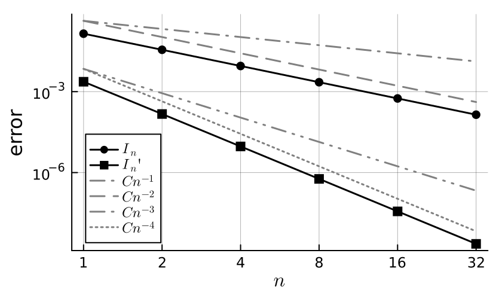{loading="lazy" width=70%}

5. **[2 points]** What are the rates of convergence of $I_n$ and $I_n'$?

::: {.exercise-solution .draft style="display: none;"}

Let $h := b - a$.

1. The trapezoid rule is exact for polynomials of degree at most $1$ and, for $f(x) = \alpha + \beta x$, we have $f'(a) - f'(b) = \beta - \beta = 0$, so the correction vanishes. For $f(x) = (x-a)^2$, the integral is $\frac{h^3}{3}$ and the rule gives $\frac h2 (0 + h^2) + \frac{h^2}{12}(0 - 2h) = \frac{h^3}{2} - \frac{h^3}{6} = \frac{h^3}{3}$. For $f(x) = (x-a)^3$, the integral is $\frac{h^4}{4}$ and the rule gives $\frac h2 h^3 + \frac{h^2}{12}(0 - 3h^2) = \frac{h^4}{2} - \frac{h^4}{4} = \frac{h^4}{4}$. Since $1, (x-a), (x-a)^2, (x-a)^3$ span $\mathcal P_3$ and the rule is linear in $f$, it is exact for all polynomials of degree at most $3$.
2. The rule only uses $f(a)$, $f(b)$, $f'(a)$ and $f'(b)$, and $p_3$ has the same values: $p_3(a) = f(a)$, $p_3'(a) = f'(a)$, $p_3(b) = f(b)$ and $p_3'(b) = f'(b)$. Therefore, the rule applied to $f$ equals the rule applied to $p_3$, which is $\int_a^b p_3$ by Question 1.
3. By Question 2, the error is
\begin{align*}
    \left| \int_a^b (f - p_3) \right|
    \leq \int_a^b \frac{|f''''(\xi_x)|}{4!} (x-a)^2(x-b)^2 \,\mathrm{d}x
    \leq \frac{\|f''''\|_{L^\infty([a,b])}}{24} \cdot \frac{(b-a)^5}{30}
    = \frac{\|f''''\|_{L^\infty([a,b])}}{720} (b-a)^5.
\end{align*}
4. Let $h := \frac{b-a}{n}$. Applying the rule on each $[x_j, x_{j+1}]$ and summing gives
\begin{align*}
    \sum_{j=0}^{n-1} \Big( \frac h2 \big[ f(x_j) + f(x_{j+1}) \big] + \frac{h^2}{12} \big[ f'(x_j) - f'(x_{j+1}) \big] \Big).
\end{align*}
The first part is the composite trapezoid rule. The derivative terms telescope: $\sum_{j=0}^{n-1} \big[ f'(x_j) - f'(x_{j+1}) \big] = f'(x_0) - f'(x_n) = f'(a) - f'(b)$, so the derivatives at the interior nodes cancel and we only need $f'(a)$ and $f'(b)$. By Question 3, the error on each subinterval is at most $\frac{\|f''''\|_{L^\infty([a,b])}}{720} h^5$, and summing over the $n$ subintervals gives
\begin{align*}
    \left| \int_a^b f - I_n' \right| \leq \frac{\|f''''\|_{L^\infty([a,b])}}{720} \frac{(b-a)^5}{n^4}.
\end{align*}
5. $I_n$ converges at the rate $O(n^{-2})$ (parallel to $C n^{-2}$) and $I_n'$ at the rate $O(n^{-4})$ (parallel to $C n^{-4}$), consistent with the trapezoid rule error estimate and Question 4.

:::
:::

<!-- midterm-2026 -->
::: {.exercise-box #bank-midterm-2026-d release="now"}
**Midterm (Fall 2026): Question D**

*Optional section, 30 pts.* **Simple Iteration.** Define $g(x) = 1 + \frac12 \sin x$ and $I := [\frac12,\frac32]$.

1. **[3 points]** Show that $g(x) \in I$ for all $x \in I$.
2. **[4 points]** Show that $g$ is a contraction on $I$ with constant $L = \frac12$.
3. **[4 points]** Which theorem guarantees that $g$ has a unique fixed point $\xi \in I$ and that $x_{n+1} = g(x_n)$ converges to $\xi$ for all $x_1 \in I$? Explain why $\xi \in [\frac12, \frac32]$.
4. **[5 points]** Show that $|x_{n+1} - \xi| \leq L^n |x_1 - \xi|$. Find $n$ such that $|x_{n+1} - \xi| \leq 10^{-3}$ is guaranteed for every $x_1 \in I$. (You may use $2^{10} = 1024$.)

Here, we apply the iteration with $x_1 = 1$ and compare with $x_N$ for $N = 100$:

```
 n         x_n        r_n := |x_n - x_N|       r_{n+1} / r_n
------------------------------------------------------------
 1    1.000000000000      4.987e-01         0.1563
 2    1.420735492404      7.797e-02         0.0554
 3    1.494380992564      4.320e-03         0.0371
 4    1.498540884399      1.602e-04         0.0361
 5    1.498695355522      5.778e-06         0.0360
 6    1.498700925407      2.081e-07         0.0360
 7    1.498701126022      7.495e-09         0.0360
 8    1.498701133248      2.700e-10         0.0360
```

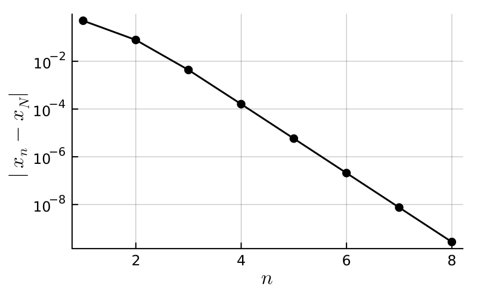{loading="lazy" width=60%}

5. **[9 points]** (a) Why do we plot $|x_n - x_N|$ instead of the errors $|x_n - \xi|$?\
(b) What do the plot and the table suggest about the order of convergence?\
(c) The theory predicts that $\frac{|x_{n+1} - \xi|}{|x_n - \xi|} \to \mu = |g'(\xi)| = \frac12 |\cos \xi|$. Estimate $\mu$ and $\xi$ from the table.
6. **[5 points]** Show that $\xi$ is a root of $f(x) = 2x - 2 - \sin x$ and that $x_{n+1} = g(x_n)$ is the relaxation method $x_{n+1} = x_n - \lambda f(x_n)$ for some $\lambda$. Which value of $\lambda$ gives faster than linear convergence? Prove your answer.

::: {.exercise-solution .draft style="display: none;"}

1. For $x \in I$, we have $0 < x < \pi$ and so $0 \leq \sin x \leq 1$. Therefore, $1 \leq g(x) \leq \frac32$, and so $g(x) \in I$.
2. By the mean value theorem, for $x, y \in I$ there exists $\eta$ between $x$ and $y$ such that $|g(x) - g(y)| = |g'(\eta)| |x - y| = \frac12 |\cos \eta| |x - y| \leq \frac12 |x - y|$.
3. The contraction mapping theorem (Banach fixed point theorem), whose hypotheses are Questions 1 and 2. The theorem gives $\xi \in I$. In fact, since $\xi = g(\xi) \in g(I) \subseteq [1, \frac32]$, we even have $\xi \in [1, \frac32]$.
4. $|x_{n+1} - \xi| = |g(x_n) - g(\xi)| \leq L |x_n - \xi|$, and so, by induction, $|x_{n+1} - \xi| \leq L^n |x_1 - \xi|$. Since $x_1, \xi \in I$, we have $|x_1 - \xi| \leq 1$ and so $|x_{n+1} - \xi| \leq 2^{-n}$. Since $2^{-10} = \frac{1}{1024} < 10^{-3}$, $n = 10$ suffices (as does any $n \geq 10$).
5. (a) We do not know $\xi$ (that is what we are computing). The convergence is fast (the ratios are about $0.036$), so $x_N$ with $N = 100$ equals $\xi$ to machine precision and $r_n = |x_n - x_N|$ is (up to rounding) the error.\
(b) The errors lie on a straight line on the semi-log plot and the ratios $r_{n+1}/r_n$ tend to a constant: the convergence is linear.\
(c) From the last row, $\mu \approx 0.0360$ and $\xi \approx x_8 \approx 1.4987$. Indeed, $\frac12 |\cos(1.4987)| \approx 0.036$. Since $\xi$ is close to $\frac\pi2$, $|\cos \xi|$ is small and $\mu$ is much smaller than $L = \frac12$.
6. $g(\xi) = \xi$ if and only if $2\xi = 2 + \sin \xi$, i.e. $f(\xi) = 0$. Moreover, $x - \frac12 f(x) = x - x + 1 + \frac12 \sin x = g(x)$, so the iteration is the relaxation method with $\lambda = \frac12$. In general, the relaxation method is simple iteration with $g_\lambda(x) := x - \lambda f(x)$, and $g_\lambda'(\xi) = 1 - \lambda f'(\xi)$. The convergence is linear with asymptotic error constant $|1 - \lambda f'(\xi)|$ unless this vanishes, i.e. unless $\lambda = \frac{1}{f'(\xi)} = \frac{1}{2 - \cos \xi} \approx 0.519$. For this $\lambda$, $g_\lambda'(\xi) = 0$ and $\frac{|x_{n+1} - \xi|}{|x_n - \xi|} = |g_\lambda'(\eta_n)| \to 0$ (by the mean value theorem, with $\eta_n$ between $x_n$ and $\xi$), so the convergence is faster than linear.

:::
:::

## Lecture 12

<!-- L12 -->
::: {.exercise-box #bank-exr-gauss-change-of-variables}
**@exr-gauss-change-of-variables**

By considering the change of variables $y = \frac{2}{b-a} \left( x - \frac{a + b}{2} \right)$ and defining $\tilde{f}(y) = \frac{b-a}{2} f\big(  \tfrac{b-a}2 y + \tfrac{a+b}2  \big)$, show that 

$$
\begin{align}
    \int_a^b f(x) \mathrm{d}x = \int_{-1}^1 \tilde{f}(y) \mathrm{d}y. 
\end{align}
$$

Moreover, show that, if $p$ is the polynomial interpolation of $f$ on $X \subset [a,b]$, then $\tilde{p}$ is the polynomial interpolation of $\tilde{f}$ on $\tilde{X} \subset [-1,1]$ where $\tilde{X} = \{ \frac{2}{b-a} \left( x - \frac{a + b}{2} \right) : x \in X \}$. As a result, we may without loss of generality consider the interval $[-1,1]$.
:::

<!-- L12 -->
::: {.exercise-box #bank-exr-gauss-two-point}
**@exr-gauss-two-point**

Choose $w_0, w_1$ and $x_0, x_1$ such that 

$$
\begin{align}
    \int_{-1}^1 f \approx w_0 f(x_0) + w_1 f(x_1)
\end{align}
$$

is exact for all polynomials of degree $3 = 2n+1$.

::: {.exercise-hint style="display: none;"}

Integrate the functions $f = 1, x, x^2, x^3$ and solve the resulting system of equations.

:::

::: {.exercise-solution style="display: none;"} 

Using the functions $f = 1, x, x^2, x^3$, we want to solve

$$
\begin{align}
    2 &= w_0 + w_1 \nonumber \\
    0 &= w_0 x_0 + w_1 x_1 \nonumber \\
    \frac{2}{3} &= w_0 x_0^2 + w_1 x_1^2 \nonumber \\
    0 &= w_0 x_0^3 + w_1 x_1^3 \nonumber
\end{align}
$$

We have 

$$
\begin{align}
    0 &= ( w_0 x_0 + w_1 x_1 )( x_0 + x_1 ) \nonumber \\
    &= (w_0 x_0^2 + w_1 x_1^2) + ( w_0 + w_1 ) x_0 x_1 \nonumber \\
    &= \frac23 + 2 x_0 x_1 \nonumber
\end{align}
$$

and so $x_0 x_1 = -\frac13$. Similarly, we have 

$$
\begin{align}
    \frac23 (x_0 + x_1) &= ( w_0 x_0^2 + w_1 x_1^2 )( x_0 + x_1 ) \nonumber \\
    &= (w_0 x_0^3 + w_1 x_1^3) + ( w_0 x_0 + w_1 x_1 ) x_0 x_1 \nonumber \\
    &= 0 + 0 \cdot x_0 x_1 = 0 \nonumber
\end{align}
$$

and so $x_0 = - x_1$ and $x_0 = - \frac{1}{\sqrt{3}}$, $x_1 = \frac{1}{\sqrt{3}}$.

Finally, we have $0 = w_0 x_0 + w_1 x_1 = (w_0 - w_1) x_0$ and so $w_0 = w_1 = 1$.

:::
:::

<!-- L12 -->
::: {.exercise-box #bank-exr-L12-error-estimate}
**@exr-L12-error-estimate**

For $n=1$, use the fact that Gauss quadrature is exact for all polynomials of degree $2n+1 = 2(1) + 1 = 3$ to show that 
$$
\begin{align}
    \left| \int_{-1}^1 f(x) \mathrm{d}x - \left( f(-\tfrac{\sqrt3}{3}) + f(\tfrac{\sqrt3}{3}) \right) \right|
    %
    \leq \frac{1}{135} \max_{x\in [-1,1]} \big| f^{(4)}(x) \big|. 
\end{align}
$$

::: {.exercise-hint style="display: none;"}

We have $X = \{x_0, x_1\} = \{ -\frac{\sqrt3}{3}, \frac{\sqrt3}3 \}$. 

Choose $p$ to be the Hermite interpolant on $\{\{x_0,x_0, x_1,x_1\}\}$ (that is, $p\in\mathcal P_3$ with $p(x_j) = f(x_j)$ and $p'(x_j) = f'(x_j)$ for $j=0,1$). 

:::

::: {.exercise-solution style="display: none;"}

Using the hint $p = I_{\{\{x_0,x_0,x_1,x_1\}\}} f$, we have 
$$
\begin{align}
    &\left| \int_{-1}^1 f - \left( f(x_0) + f(x_1) \right) \right| \nonumber \\
    %
    &= \left| \int_{-1}^1 f - \left( p(x_0) + p(x_1) \right) \right| \nonumber \\
    %
    &= \left| \int_{-1}^1 (f - p) \right|. \nonumber
\end{align}
$$
Here, we have used the fact that Gauss quadrature is exact for all polynomials of degree $3$. 

Using the error estimate for Hermite interpolation, there exist $\xi_x \in [-1,1]$ such that $f(x) - p(x) = \frac{f^{(4)}(\xi_x)}{4!} (x-x_0)^2 (x-x_1)^2$. Therefore, 
$$
\begin{align}
    &\left| \int_{-1}^1 (f - p) \right| \nonumber \\ 
    &\leq \frac1{4!} \|f^{(4)}\|_{L^\infty} 
    %
    \int_{-1}^1 (x-x_0)^2 (x-x_1)^2  \mathrm{d}x \nonumber \\
    &= \frac{8}{45} \frac{1}{4!} \| f^{(4)} \|_{L^\infty}\nonumber \\
    &=  \frac{1}{135} \| f^{(4)} \|_{L^\infty}, \nonumber
\end{align}
$$
as required.

:::
:::

<!-- L12 -->
::: {.exercise-box #bank-exr-gauss-log2}
**@exr-gauss-log2**

Approximate $\log 2 = \int_1^2 \frac{1}{x} \mathrm{d}x$ using Gauss quadrature and evaluate an upper bound for the error.

::: {.exercise-solution style="display: none;"}

First notice that 
$$
\begin{align}
    \log 2 &= \int_1^2 \frac1x \mathrm{d}x \nonumber \\
    %
    &= \frac{1}{2} \int_{-1}^1 \frac1{ \frac{1}2 x + \frac32 } \mathrm{d}x \nonumber \\
    %
    &= \int_{-1}^1 \frac1{ 3 + x } \mathrm{d}x \nonumber \\
    %
    &\approx \frac1{ 3 - \frac{\sqrt{3}}3 } + \frac1{ 3 + \frac{\sqrt{3}}3 } \nonumber \\
    %
    &= \frac9{13}. \nonumber
\end{align}
$$
The error here is $\log 2 - \tfrac{9}{13} \approx 8.39 \times 10^{-4}$. 

The error bound is $\frac{1}{135} \|f^{(4)}\|_{L^\infty}$ where $f(x) = \frac{1}{3+x}$. Taking derivatives of $f$, we find that $f^{(4)}(x) =  \frac{24}{(3+x)^5}$ and so the error between $\log 2$ and the approximation using Gauss quadrature with $n=1$ belongs to 
$$
\begin{align}
&\big[\tfrac{24}{135} \min_{x\in [-1,1]} (3+x)^{-5}, \tfrac{24}{135} \max_{x\in [-1,1]} (3+x)^{-5}\big] \nonumber\\ 
%
&= \big[ \tfrac1{5760}, \tfrac{1}{180} \big] 
%
\approx \big[ 1.74 \times 10^{-4}, 5.56 \times 10^{-3} \big].
\end{align}
$$ 
The actual error belongs to this interval!

:::
:::

<!-- L12 -->
::: {.exercise-box #bank-exr-l11-compare-nc}
**@exr-l11-compare-nc**

Compare this to the rectangular rule and its composite rule with 2 sub-intervals, and the trapezoid and Simpson rules. 

::: {.exercise-solution style="display: none;"}

Apply each rule to $\int_1^2 g$ with $g(x) = \frac1x$ (exact value $\log 2 \approx 0.693147...$):

| rule | approximation | error |
|---|---|---|
| rectangular | $g(1) = 1$ | $-0.307$ |
| composite rectangular, $K = 2$ | $\frac12\big( g(1) + g(\frac32) \big) = \frac56$ | $-0.140$ |
| trapezoid | $\frac12 \big( g(1) + g(2) \big) = \frac34$ | $-0.0569$ |
| Simpson | $\frac16\big( g(1) + 4 g(\frac32) + g(2) \big) = \frac{25}{36}$ | $-1.30 \times 10^{-3}$ |
| Gauss, $n = 1$ | $\frac{9}{13}$ | $8.39 \times 10^{-4}$ |

Using the error estimates from last time (with $g''(x) = 2x^{-3}$ and $g^{(4)}(x) = 24 x^{-5}$ on $[1,2]$), the trapezoid error is $-\frac{(b-a)^3}{12} g''(\xi) \in [-\frac16, -\frac1{48}]$ and the Simpson error is $-\frac{(b-a)^5}{2880} g^{(4)}(\xi) \in [-\frac1{120}, -\frac1{3840}]$; the actual errors lie in these intervals.

Gaussian quadrature uses only two function values and beats the trapezoid rule (also two function values, but only exact on $\mathcal P_1$) by a factor of about $70$. It is even slightly more accurate than Simpson's rule, which is also exact on $\mathcal P_3$ but needs three function values.

:::
:::

<!-- L12 -->
::: {.exercise-box #bank-exr-legendre-first}
**@exr-legendre-first**

Show that $P_0(x) = 1$, $P_1(x) = x$, and $P_2(x) = x^2 - \frac13$. What are the roots of $P_2$ and compare to the nodes in @exr-gauss-two-point.

::: {.exercise-hint style="display: none;"} 

Write $P_0(x) = 1$, $P_1(x) = x + a$, and $P_2(x) = x^2 + b x + c$ and solve for $a, b, c$.

::: 

::: {.exercise-solution style="display: none;"}

When $n=0$, there is only one monic polynomial: $P_0(x) = 1$.

When $n=1$, we require $P_1(x) = x + a$ to satisfy

$$
\begin{align}
    0 = \int_{-1}^1 P_1(x) \cdot 1 \, \mathrm{d}x = 2 a
\end{align}
$$

and so $P_1(x) = x$.

When $n=2$, we have $P_2(x) = x^2 + a x + b$ and so 

$$
\begin{align}
    0 &= \int_{-1}^1 P_2(x) \cdot 1 \, \mathrm{d}x = 2b + \frac23 \nonumber \\
    0 &= \int_{-1}^1 P_2(x) x \, \mathrm{d}x = \frac{2a}3 \nonumber
\end{align}
$$

therefore $P_2(x) = x^2 - \frac13$.

:::
:::

<!-- L12 -->
::: {.exercise-box #bank-exr-legendre-equiv}
**@exr-legendre-equiv**

Show that the two definitions in @def-legendre are equivalent.

::: {.exercise-hint style="display: none;"}

Suppose that $p_k \in \mathcal P_k$ are monic polynomials of degree exactly $k$. Show that the $p_k$ are linearly independent: if $\sum_{k=0}^n \alpha_k p_k = 0$, then all $\alpha_k = 0$.

:::

::: {.exercise-solution .draft style="display: none;"}

Let's use the hint: if $p_k$ are monic of degree exactly $k$ and $q = \sum_{k=0}^n \alpha_k p_k = 0$, then the coefficient of $x^n$ is $\alpha_n$ and must be zero and $q = \sum_{k=0}^{n-1} \alpha_k p_k = 0$. Continuing in this way, gives $\alpha_n = \alpha_{n-1} = ... = \alpha_0 = 0$.

....

:::
:::

<!-- L12 -->
::: {.exercise-box #bank-exr-l11-max-degree}
**@exr-l11-max-degree**

Show that Gauss quadrature with nodes $X = \{x_0, \dots, x_n\}$ is **never** exact for all polynomials of degree $N > 2n+1$.

::: {.exercise-hint style="display: none;"}

Apply the quadrature rule to $\ell_X(x)^2$.

:::

::: {.exercise-solution .draft style="display: none;"}

Let $\ell_X(x) := \prod_{j=0}^n (x - x_j)$. Then $\ell_X^2$ has degree exactly $2n+2$, and so $\ell_X^2 \in \mathcal P_N$ whenever $N > 2n+1$. Applying the quadrature rule gives $\sum_{j=0}^n w_j \ell_X(x_j)^2 = 0$ since $\ell_X(x_j) = 0$ for every node. However, $\ell_X^2 \geq 0$ vanishes only at the $n+1$ nodes, so $\int_{-1}^1 \ell_X(x)^2 \mathrm{d}x > 0$. Therefore the rule is not exact for $\ell_X^2 \in \mathcal P_N$.

This argument never uses the particular nodes or weights: **no** quadrature rule with $n+1$ nodes is exact on $\mathcal P_{2n+2}$, and so Gaussian quadrature has the maximal possible degree of exactness.

:::
:::

<!-- L12 -->
::: {.exercise-box #bank-exr-l11-three-point}
**@exr-l11-three-point**

1. Write down the Gaussian quadrature rule with $n=2$.
2. What is the absolute error in approximating $\log 2$ using the $n=2$ scheme and following the same arguments as in class (see @exr-gauss-log2)? 
3. How would you prove an error bound for the $n=2$ rule in general?

::: {.exercise-hint .draft style="display: none;"}

For 1, find the monic $P_3(x) = x^3 + a x^2 + bx + c$ orthogonal to $1, x, x^2$ and compute $w_j = \int_{-1}^1 \ell_j$. For 3, copy the argument for $n=1$ with the Hermite interpolant on $\{\{x_0,x_0,x_1,x_1,x_2,x_2\}\}$.

:::

::: {.exercise-solution .draft style="display: none;"}

1. Orthogonality of $P_3(x) = x^3 + ax^2 + bx + c$ to $1, x, x^2$ gives $\frac{2a}{3} + 2c = 0$, $\frac25 + \frac{2b}{3} = 0$ and $\frac{2a}{5} + \frac{2c}{3} = 0$, so $a = c = 0$, $b = -\frac35$ and $P_3(x) = x\big( x^2 - \frac35 \big)$. The nodes are $\{-\sqrt{3/5}, 0, \sqrt{3/5}\}$. With $c := \sqrt{3/5}$,
$$
    w_1 = \int_{-1}^1 \frac{x^2 - c^2}{-c^2} \mathrm{d}x = \int_{-1}^1 \Big( 1 - \tfrac53 x^2 \Big) \mathrm{d}x = \frac89, \qquad w_0 = \int_{-1}^1 \frac{x(x-c)}{2c^2} \mathrm{d}x = \frac56 \cdot \frac23 = \frac59,
$$
and $w_2 = \frac59$ by symmetry (check: $\sum_j w_j = 2$, see @lem-gauss-weights). So
$$
    \int_{-1}^1 f \approx \frac59 f\Big( -\sqrt{\tfrac35} \Big) + \frac89 f(0) + \frac59 f\Big( \sqrt{\tfrac35} \Big),
$$
which is exact on $\mathcal P_5$ by @thm-gauss-exactness.

2. With $f(t) = \frac{1}{3+t}$ (as in @exr-gauss-log2), and using $\frac{1}{3-c} + \frac{1}{3+c} = \frac{6}{9 - c^2} = \frac57$,
$$
    \log 2 \approx \frac89 \cdot \frac13 + \frac59 \cdot \frac57 = \frac{131}{189} \approx 0.6931217,
$$
with absolute error $\log 2 - \frac{131}{189} \approx 2.55 \times 10^{-5}$ (about $33$ times smaller than for $n=1$). Using part 3 with $f^{(6)}(t) = \frac{720}{(3+t)^7}$, the error is $\frac{8}{175} (3 + \xi)^{-7} \in \big[ \frac{8}{175 \cdot 4^7}, \frac{8}{175 \cdot 2^7} \big] \approx [2.79 \times 10^{-6}, 3.57 \times 10^{-4}]$, and the actual error lies in this interval.

3. Let $p \in \mathcal P_5$ be the Hermite interpolant of $f$ with $p(x_j) = f(x_j)$ and $p'(x_j) = f'(x_j)$ for $j = 0,1,2$. Since the rule is exact on $\mathcal P_5$ and $f(x_j) = p(x_j)$, the error is $\int_{-1}^1 (f - p)$, and $f(x) - p(x) = \frac{f^{(6)}(\xi_x)}{6!} P_3(x)^2$ (@exr-l09-hermite-error). Since $P_3^2 \geq 0$, the mean value theorem gives
$$
    \int_{-1}^1 f - \sum_{j=0}^2 w_j f(x_j) = \frac{f^{(6)}(\xi)}{720} \int_{-1}^1 P_3(x)^2 \mathrm{d}x = \frac{8}{175} \cdot \frac{f^{(6)}(\xi)}{720},
$$
using $\int_{-1}^1 \big( x^6 - \frac65 x^4 + \frac{9}{25} x^2 \big) \mathrm{d}x = \frac27 - \frac{12}{25} + \frac{6}{25} = \frac{8}{175}$. Therefore the error is at most $\frac{1}{15750} \|f^{(6)}\|_{L^\infty([-1,1])}$.

:::
:::

<!-- L12 -->
::: {.exercise-box #bank-exr-l11-legendre-roots}
**@exr-l11-legendre-roots**

Show that the roots of $P_{n+1}$ are real, distinct, and lie in the open interval $(-1,1)$ (compare with the proof of @lem-legendre-roots).

::: {.exercise-hint .draft style="display: none;"}

Let $y_1 < \dots < y_m$ be the points in $(-1,1)$ where $P_{n+1}$ changes sign. If $m \leq n$, consider $q(x) := \prod_{i=1}^m (x - y_i)$.

:::

::: {.exercise-solution .draft style="display: none;"}

Let $y_1 < \dots < y_m$ be the roots of $P_{n+1}$ in $(-1,1)$ of odd multiplicity (i.e. the points where $P_{n+1}$ changes sign). Suppose, for contradiction, that $m \leq n$ and let $q(x) := \prod_{i=1}^m (x - y_i)$ ($q = 1$ if $m = 0$). Then $q \in \mathcal P_n$ and so $\int_{-1}^1 P_{n+1} q = 0$. On the other hand, $P_{n+1} = q g$ where every root of $g$ in $(-1,1)$ has even multiplicity, so $g$ does not change sign on $(-1,1)$. Therefore, $P_{n+1} q = q^2 g$ has one sign on $[-1,1]$ and vanishes only at finitely many points, so its integral is non-zero, a contradiction.

Therefore $m = n+1$: $P_{n+1}$ has $n+1$ distinct roots in $(-1,1)$. Since $P_{n+1}$ has degree $n+1$, these are all of its roots, and they are real and simple.

(The proof of @lem-legendre-roots assumes the roots are real. Without this argument, one can rule out non-real roots directly: they come in conjugate pairs $x_k, \overline{x_k}$, and $q := P_{n+1} / \big( (x - x_k)(x - \overline{x_k}) \big)$ is a real polynomial of degree $n-1$ with $0 = \int_{-1}^1 P_{n+1} q = \int_{-1}^1 \frac{P_{n+1}(x)^2}{|x - x_k|^2} \mathrm{d}x > 0$.)

:::
:::

## Lecture 13

<!-- L13 -->
::: {.exercise-box #bank-exr-l12-warmup name="Warm-up"}
**@exr-l12-warmup**

1. How would you write the following system of equations as a matrix equation?

$$
\begin{align*}
    3x - y + z &= 1 \\
    x-y-z &= 3\\
    y + z &= 0
\end{align*}
$$

2. Why is there a solution to this equation?
3. Use Cramer's rule to compute the inverse of $A$.
4. Therefore show that $x = 3, y = 4, z = -4$.

::: {.exercise-solution style="display: none;"}

1. 
$$
\begin{align*}
    \begin{pmatrix}
        3 & -1 & 1 \\ 
        1 & -1 & -1 \\
        0 & 1 & 1
    \end{pmatrix}
    \begin{pmatrix}
    x \\ y \\ z
    \end{pmatrix}
    = 
    \begin{pmatrix}
    1 \\ 3 \\ 0
    \end{pmatrix}
\end{align*}
$$

2. The determinant of $A$ is non-zero.

:::

::: {.exercise-solution .draft style="display: none;"}

2. Expanding along the first row, $\det A = 3\big((-1)(1) - (-1)(1)\big) + \big(1 - 0\big) + \big(1 - 0\big) = 2 \not= 0$, so $A$ is invertible and $A\mathbf x = \mathbf b$ has exactly one solution $\mathbf x = A^{-1} \mathbf b$ (for every $\mathbf b$).

3. The cofactors $C_{ij} = (-1)^{i+j} M_{ij}$ (where $M_{ij}$ is the determinant after deleting row $i$ and column $j$) are
$$
\begin{align*}
    \begin{pmatrix}
        C_{11} & C_{12} & C_{13} \\
        C_{21} & C_{22} & C_{23} \\
        C_{31} & C_{32} & C_{33}
    \end{pmatrix}
    = 
    \begin{pmatrix}
        0 & -1 & 1 \\
        2 & 3 & -3 \\
        2 & 4 & -2
    \end{pmatrix}
\end{align*}
$$
and $[A^{-1}]_{ij} = C_{ji} / \det A$, so
$$
\begin{align*}
    A^{-1} = \frac12 \begin{pmatrix} 0 & 2 & 2 \\ -1 & 3 & 4 \\ 1 & -3 & -2 \end{pmatrix}
    = \begin{pmatrix} 0 & 1 & 1 \\ -\tfrac12 & \tfrac32 & 2 \\ \tfrac12 & -\tfrac32 & -1 \end{pmatrix}.
\end{align*}
$$

4. $\mathbf x = A^{-1} \mathbf b = \big( 0 + 3 + 0, -\tfrac12 + \tfrac92 + 0, \tfrac12 - \tfrac92 + 0 \big)^\intercal = (3, 4, -4)^\intercal$. Check: $9 - 4 - 4 = 1$, $3 - 4 + 4 = 3$, $4 - 4 = 0$.

:::
:::

<!-- L13 -->
::: {.exercise-box #bank-exr-l12-gauss-singular}
**@exr-l12-gauss-singular**

What happens when you apply Gauss elimination to the following systems?

*(i)*

$$
\begin{align*}
    x - y + 2z &= -8 \\
    2x - 2y + 3z &= -20 \\
    z &= 0
\end{align*}
$$

*(ii)*

$$
\begin{align*}
    x - y + z &=4 \\
    2y - z &= -2 \\
    3x + 3y &= 6
\end{align*}
$$

::: {.exercise-solution .draft style="display: none;"}

*(i)* 
$$
\begin{align*}
\begin{pmatrix} 1 & -1 & 2 &|& -8\\ 2 & -2 & 3 &|& -20\\ 0 & 0 & 1 &|& 0\end{pmatrix}
\stackrel{\mathbf r_2 \to \mathbf r_2 - 2\mathbf r_1}{\longrightarrow}
\begin{pmatrix} 1 & -1 & 2 &|& -8\\ 0 & 0 & -1 &|& -4\\ 0 & 0 & 1 &|& 0\end{pmatrix}
\stackrel{\mathbf r_3 \to \mathbf r_3 + \mathbf r_2}{\longrightarrow}
\begin{pmatrix} 1 & -1 & 2 &|& -8\\ 0 & 0 & -1 &|& -4\\ 0 & 0 & 0 &|& -4\end{pmatrix}.
\end{align*}
$$
After the first step the $(2,2)$ pivot is $0$ (and no row swap helps since the rest of the second column is zero), and the last row reads $0 = -4$. The system is *inconsistent*: there is no solution (row 2 says $z = 4$ but equation 3 says $z = 0$). The matrix is singular: its first two columns are negatives of each other.

*(ii)*
$$
\begin{align*}
\begin{pmatrix} 1 & -1 & 1 &|& 4\\ 0 & 2 & -1 &|& -2\\ 3 & 3 & 0 &|& 6\end{pmatrix}
\stackrel{\mathbf r_3 \to \mathbf r_3 - 3\mathbf r_1}{\longrightarrow}
\begin{pmatrix} 1 & -1 & 1 &|& 4\\ 0 & 2 & -1 &|& -2\\ 0 & 6 & -3 &|& -6\end{pmatrix}
\stackrel{\mathbf r_3 \to \mathbf r_3 - 3\mathbf r_2}{\longrightarrow}
\begin{pmatrix} 1 & -1 & 1 &|& 4\\ 0 & 2 & -1 &|& -2\\ 0 & 0 & 0 &|& 0\end{pmatrix}.
\end{align*}
$$
Now the third pivot is $0$ but the last row reads $0 = 0$: the system is consistent but underdetermined, and there are infinitely many solutions. Taking $z = t$ as a free parameter, back substitution gives $y = \frac{t-2}{2}$ and $x = 4 + y - z = 3 - \frac{t}{2}$, i.e. $(x,y,z) = (3,-1,0) + t\big(-\tfrac12, \tfrac12, 1\big)$ for $t \in \mathbb R$.

In both cases elimination produces a zero pivot that cannot be removed by swapping rows: this is how Gaussian elimination detects a singular matrix. Whether there is no solution or infinitely many depends on the right-hand side.

:::
:::

<!-- L13 -->
::: {.exercise-box #bank-exr-l12-lu-solve}
**@exr-l12-lu-solve**

Solve $LU x = b$ where 

$$
\begin{align*}
    L = \begin{pmatrix}
        1 & & &  \\
        3 & 1 & & \\
        4 & 2 & 1 & \\
        0 & 7 & 2 & 1      
    \end{pmatrix}, \qquad  
    %
    U = 
    \begin{pmatrix}
        4 & 1& 0 & 0  \\
         & 1 & 0 &1 \\
         &  & 1 & 0 \\
         &  &  & 2      
    \end{pmatrix}
    , \qquad b = \begin{pmatrix}
        1 \\ 1 \\ 1 \\ 1 
    \end{pmatrix}
\end{align*}
$$

::: {.exercise-solution .draft style="display: none;"}

Forward substitution, $Ly = b$:
$$
\begin{align*}
    y_1 &= 1, \\
    y_2 &= 1 - 3y_1 = -2, \\
    y_3 &= 1 - 4y_1 - 2y_2 = 1, \\
    y_4 &= 1 - 7y_2 - 2y_3 = 13.
\end{align*}
$$
Backward substitution, $Ux = y$:
$$
\begin{align*}
    x_4 &= \tfrac{13}{2}, \\
    x_3 &= 1, \\
    x_2 &= -2 - x_4 = -\tfrac{17}{2}, \\
    x_1 &= \tfrac14 (1 - x_2) = \tfrac{19}{8}.
\end{align*}
$$
So $x = \big(\tfrac{19}{8}, -\tfrac{17}{2}, 1, \tfrac{13}{2}\big)^\intercal$, which agrees with the code below.

:::
:::

<!-- L13 -->
::: {.exercise-box #bank-exr-l12-lu-by-hand}
**@exr-l12-lu-by-hand**

Compute the $LU$ decomposition of 
$$
\begin{align*}
    A = \begin{pmatrix} 1 & 2 & -3 \\ 0 & 1 & -1 \\ 1 & 1 & 0 \end{pmatrix}
\end{align*}
$$
by hand, and check your answer with `LU_decomp`.

::: {.exercise-solution .draft style="display: none;"}

Step 1: $\mathbf u_1 = (1, 2, -3)$ (first row) and $\mathbf l_1 = (1, 0, 1)^\intercal$ (first column divided by $u_{11} = 1$). Then
$$
\begin{align*}
    A - \mathbf l_1 \mathbf u_1 = \begin{pmatrix} 0 & 0 & 0 \\ 0 & 1 & -1 \\ 0 & -1 & 3 \end{pmatrix}.
\end{align*}
$$
Step 2: $\mathbf u_2 = (0, 1, -1)$ and $\mathbf l_2 = (0, 1, -1)^\intercal$, leaving $u_{33} = 3 - 1 = 2$. Therefore
$$
\begin{align*}
    L = \begin{pmatrix} 1 & 0 & 0 \\ 0 & 1 & 0 \\ 1 & -1 & 1 \end{pmatrix}, \qquad 
    U = \begin{pmatrix} 1 & 2 & -3 \\ 0 & 1 & -1 \\ 0 & 0 & 2 \end{pmatrix},
\end{align*}
$$
and one can check that $LU = A$.

:::
:::

<!-- L13 -->
::: {.exercise-box #bank-exr-l12-forward-cost}
**@exr-l12-forward-cost**

Show that forward substitution for solving $Ly = b$ (where $L \in \mathbb R^{n \times n}$ is lower triangular with non-zero diagonal entries) requires exactly $n^2$ arithmetic operations (additions, subtractions, multiplications, and divisions). How many does backward substitution require?

::: {.exercise-hint .draft style="display: none;"}

Look at `forwardSub`: count the operations needed to compute `y[i]`.

:::

::: {.exercise-solution .draft style="display: none;"}

Computing $y_i = \big( b_i - \sum_{j=1}^{i-1} L_{ij} y_j \big) / L_{ii}$ requires $i-1$ multiplications, $i-2$ additions (for $i \geq 2$) and $1$ subtraction (i.e. $i-1$ additions/subtractions in total), and $1$ division: that is, $2i - 1$ operations. Therefore, the total is
$$
\begin{align*}
    \sum_{i=1}^n (2i - 1) = n(n+1) - n = n^2.
\end{align*}
$$
By symmetry, backward substitution also requires $n^2$ operations. This is much cheaper than the $O(n^3)$ operations needed to compute the $LU$ decomposition.

:::
:::

<!-- L13 -->
::: {.exercise-box #bank-exr-l12-companion}
**@exr-l12-companion**

1. Check that $p(x) = \det(xI - C)$ in @exm-l12-companion when $n = 2$.
2. Use `eigvals` (from `LinearAlgebra`) to compute the roots of $p(x) = x^3 - 6x^2 + 11x - 6$ and compare with `roots` from `Polynomials.jl`.

::: {.exercise-solution .draft style="display: none;"}

1. When $n = 2$, $p(x) = a_0 + a_1 x + x^2$ and 
$$
\begin{align*}
    \det( xI - C ) = \det \begin{pmatrix} x & a_0 \\ -1 & x + a_1 \end{pmatrix} = x(x + a_1) + a_0 = p(x).
\end{align*}
$$

2. Here $a_0 = -6$, $a_1 = 11$, $a_2 = -6$:

```julia
C = [0 0 6; 1 0 -11; 0 1 6]
eigvals(C)                         # 1, 2, 3
roots(Polynomial([-6, 11, -6, 1])) # 1, 2, 3
```

Indeed $p(x) = (x-1)(x-2)(x-3)$.

:::
:::

